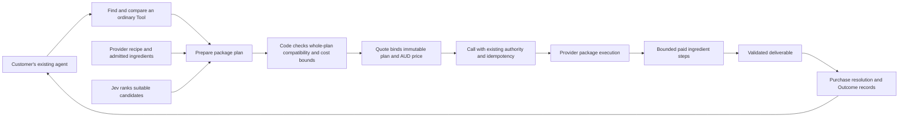

# ADR 0004: Bounded service packages with Jev-assisted composition

## Decision in one sentence

Sell a bounded professional service package as one ordinary Tool; use Jev to
select suitable ingredients within a Provider-defined recipe before the Quote,
then execute the frozen plan through durable, budgeted steps.

This is a proposed design, not implementation or deployment approval. It extends
[ADR 0003](0003-jev-market-journey-intelligence.md), preserves
[PRODUCT.md](../../PRODUCT.md#core-market-journeys) and
[CONTEXT.md](../../CONTEXT.md), and does not supersede existing release authority.
It is a later product capability, not another gate on the initial AUD x402 release.
Research and source inspection were performed on 21 September 2026; the inspected
AE checkout was at `a20ae18cdc730e9c968cff1ceefc23f1b10056e0` with unrelated working changes.

## Product purpose and first example

Buyers should find and purchase a useful contribution without assembling several
vendors themselves. Providers should be able to sell their method and domain
knowledge as a repeatable service, using other services as ingredients. This
improves journeys 1–4: natural-language matching, comparison, purchase and
Provider distribution. Measure fewer buyer integration steps, time to usable
output, repeat purchases and Provider publishing effort. Recovery controls
support these outcomes; they are not the product proposition.

Proposed first fixture: **compare three maintenance quotes for a property manager**.
The buyer supplies three documents and a short description of the job. The
package returns comparable line items, stated inclusions and exclusions, missing
information, exact arithmetic on stated prices, and links back to document
evidence. It does not decide who to hire, certify a contractor or provide a
professional compliance opinion.

Recipe: document extraction → bounded scope comparison → deterministic totals
and report assembly. Extraction can use one of a small number of admitted x402
services. Scope comparison may itself be an explicitly priced semantic service;
this is distinct from Jev's pre-purchase ingredient selection. Report assembly
is local code unless an external service adds demonstrated value.

This is a candidate for engineering and buyer evaluation, not a claim that every
required x402 supplier is available. Before coding a live integration, inventory
real endpoint availability, Australian document handling, permitted commercial
reuse, price caps, output quality and recovery support. Use fixtures for missing
suppliers. If the available ingredients cannot produce a useful package, change
the recipe or recruit a Provider; do not obscure the gap with agent improvisation.

## What existing products establish

| Reference | Observed evidence | Design implication and limit |
| --- | --- | --- |
| [x402.jobs](https://github.com/rawgroundbeef/x402.jobs) | Published code chains resource and transform nodes, resolves references to previous outputs, runs ready nodes concurrently through Inngest and records step outputs/payments. | Paid workflow composition is already implemented elsewhere. Source inspection establishes a reference pattern, not production reliability, traction or Australian purchasing support. |
| [Questflow / Coinbase](https://www.coinbase.com/developer-platform/discover/case-studies/questflow) | Coinbase's 1 August 2025 case study describes server wallets, x402 agent payments and multi-agent orchestration. | Agent coordination and autonomous payment are existing patterns. The vendor case study does not establish a fixed-price Australian service package or independently verified current scale. |
| [Nevermined](https://nevermined.ai/docs/api-reference/openclaw-plugin/setup) | Current plugin documentation explicitly supports payment plans containing multiple agents and x402 access. | A shared access/pricing package is distinct from executing several services to deliver one contracted result. Preserve Nevermined as the publishing/payment-plan reference. |
| [Locus](https://paywithlocus.com/tools) | Its published catalogue describes one prepaid balance, per-call metering and credentials scoped to tool bundles. | Consolidated access and spending controls are an established experience baseline. These pages do not by themselves establish a composed-output guarantee or Australian availability. |
| [Apify x402](https://docs.apify.com/integrations/x402) | Current experimental integration buys a prepaid API token with USDC, then uses that balance for eligible Actors. | A potential ingredient pool. Model its actual prepaid funding flow; do not assume every Actor is a directly payable per-call x402 endpoint. |
| Colosseum [MCPay](https://colosseum.com/projects/explore/mcpay) and [XAAM](https://colosseum.com/projects/explore/xaam) | Copilot identifies paid MCP access and specialist-agent supply respectively. | Relevant monetisation and distribution precedents; submissions do not demonstrate this complete package architecture. |

Three patterns therefore need separate treatment: access to several services
under one balance/plan, execution of several services in a workflow, and sale of
one defined deliverable backed by those services. AE can use the first two
patterns to implement the third. This is a product design inference, not a claim
that competitors lack outcome-based offerings.

x402.jobs was inspected at commit
`2984d0b9fc2f0fc64e3bdf1743601212d9b09a61`: its
[runner](https://github.com/rawgroundbeef/x402.jobs/blob/2984d0b9fc2f0fc64e3bdf1743601212d9b09a61/apps/api/src/inngest/functions/run-workflow.ts)
uses durable steps and sets function retries to zero; its
[step executor wrapper](https://github.com/rawgroundbeef/x402.jobs/blob/2984d0b9fc2f0fc64e3bdf1743601212d9b09a61/apps/api/src/inngest/functions/run-workflow/execute-step.ts)
records execution outcomes. Its HEAD-based reachability preflight does not prove
schema compatibility, price stability or delivery. No runtime or security audit
was performed. Its [licence](https://github.com/rawgroundbeef/x402.jobs/blob/2984d0b9fc2f0fc64e3bdf1743601212d9b09a61/LICENSE)
restricts competing commercial services: use it as a research reference, not an
implementation dependency or copied codebase.

Copilot winner and accelerator checks in this research session returned
MCPay/Frames C4, first place Stablecoins at Cypherpunk (September–October 2025),
and XAAM's AI honorable mention at Breakout (April–May 2025). Direct searches for
x402.jobs, Questflow and Jev returned adjacent projects rather than exact matches;
their direct primary sources supply the missing evidence. Corpus absence is not
evidence of market absence.

Copilot's archive also surfaced Sam Broner's February 2026
[Tourists in the bazaar](https://a16zcrypto.com/posts/article/against-b2b-payments-stablecoins):
the customer relationship and supplier relationship have different requirements.
That is a useful conceptual precedent for a simple package purchase backed by
several vendor transactions. It is an investment thesis, not demand validation.

The [x402 protocol](https://github.com/coinbase/x402) supplies payment negotiation
and settlement mechanics. A package still needs contracts for component inputs,
outputs, execution, pricing and failure. HTTP payment interoperability alone does
not make several services semantically compatible or financially atomic.

## Architecture and ownership

The external market path remains discovery → `tool.quote` → `tool.call` →
existing status/recovery. A package is a Tool with a larger but bounded service
contract. There is no separate Bundle market object, cart contract or
`bundle.buy` API. The buyer's harness retains the wider objective, planning,
memory and use of the deliverable.

The package Provider owns the recipe, promised output and ingredient procurement.
AE is the buyer-facing Seller for supported principal-reseller purchases.
Hosting a Provider's execution does not transfer or erase either role. A Provider
can publish a fixed recipe first and later permit selection from approved
alternatives. No visual workflow editor is necessary for the first release.

**Commercial default:** the first paid package has one real package Provider and
one upstream package price. AE charges the buyer once and records its obligation
to that Provider. Ingredients are funded from the Provider's separately
authorised working capital, with their own supplier records. Never recursively
charge the original customer for each ingredient or inherit their grant as
unlimited downstream authority. Provider funding must exist before execution;
do not assume the outer payment has already become spendable.

An AE-operated first-party package is a legitimate later variant, but cannot be
implemented as a fictitious purchase from AE to itself. It needs explicit
ingredient operating costs and treasury allocation, rather than a self-payable.
Prototype it with fixtures if no independent Provider is ready. Before a paid
pilot, choose the actual operator and implement that commercial lane; do not
invent a legal entity to satisfy the existing receipt shape.

## The three new internal artifacts

These names describe proposed internal concepts, not current canonical market
entities or implemented storage tables.

| Artifact | Contains | Why it exists |
| --- | --- | --- |
| Package definition | Owning Provider, immutable version, input/output contract, small acyclic recipe, selection slots, admitted alternatives, adapter versions, terms, execution limits and price policy | Preserves the Provider's repeatable method independently of any buyer's request. |
| Compiled package plan | Definition version, request digest, selected ingredients, graph and adapter digests, data destinations, step caps, total exposure cap, output contract, expiry and selection evidence | Makes the exact quoted composition reproducible and prevents selection drift after purchase. |
| Package run | Parent Call reference, plan reference, step attempts, artifact references, supplier spend/reservations, delivery evidence and recovery state | Supports durable execution without turning a rerun into another purchase. |

Initial limits are design defaults: up to eight expanded execution nodes, two
concurrent paid steps, no recursion, no nested packages, no unbounded loops and
no generated executable code. A three-document extraction fan-out counts as
three nodes. Limits must be benchmarked against the installed runtime; these
are not claims about Convex platform limits.

Ingredient contracts require more than JSON Schema: semantic meaning, units,
jurisdiction/coverage, freshness, required credentials, permitted data use,
output size, side effects, price bounds, payment network and recovery support.
An AUD decimal value and a USD decimal value are not interchangeable because
both are numbers. Local adapters explicitly map fields and units; a model must
not invent those mappings during a paid run.

Start with these concepts inside one bounded implementation area, not a service
per artifact or a universal composition language.

## Jev's specific job

1. Code filters candidates by hard constraints: admission, input/output semantics,
   data destinations, authorised use, network, availability and budget bounds.
2. Jev judges suitability within the remaining closed candidate set. Permit
   `no_fit`; do not force a winner or let the model invent endpoints.
3. Code checks the complete proposed composition. Picking the best candidate for
   each slot independently does not prove their interfaces work together.
4. Freeze the selected plan. Record candidate versions, rubric, input digest,
   effective model identity when available and inference result. Quote replay
   and Call recovery use that decision; they do not ask Jev again.

Use the existing [Jev gateway](../../src/modules/decision-engine/jev-client.ts).
TypeSafe's [skill suggestion example](https://docs.typesafe.ai/cookbooks/skill_suggestion)
supports shortlist-and-rerank with rejection; its
[use-case map](https://docs.typesafe.ai/concepts/use-case-map) separates semantic
decisions from code-owned workflows. Probabilities are model uncertainty, not
proof of compatibility or delivery quality.

For the first recipe use a fixed graph and at most three candidates per variable
slot. Bound the total combinations examined, reject or narrow before selection
when that bound is exceeded, and use straightforward deterministic compatibility
checks. Do not add a graph optimiser or constraint-solver dependency.

If a recipe has only one viable candidate per slot, execute deterministic
selection with no Jev call. Existing [ADR 0003 experiments](0003-jev-market-journey-intelligence.md)
did not show benefit from inserting advisory Jev calls into every small purchase
loop. Composition must earn its inference cost through improved useful matches,
reduced preparation work or lower total service cost.

## Quote, price and execution contracts

**Prepare/compile.** Requires a versioned definition, authorised input access and
admitted candidate snapshots. Ensures either a validated immutable plan or an
explicit no-fit/refusal. Invariant: preparation sends no paid ingredient request.
On violation, fail before issuing a purchasable Quote. Metadata checks and Jev
inference have operating cost even though they are not buyer ingredient Calls.

**Quote/admit.** Requires a current plan, output promise, price, expiry, customer
authority and separately scoped Provider funding. Ensures the admitted Call
references exactly the plan quoted. Invariant: buyer consideration, package
Provider obligation and ingredient budgets are separate amounts and subjects.
On stale input, expired plan, changed material or insufficient capacity, refuse;
never silently substitute a different composition.

Add an internal package preparation hook behind the existing quote path. Persist
its plan and include the plan digest in a deliberately versioned commitment
format, with explicit handling for existing Quotes. This is new schema/material
work: today's input hash and single-endpoint inspection do not already bind a
hidden execution graph. Preserve public action names and protected existing hash
material; do not change what an existing version means. Any additive public
description of destinations or terms must be contract-tested across harnesses.

The buyer receives one fixed AUD price for the stated deliverable. The Provider
sets its package price against bounded ingredient costs and absorbs variation
within its own authorised limit. Intermediate inputs may not exist at quote
time, so use admitted worst-case bounds and recheck each actual payment request
before signing. A directory price or HEAD response is not an exact downstream
quote. If a required ingredient has no enforceable cost bound, exclude it from
the fixed-price first cut. Exact amounts and conversions use existing money
types and valuation rules, never model-generated arithmetic.

**Dispatch.** Requires the frozen plan, validated upstream artifacts, current
execution authority and a reserved step budget. Ensures an attempt record exists
before signing/sending a paid request. Invariant: spent amounts plus unresolved
maximum exposure plus reserved new attempts cannot exceed the Provider run cap.
Reserve atomically so parallel steps cannot each spend the same remainder.
On uncertain remote outcome, stop new paid dispatch and reconcile; local database
transactions cannot roll back remote payments.

**Complete.** Requires all required deliverables to satisfy the package contract
and their artifacts to be durably recorded. Ensures the parent Call can return
the promised contribution and attributable evidence. Invariant: payment,
delivery and Purchase status remain different facts. On invalid/missing output,
do not report success because money settled. Apply the published remedy policy
independently of unresolved supplier liabilities.

Recommended initial remedy: no charge retained for an undelivered required
package, even if some ingredient costs are sunk. This is a proposed commercial
policy requiring margin and contract validation before a paid release; it is
not a statement about current AE refunds or statutory requirements.

## Durable execution and failure behavior

Reuse the installed `@convex-dev/workflow` and existing transaction/journal
patterns. Keep nondeterministic network and model work in actions; the workflow
body follows persisted state. Store large outputs as controlled artifacts and
pass references through the journal. Pin the workflow implementation version
for active runs so deployment does not reorder their replay history.

Workflow durability does not make external payment exactly once. Paid steps use
explicit `retry: false` until the adapter proves a safe recovery protocol. This
also prevents accidental inheritance of retry defaults from other workpools.
Every attempt is scoped to owner, environment, parent Call, plan and node; replay
with different inputs is a conflict. Retain deduplication and payment evidence
while obligations can remain unresolved, not merely for a short cache TTL.

| Boundary/failure | Required observable behavior |
| --- | --- |
| Duplicate parent Call or workflow-start delivery | Same run and buyer purchase; no second ingredient dispatch. Start intent and run identity are recoverable from durable state. |
| Concurrent workers attempt the same node | Atomic claim permits one dispatch reservation; stale workers cannot overwrite a newer result. A local fencing token alone cannot prevent a remote server acting on an already sent request. |
| Process dies before paid dispatch | Resume only from evidence proving no dispatch occurred; a prepared-but-ambiguous attempt enters reconciliation. |
| Timeout after signing/sending | Record unknown outcome and retain maximum exposure. Inspect provider/payment evidence; never issue a fresh payment merely because HTTP timed out. |
| Provider supports idempotent status/result recovery | Reuse the same logical attempt and payment identity according to that specific adapter's documented semantics. |
| Output received, local checkpoint lost | Retrieve the same result where supported; otherwise remain uncertain. Do not pay for a replacement automatically. |
| Required output malformed or semantically incompatible | Block dependants, preserve costs and evidence, fail delivery and apply the package remedy. |
| Cancel or a required branch fails | Stop unstarted work; already dispatched parallel requests may still settle and must be recorded. |
| Supplier price/schema changes | Refuse before sending if incompatible with the frozen contract; any replacement plan requires a fresh Quote. |
| Late settlement after buyer refund | Record the real supplier cost/liability without recharging the buyer or reopening the finished delivery promise. |

Model execution and settlement as separate validated unions. A delivered artifact
can coexist with unresolved settlement; a failed delivery can coexist with a
confirmed cost. Delivery-complete requires an artifact reference and digest;
settlement-confirmed requires evidence; unknown settlement requires an attempt
and maximum-exposure amount. Do not encode these with unrelated `paid`, `done`
and `failed` booleans. Runtime parsers enforce the same constraints on persisted
and external data; TypeScript brands alone provide no runtime protection.

For long-running packages, the Provider execution adapter must support a durable
start identity and authenticated status/result retrieval. Map that into the
existing parent Call recovery vocabulary. A parent `pending` state does not
prove that an arbitrary upstream x402 endpoint supports asynchronous recovery;
that adapter is explicit new work. Do not hold one HTTP request open indefinitely.

Provider metadata and returned documents are untrusted data, never instructions
to change the recipe. Models receive only necessary fields, never payment keys.
Network destinations come from admitted plans, with redirects and private-network
targets controlled by transport policy. Enforce tenant-scoped artifact access,
retention and deletion. Selected data recipients must remain within the disclosed
and authorised data-use envelope.

## Existing foundations versus new work

| Existing evidence | Reuse | Required extension |
| --- | --- | --- |
| [Quote contract](../../src/modules/capability-execution/quote.ts), [quote action](../../convex/lib/capabilityQuotes/quoteAction.ts) | Tool input, authority/financial preparation, current live requirement inspection | Package preparation, immutable plan binding and versioned commitment handling. |
| [Call material](../../src/modules/capability-execution/call-material.ts), [admission](../../src/modules/capability-execution/call-admit.ts) | Material digests, idempotency, admission controls | Bind and verify package execution material without changing existing identifier semantics. |
| [Call contract](../../src/modules/capability-execution/call-contracts.ts) | Parent Call result/recovery vocabulary and one-package purchase | Current account-AUD receipt has one Provider obligation/settlement; it is not an ingredient cost ledger. |
| [Provider consequence boundary](../../src/modules/capability-execution/provider-consequence-runtime.ts) | Existing payment/journal/recovery concepts | Review its single-target assumptions before reuse for separately funded ingredient attempts; do not import private helpers across boundaries. |
| [Convex configuration](../../convex/convex.config.ts), [existing workflow](../../convex/x402DirectoryIndexRefresh.ts) | Installed Workflow component and established integration pattern | Package workflow, explicit action retry policy, resumable Provider adapter and durable commercial evidence. |
| [Decision gateway](../../src/modules/decision-engine/jev-client.ts) | Jev routing, structured decisions and inference evidence | Package-specific bounded candidate evaluation and usefulness tests. |

No source inspection here establishes hosted readiness, a complete Australian
business-document implementation or live supplier compatibility. Required seller,
tax, receipt and remedy work follows the existing product/release programme.

## Boundaries and complexity review

Likely changes inferred from Joel's stated direction are new ingredients,
different professional recipes, better matching and more payment arrangements.
The requested noninteractive exploration replaces a further design interview.

| Boundary | Decision it hides | Change test |
| --- | --- | --- |
| Package definition/compiler | How a bounded professional recipe becomes a valid plan | A new compatible extractor changes the candidate/adapter registration, not buyer purchase logic. |
| Existing decision engine | How suitable candidates are scored | A Jev rubric/model change does not rewrite execution or money rules. |
| Package execution adapter | How a Provider performs and recovers the frozen recipe | Workflow scheduling changes do not change Tool identity or buyer quote semantics. |
| Existing money/authority boundaries | Who may spend, exact amount meaning, reservations and financial records | A payment rail change stays behind its adapter; a change of commercial owner intentionally requires commercial-model review. |

Keep these boundaries within the current application. No new orchestration
service, generic plugin bus, universal DAG editor, package marketplace taxonomy
or speculative service split is proposed.

| Addition | Concrete cost | Burden removed | Decision |
| --- | --- | --- | --- |
| Versioned recipe and compiler | Contract/adaptor maintenance, bounded compatibility checks | Repeated bespoke integrations and incompatible combinations | Keep, limited to the first recipe. |
| Frozen plan and quote binding | Storage, expiry and commitment migration | Post-purchase model/vendor drift and irreproducible Quotes | Keep before paid execution. |
| Durable run and attempt evidence | Recovery states, artifact lifecycle and fault tests | Duplicate spend and lost progress after interruption | Keep; reuse Workflow rather than add infrastructure. |
| Runtime Jev selection | Inference latency/cost and evaluation set | Potentially better ingredient fit and fewer manual choices | Conditional: retain only if measured against a fixed recipe baseline. |
| Arbitrary generated workflows and nested packages | Unbounded graph, authority and accounting complexity | No demonstrated first-customer need | Remove from initial scope. |

Design synthesis: one output promise, one buyer purchase, an explicit Provider
execution boundary and a small replaceable ingredient set form a coherent
extension of the market. The largest residual risks are supply quality,
incremental matching usefulness, reliable remote recovery and commercial cost
allocation. A general agent planner would increase all four before proving demand.

## Build sequence and acceptance evidence

1. **Prove one recipe.** Obtain representative, permissioned quote documents and a
   property professional's comparison rubric. Inventory real candidate suppliers.
   Produce an offline fixture-backed package and compare it with the manual job.
   Acceptance: useful output with source evidence and an explicit coverage map
   of available, missing and unsuitable ingredients. No paid external calls.
2. **Build the pure compiler.** Parse the definition and admitted contracts;
   validate graph, semantics, adapters and caps; persist a frozen plan. Compare a
   fixed recipe, Jev-assisted choice and a general-model selection baseline on
   the same cases. Acceptance: incompatible/no-fit cases never become purchasable;
   measure human-rated usefulness, preparation turns, latency and total cost.
3. **Exercise durable execution with fake payment boundaries.** Use the installed
   Workflow component; inject crashes, duplicate starts, concurrent claims,
   malformed output, unknown settlement and late results. Acceptance: replay
   adds no unauthorised financial attempt, caps hold under concurrency, completed
   artifacts survive restart and uncertainty is preserved rather than guessed.
4. **Integrate one package Tool in sandbox.** Add quote preparation/commitment
   binding and the Provider start/status adapter; connect the chosen real
   commercial owner and separate supplier budget. Acceptance: unchanged ordinary
   Tool buying journey, replay returns the same plan/run, one buyer purchase,
   correct cost allocation and no hidden recursion into customer authority.
5. **Run a capped paid pilot under the existing release process.** Validate actual
   supplier recovery, contracted data use, output quality, invoice evidence and
   margin including sunk failures and support. Source/test success alone is not
   production proof. Expand suppliers and publishing UX only after repeat use.

Do not choose an arbitrary Jev win-rate threshold after seeing results. Before
the paired evaluation, record a minimum useful improvement and acceptable
latency/cost with the package owner. No improvement means retain fixed recipes,
not abandon the useful package or add more model calls.

## Decisions for implementation acceptance

Recommended defaults are fixed below so engineering discovery can proceed without
another exploratory interview. They do not authorise public/storage changes or
money movement by themselves.

- **First workflow:** maintenance-quote comparison, subject to real supplier and
  buyer evidence; no autonomous contractor selection.
- **First composition model:** Provider-written graph with bounded ingredient
  substitution before Quote; no graph generation during execution.
- **First money model:** independent package Provider and its own ingredient
  funding; first-party AE packages need the explicit operating-cost variant.
- **Infrastructure:** current Convex Workflow, current Jev gateway and current
  market/purchase boundaries; no new runtime dependency.
- **Outstanding before paid implementation:** identify the actual Provider,
  complete the supplier coverage matrix, settle the exact commitment migration
  and recovery adapter, and validate the package remedy/cost policy.

This ADR records an implementable direction and its required boundaries. It does
not claim those outstanding implementation contracts are already complete.
