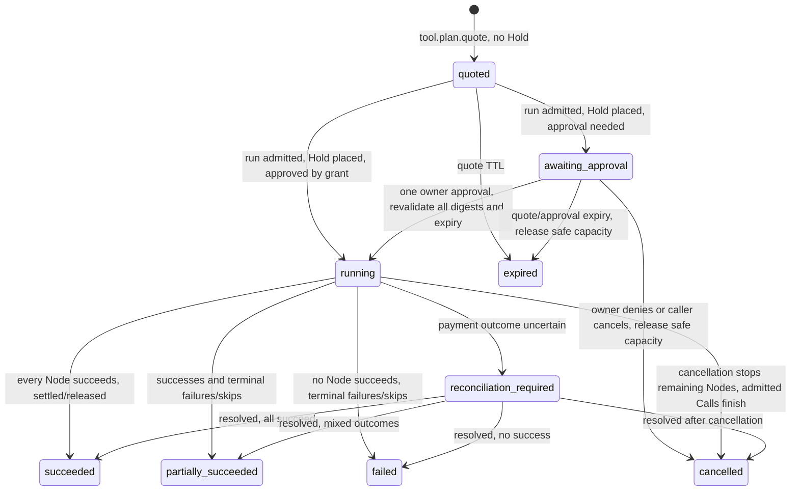

# RFC: Plan Quotes for multi-Tool purchases

Status: proposed for Joel's D1–D5 decisions · 2026-10-05 · Design only, not an implementation.

## 1. Summary and invariants

**Thesis:** A Plan is an agent-authored DAG of ordinary Tool purchases committed under **one Plan Quote envelope and one authority** with an exact approved total composed of **per-node price ceilings**. It is not an aggregate SKU or aggregate price: every admitted Node still receives its own Quote → Call → receipt. The existing singular `toolRef` on Quotes and Calls remains singular (`src/modules/capability-execution/internal/convex-schema.ts:353-365,422-456`).

- **Money:** No Node is charged above its Ceiling. No Node is paid for when its resolved input fails that Tool's `inputSchema`. A Plan Hold caps exposure, and unused capacity returns at terminal settlement; uncertain money stays under reconciliation, not optimistic release.
- **Security:** A run is static: provider outputs fill declared input slots only. There is **no model invocation or Tool selection mid-plan**. No provider output can alter the graph, Tool identity, authority or approved spend.
- **Authority:** The caller approves one exact total; each Call derives bounded authority from the same Plan authority, not another owner approval. Every cross-provider data transfer is disclosed before approval.
- **Language:** Plan = DAG; Plan Quote = `quoted` record; Plan Run = *same record after commit*; Node, Ceiling, Hold. Avoid “bundle” and “job” in product copy; add definitions to `CONTEXT.md` in W1. The existing one-Tool boundary sentence remains true and gains a Plan cross-reference (`src/modules/capability-execution/quote.actions.ts:31-35`).

## 2. Requirements and non-goals

| ID | Requirement |
| --- | --- |
| F1 | Accept a frozen 1–10-Node DAG with declared dependencies, only `flow://` references and bounded `$map`/`$concat` transforms; reject unadmitted Tools and ill-typed static edges. |
| F2 | Quote bound inputs exactly and deferred inputs only for input-independent fixed-AUD or x402 pricing; show each Ceiling, exact `approvedTotalAudUnits`, rate tolerance, expiry and data destinations. |
| F3 | At commit, authenticate Principal and grant, verify exact total, entire Plan and Tool material, budget/exposure, reserve one Hold, and perform one owner approval if required. |
| F4 | Requote resolved input using `issueQuote` before each Call; enforce input schema and price Ceiling **before payment**, admit through existing Call lifecycle, preserve at-most-once purchase and existing reconciliation. |
| F5 | Project durable Plan and Node states from the Plan plus Calls; refuse/defer dependents of failed/uncertain parents; release only provably unused Hold capacity. |
| F6 | Expose quote/run/get/cancel consistently over HTTP/MCP/CLI; chat and Mercator ingest follow only after these run live. |
| N1 | Bounded: ≤10 Nodes, depth ≤5, ≤3 concurrent Calls per Plan and ≤2 per providerHost, resolved array ≤100 items, plus existing input size cap. |
| N2 | Exact AUD micro-unit arithmetic; no floating-point price or hidden fee; explicit expiration and stable replay. |
| N3 | Query-only reads, no side effects in `get` or `suggest`; scoped records and redacted credentials; per-Node audit evidence and human-readable refusal codes. |

**Non-goals:** Provider-authored package SKU, general DAG editor or optimizer, recursive/nested Plans, runtime AI planner, executing generated code, fan-out into new Nodes, atomic all-or-nothing provider effects, new Call worker or Workflow-per-Plan, new plan take rate. ADR 0004's Provider package is a single Tool purchase (`docs/adr/0004-bounded-service-packages.md:117-122,151-164,335-343`); its execution graph is **not** this buyer-authored Plan.

## 3. Reverse-engineered Mercator: evidence and boundary

**OBSERVED wire** ([OpenAPI](https://mercator.sh/openapi.json), [docs](https://mercator.sh/docs#run-a-rest-workflow)): `GET /v1/services/search` → `GET /v1/services/{serviceId}` → `POST /v1/quote {plan}` → `POST /v1/jobs {idempotencyKey,plan}` → `GET /v1/jobs/{jobId}`. MCP `quote_plan` takes a Plan; `create_job` also takes exact `approved_total` and `idempotency_key` ([tool contracts](https://mercator.sh/openapi.json#/x-mercator-mcp/tools/create_job)). The agent/client constructs the Plan; the documented JSON example is not a reusable bundle-file standard ([docs](https://mercator.sh/docs#run-a-rest-workflow)). Its `FlowPlan` nodes carry `{id,serviceId,method,path,input,dependsOn}` (1–10); `flow://node/output#/pointer` is an RFC 6901 JSON pointer; `$map` projects array items and `$concat` joins strings or flattens arrays ([schema](https://mercator.sh/openapi.json#/components/schemas/FlowPlan), [MCP instructions](https://mercator.sh/openapi.json#/x-mercator-mcp/tools/quote_plan)).

**OBSERVED semantics:** Independent nodes run concurrently (≤3 per service); failed work may yield `partially_succeeded`, with successful outputs preserved and dependent steps skipped. Free transient calls retry up to three times; purchased provider calls are attempted at most once ([docs](https://mercator.sh/docs#combine-services-in-one-job), [job](https://mercator.sh/docs#get-a-job)). Quote includes `planHash`, `costMultiplier`, USD totals and per-Node amounts; REST submission sends the unchanged Plan, not a mandatory quote ID ([QuotePlanOutput](https://mercator.sh/openapi.json#/components/schemas/QuotePlanOutput), [JobRequest](https://mercator.sh/openapi.json#/components/schemas/JobRequest)). Same payer/key/unchanged Plan recovers the same job; changed key risks another purchase ([docs](https://mercator.sh/docs#create-a-job)). Mercator takes provider costs plus a multiplier, uses MPP/Stripe SPT for buyer payment and MPP or x402 for providers ([payments](https://mercator.sh/docs#costs-and-payment)). Refunds are not atomic: Tempo unused capacity returns as MACH credits; Stripe does not automatically refund failed-job capacity; successful purchases remain billable ([refunds](https://mercator.sh/docs#failed-job-refunds)). Its public [plugin repository](https://github.com/tempoxyz/plugins/tree/main/plugins/mercator) is not evidence that the hosted backend is open source.

**Take:** frozen client-authored graph, declared dependencies, references and transforms, exact-total echo, safe replay, partial results. **Do not take:** Mercator's USD multiplier, payment rail, job status as a Node lifecycle, refund promise, unspecific pointer typing, or any claim that its API plans automatically. Our AUD Plan Quote is a persisted AE commitment, not a Mercator `QuotePlanOutput` clone. Mercator's public schema does not state its cycle algorithm or fan-out cap; our bounds are our own ([FlowPlan](https://mercator.sh/openapi.json#/components/schemas/FlowPlan)).

## 4. Adaptation mapping

### A. Mercator concept → AE object

| Mercator | AE adaptation | Boundary/evidence |
| --- | --- | --- |
| Service endpoint | Admitted `toolRef` resolved server-side to current Provider, endpoint, contract and pricing | Existing one-Tool quote syntax is `operation:v1:<64 lowercase hex>` (`src/modules/capability-execution/quote.ts:20-25`); no caller-supplied Provider credential (`src/modules/capability-execution/call.actions.ts:27-32`). |
| FlowPlan | Normalized `PlanJson` with 1–10 `Node`s, stages and `planDigest` | No current Plan table; existing Quote/Call each binds one Tool (`src/modules/capability-execution/internal/convex-schema.ts:353-365,422-433`). |
| `flow://` + `$map`/`$concat` | Declared data dependencies, static pointer compatibility, bounded runtime resolution | Supply graph currently marks `schema_compatible` only on exact output/input schema-digest equality; it does **not** run a chain (`src/modules/capability-supply/internal/graph/query-graph.ts:259-270`). |
| `POST /v1/quote` | `tool.plan.quote`: persisted `quoted` Plan, Node Ceilings and exact AUD total | Existing `tool.quote` is a commitment, no reservation (`src/modules/capability-execution/quote.actions.ts:27-48`). |
| `POST /v1/jobs` | `tool.plan.run`: exact-total, idempotent commit and one Hold; same Plan record becomes a Run | Calls already replay by Principal/key (`src/modules/capability-execution/internal/convex-schema.ts:494-496`); operation-key helper binds actor, operation, key and request hash (`src/modules/observability/internal/operation-keys.ts:5-13,39-44`). |
| Job/node result | Plan projection from Call receipts plus no-Call outcomes | Existing receipt is embedded on Calls (`src/modules/capability-execution/internal/convex-schema.ts:63-82,463-477`). |

### B. Our schema → Plan object model and index audit

| Source → target | Fields/reads/reuse | Index status |
| --- | --- | --- |
| `capabilityQuotes` → Node Quote at dispatch | Reuse current `issueQuote` for resolved input and pricing evidence; bound Nodes use its valuation path for prospective exact Ceiling, without persisting a `capabilityQuotes` row at Plan quote time. Quote expiry already considers authority, Tool, rate and spending-period expiry (`convex/lib/capabilityExecution/quotes/quoteValuation.ts:365-383`; `src/modules/capability-execution/internal/convex-schema.ts:353-421`). | PRESENT `by_quoteRef`, `by_state_and_expiresAt`; no Plan lookup. |
| `capabilityCalls` → admitted Node | Add `planRef?`, `planNodeId?`; preserve single `quoteRef`, `toolRef`, idempotencyKey, authority, financial state, result and receipt (`src/modules/capability-execution/internal/convex-schema.ts:422-485`). | PRESENT `by_principalId_and_idempotencyKey` (`:494-496`); ABSENT `by_planRef` (add). |
| NEW `capabilityPlans` | `planRef, principalId, ownerId, accountRef, credentialId, grantRef, grantGeneration, environment, planJson, planDigest, nodes[{nodeId,toolRef,toolMaterialDigest,kind,inputTemplateDigest,pricingDigest,ceilingAudUnits,dependsOn}], stages, approvedTotalAudUnits, state, authority?, idempotencyKey?, holdReservationRefs?, nodeOutcomes[], expiresAt, runDeadlineAt, createdAt, updatedAt`. Only no-Call outcomes `skipped|input_invalid|price_exceeded_ceiling|cancelled`; no aggregate receipt. Necessary: Plan state, Hold, skipped/no-Call outcomes have no home in the singular existing tables (`src/modules/capability-execution/internal/convex-schema.ts:353-456`). | ABSENT table/indexes; add `by_planRef`, `by_principalId_and_idempotencyKey`, `by_ownerId_and_state_and_createdAt`, `by_state_and_runDeadlineAt`. |
| Existing grants, spending periods, Formance + commercial policy → Plan exposure | Reuse per-Call, daily/monthly and account ceilings, balance and legal exposure checks; **W0 must establish how one Hold participates in daily/monthly availability**, rather than counting both full Hold and each Node twice (`convex/lib/capabilityExecution/quotes/quoteValuation.ts:219-299`; `convex/lib/capabilityExecution/callLifecycle/admissionRefusal.ts:135-193`). | Existing point reads; no new index asserted; Formance Hold account support OPEN W0. |
| `toolSelectionDecisions`, supply graph → suggestion only | Existing selection picks one Tool; `schema_compatible` edges may seed a read-only skeleton, not certify an executable Plan (`src/modules/capability-execution/schema.ts:15-43`; `src/modules/capability-supply/internal/graph/query-graph.ts:259-270`). | PRESENT graph read; no plan execution index. |

### C. Actions → surface, effect, replay and refusal

| Action | Surface/placement | Effect and idempotency | Principal refusals |
| --- | --- | --- | --- |
| `tool.plan.quote` | POST `/api/v1/tools/plans/quote`; MCP `ae_tool_plan_quote`; `ae plan quote <file>` | `defineAction`, commitment/write; creates Plan Quote, no Hold/Call; canonical material pins Plan and Tool; no purchaser replay contract invented for Quote. | Validation union §5; existing Tool/grant/payment-readiness refusals passed through, no fake price. |
| `tool.plan.run` | POST `/api/v1/tools/plans/run`; MCP `ae_tool_plan_run`; `ae plan run` | External-effect admission; `reserveOperationKey` (`tool.plan.run`, requestHash = `planDigest + planRef`), caller key scoped to Principal; exact total echo. Same key/unchanged Plan returns same Run; changed command refuses. | `plan_quote_expired`, `plan_changed`, `approved_total_mismatch`, `grant_changed`, `approval_required`, `total_exceeds_available`, `hold_unavailable`, `idempotency_conflict`. |
| `tool.plan.get` | GET `/api/v1/tools/plans/$planRef`; MCP `ae_tool_plan_get`; `ae plan watch` | Read-only; scope to Principal/owner; no nonce, no audit write, no polling purchase. | `plan_not_found`, `plan_access_denied`. |
| `tool.plan.cancel` | POST `/api/v1/tools/plans/cancel`; MCP `ae_tool_plan_cancel`; CLI cancellation command follows route parity | Write; stop unadmitted Nodes, maintain accepted Calls' own lifecycle and uncertain funds; stable replay of terminal state, no undo of already purchased effects. | `plan_not_found`, `plan_access_denied`, `plan_not_cancellable`. |
| `tool.plan.suggest` (W5) | Read-only discovery action; CLI/MCP/HTTP before optional chat | Project graph edges into editable skeleton; cannot create Quote/Hold or auto-run. | `no_compatible_edges`, `tool_not_admitted`. |

Action registry already uses `defineAction` effects and surface lists (`src/modules/capability-execution/quote.actions.ts:27-54`); MCP's `buy` role currently lists `tool.quote` and `tool.call` (`src/modules/actions/mcp-toolsets.ts:3-7`). HTTP route style follows `/api/v1/tools/quote` (`src/modules/capability-execution/quote.ts:20-25`). Proposed actions belong to the capability-execution module, not a second commerce system.

## 5. Contract shapes (TypeScript signatures only; proposed)

```ts
type Brand<T, Name extends string> = T & { readonly __brand: Name }
type PlanRef = Brand<string, 'PlanRef'>
type PlanNodeId = Brand<string, 'PlanNodeId'>
type FlowRef = Brand<string, 'FlowRef'>
type ToolRef = Brand<string, 'ToolRef'>          // operation:v1:<64 lowercase hex>
type AudUnits = Brand<string, 'AudUnits'>        // unsigned integer, exponent 6
type JsonValue = null | boolean | number | string | readonly JsonValue[] | { readonly [key: string]: JsonValue }
type PlanInput = JsonValue | Readonly<{ $map: Readonly<{ from: FlowRef; path?: string }> }>
  | Readonly<{ $concat: readonly (string | FlowRef | readonly JsonValue[])[] }>
type PlanNode = Readonly<{ id: PlanNodeId; toolRef: ToolRef; input: Readonly<Record<string, PlanInput>>; dependsOn: readonly PlanNodeId[] }>
type MercatorNode = Readonly<{ id: PlanNodeId; serviceId: string; method: 'DELETE' | 'GET' | 'PATCH' | 'POST' | 'PUT'; path: string; input: Readonly<Record<string, PlanInput>>; dependsOn: readonly PlanNodeId[] }>
type PlanJson = Readonly<{ nodes: readonly PlanNode[] }>
type PlanNodeQuote = Readonly<{ nodeId: PlanNodeId; toolRef: ToolRef; kind: 'bound' | 'deferred'; ceilingAudUnits: AudUnits; validation: 'typed' | 'untyped_ref'; dependsOn: readonly PlanNodeId[] }>
type PlanState = 'quoted' | 'awaiting_approval' | 'running' | 'succeeded' | 'partially_succeeded' | 'failed' | 'cancelled' | 'expired' | 'reconciliation_required'
type NodeState = 'waiting' | 'ready' | 'admitted' | 'succeeded' | 'failed' | 'skipped'
type NoCallOutcome = 'skipped' | 'input_invalid' | 'price_exceeded_ceiling' | 'cancelled'
type PlanAuthority = Readonly<{ format: 'plan'; planRef: PlanRef; planDigest: string; approvedTotalAudUnits: AudUnits; nodeCeilings: readonly Readonly<{ nodeId: PlanNodeId; ceilingAudUnits: AudUnits }>[]; grantRef: string; grantGeneration: number; grantDigest: string; expiresAt: number }>
type PlanNodeAuthority = Readonly<{ format: 'plan_node'; planRef: PlanRef; planAuthorityDigest: string; nodeId: PlanNodeId; resolvedInputDigest: string; ceilingAudUnits: AudUnits }>
type PlanQuote = Readonly<{ kind: 'quoted'; planRef: PlanRef; planDigest: string; nodes: readonly PlanNodeQuote[]; stages: readonly (readonly PlanNodeId[])[]; approvedTotalAudUnits: AudUnits; currency: 'AUD'; exponent: 6; expiresAt: number; dataFlows: readonly Readonly<{ from: PlanNodeId; to: PlanNodeId; destinationProviderHost: string }>[] }>
type PlanQuoteInput = Readonly<{ plan: PlanJson }>
type PlanRunInput = Readonly<{ planRef: PlanRef; approvedTotalAudUnits: AudUnits; idempotencyKey: string }>
type PlanValidationRefusalCode = 'plan_empty' | 'plan_too_large' | 'duplicate_node_id' | 'unknown_dependency' | 'cycle' | 'ref_not_in_depends_on' | 'bad_pointer' | 'tool_not_admitted' | 'input_schema_mismatch' | 'ref_type_mismatch' | 'deferred_node_dynamic_price' | 'ceiling_exceeds_per_call_cap' | 'total_exceeds_available'
type PlanRunRefusalCode = 'plan_quote_expired' | 'plan_changed' | 'approved_total_mismatch' | 'grant_changed' | 'approval_required' | 'total_exceeds_available' | 'hold_unavailable' | 'idempotency_conflict' | 'plan_not_found' | 'plan_access_denied' | 'plan_not_cancellable'
type NodeRefusalCode = 'input_invalid' | 'price_exceeded_ceiling' | 'tool_not_ready' | 'reconciliation_required'
type PlanQuoteResult = PlanQuote | Readonly<{ kind: 'refused'; code: PlanValidationRefusalCode; nodeId?: PlanNodeId }>
type PlanRunResult = Readonly<{ kind: 'running' | 'awaiting_approval' | 'replayed'; planRef: PlanRef; state: PlanState }> | Readonly<{ kind: 'refused'; code: PlanRunRefusalCode }>
```

`PlanInput` describes the outer wire shape, **not** a complete recursive schema: literals can contain references/one-operator transforms at any declared slot; Zod must reject multiple operators, unknown operators and malformed nested values. W0 chooses an existing JSON Schema/pointer library, not custom ad hoc parsers. Branded types exist only after total parsing. `MercatorNode` is accepted only via W5 directory resolution of `(providerHost, resource path, method)` to a **single admitted** `toolRef`; ambiguity refuses. The `toolRef` format and underlying JSON-value contract already exist (`src/modules/capability-execution/quote.ts:1-25`). Runtime-specific existing Tool/Call refusals remain typed in their own contracts; this union is the Plan layer, not a replacement.

## 6. State machine and derived Node states



| Derived Node state | Projection from Plan, no-Call outcome and `capabilityCalls` | Permitted effect |
| --- | --- | --- |
| `waiting` | Dependency incomplete or Plan not `running`. | None. |
| `ready` | Every predecessor succeeded, Node not admitted; free Plan concurrency/provider slot. | Resolve only declared slots; check runtime schema; issue fresh Quote. |
| `admitted` | Exactly one Call for `(planRef,nodeId)` exists, including pending/worker/unknown. | Its Call lifecycle owns dispatch and reconciliation; never resubmit with new key. |
| `succeeded` | Linked Call completed successfully with outcome/evidence. | Unblock dependents only when output is trustworthy and available. |
| `failed` | Linked Call terminal failure/refusal, or no-Call `input_invalid`/`price_exceeded_ceiling`. | Skip dependents; preserve purchased successful siblings. |
| `skipped` | Dependency failed/uncertain, cancellation or no-Call `skipped`/`cancelled`. | Never purchase. |

A Call `pending` does not mean paid/running: its `state`, `dispatchState` and financial state are separate (`src/modules/capability-execution/internal/convex-schema.ts:444-473`; `convex/lib/capabilityExecution/callLifecycle/admissionApprovals.ts:195-200`). A Plan cannot become terminal while any Call can still settle or refund, or while a Hold transfer is uncertain; `reconciliation_required` preserves exposure and blocks dependents until resolved.

## 7. Money, authority and Hold

```mermaid
sequenceDiagram
  participant A as Agent / owner
  participant P as Plan Quote + Run
  participant F as Formance
  participant C as Existing Quote / Call
  participant V as Provider
  A->>P: quote(frozen DAG)
  P-->>A: PlanRef, digest, Node ceilings, exact AUD total, disclosure, expiry
  A->>P: run(PlanRef, exact approvedTotalAudUnits, key)
  P->>P: validate principal/grant/tool digests, expiry, aggregate fences, replay
  P->>F: one account → plans:{planRef}:hold transfer
  F-->>P: durable Hold evidence
  opt owner approval required
    P-->>A: awaiting_approval (all Node ceilings + data-flow edges)
    A->>P: approve once; revalidate Plan/grant/Tools/expiry
  end
  loop ready Node; ≤3 Plan, ≤2/providerHost
    P->>P: resolve upstream data; validate resolved Tool inputSchema
    P->>C: issueQuote(resolved input), assert price ≤ Node Ceiling
    C->>F: reserve Node Call capacity from Plan Hold
    C->>V: existing at-most-once dispatch / reconciliation
    V-->>C: output or failure, settlement evidence
    C-->>P: terminal Call transition triggers advancePlan
  end
  P->>F: release provably unused Hold remainder at terminal
  F-->>P: release evidence; else reconciliation_required
  P-->>A: projected per-Call receipts and actual settled total
```

At run, each Ceiling ≤ `maximumSpendPerCallUnits` and the exact sum ≤ current daily/monthly availability, enabled account ceiling, balance and legal exposure; the existing per-Call daily/monthly fences and quote pricing must be reused (`convex/lib/capabilityExecution/quotes/quoteValuation.ts:219-299`; `convex/lib/capabilityExecution/callLifecycle/admissionRefusal.ts:135-193`). Pricing: fixed AUD Ceiling = exact price; USDC-priced Ceiling = quoted AUD price × `(1 + rateToleranceBps)` with integer rounding up and default 50 bps in commercial policy (D3). Ref-containing Nodes are deferred: only fixed AUD or input-independent x402 price; refuse dynamic input-dependent prices. The `issueQuote` at dispatch checks **resolved** input and current pricing; any `decisionAudUnits > ceilingAudUnits` yields `price_exceeded_ceiling` and skips dependents. Existing fixed-AUD and USDC-to-AUD pricing paths are distinct (`convex/lib/capabilityExecution/quotes/quoteValuation.ts:144-184`). No aggregate fee or charge.

Plan authority `format:plan` pins PlanRef/digest, exact total, each Ceiling, grant ref/generation/digest and expiry; derived `format:plan_node` pins parent authority digest, Node, resolved input digest and Ceiling. Existing per-Call authority already binds Tool, input, grant, target, amount and expiry (`src/modules/capability-execution/call-authority.ts:352-418`). Approval must revalidate Plan digest, grant generation, every Tool material digest and expiry; stale Plan returns `plan_quote_expired` and must be requoted. If a provider effect was `possibly_submitted`, reuse existing Call reconciliation rather than retry payment or release its disputed exposure (`src/modules/capability-execution/internal/convex-schema.ts:444-450`). W0 must prove the Hold account and period accounting before promising this path; neither is established merely by the existing Call reservations.

## 8. Execution reducer and ownership

Pure `advancePlan(planRef)` decision over normalized Plan + indexed Node Calls + no-Call outcomes determines topological readiness, skips, slots and terminal projection. Its internal mutation persists guarded decisions and admits eligible Nodes through the **existing** admission/worker path; it does not perform a provider request, infer an input, rerun a purchased Call or contain a model. Quote-time Zod parse → branded IDs/refs → exact duplicate and dependency checks → Kahn topological levels (depth bound) → RFC6901 pointer validation (`~0`, `~1`, no escaping root) → upstream `outputSchema` pointer type checked against target `inputSchema` property. An upstream schema with no usable type marks the edge `untyped_ref` (allowed with visible disclosure), but runtime Tool input validation is still mandatory pre-payment. A demonstrably incompatible typed edge returns `ref_type_mismatch`. `$map` projects ≤100 array items **into one input**, never creates Nodes; `$concat` is a one-operator transform. Every referenced ID must be in `dependsOn`.

Trigger reducer once after run commit and after an existing Call's terminal transition when `planRef` is present (`convex/capabilityCalls.ts:99-112,176-177`); guard concurrent advances with persisted Node attribution plus deterministic Call key `${planRef}:${nodeId}` and the existing Principal/key uniqueness (`src/modules/capability-execution/internal/convex-schema.ts:494-496`). Deadline sweep uses `by_state_and_runDeadlineAt`; exhausted or ambiguous Holds are reconciled, not silently expired. Continue using existing workpool/worker retry, durable claim and reconciliation (`convex/lib/capabilityExecution/callLifecycle/dispatchEnqueue.ts:22-46`). **Reject per-Plan `@convex-dev/workflow` 0.4.6**, already installed (`package.json:78-79`): duplicating the Call worker creates a second retry/payment authority path. Any workflow pattern used for other contexts does not establish a Plan executor.

## 9. Surfaces and illustrative contract exchange

`defineAction` entries in capability-execution; `tool.plan.quote|run|get|cancel` across HTTP/MCP/CLI, with MCP `buy` listing `ae_tool_plan_quote|run|get|cancel`; `get` alone is read-only. HTTP paths and CLI commands are the §4C contract. `ae plan watch <planRef>` renders topological levels as ASCII columns, prints explicit failed/skipped/uncertain Nodes and amounts from real receipts, polls `get` without running again. Add `ae plan cancel <planRef>` for action parity. Chat (W5) admits **one Plan as one execute action** while `MAX_CHAT_EXECUTE_CALLS` stays one (`convex/lib/chat/tools/agent.ts:38-44`); chat cannot buy extra Calls on a side path. Existing CLI has `quote` and `call` but no `plan` (`tools/ae/cli.ts:95-102`). Update `quote.actions.ts` with the Plan cross-reference, preserving the no-aggregate-sale sentence (`src/modules/capability-execution/quote.actions.ts:31-35`).

Temporary placeholder: the external reverse-engineering assignment expected an Exa search → contents example, but validation against real x402 Bazaar listings is now required before finalizing. The real ToolRefs, endpoint inputs and validated mock chain must come from `local://bazaar-mock-plans.md`; do not substitute invented or placeholder Tools.

> Bazaar validation pending: preserve the Mercator-compatible Plan shape in the final example, with both Nodes and the projected dependency taken from validator-approved mock-plan evidence.

Temporary Plan Quote response placeholder: replace with a response using the approved mock Plan's Node identifiers and actual structural properties after `local://bazaar-mock-plans.md` is available. Amounts must be labelled synthetic/mock unless verified as current live quoted amounts.

> Bazaar quote example pending validator evidence. A final example must not imply placeholder PlanRefs, ToolRefs, prices, schemas, or providers are live.

The final response must still express the established contract: `kind: quoted`, persisted Plan identity/digest/expiry, AUD micro-units, per-Node Ceilings, exact `approvedTotalAudUnits`, topological stages and cross-Provider data flows. The issued Plan Quote alone supplies authority; `tool.plan.run` echoes exact `approvedTotalAudUnits` plus `planRef` and `idempotencyKey`. W5 Mercator ingest maps `(serviceId,method,path)` to a unique admitted AE Tool through x402 directory `(providerHost,resource path)`; no direct raw HTTP execution.


## 10. Arc UI presenters

Use real records mapped into `src/modules/capability-execution/plan.view-model.ts`. Each feature is a compound folder with container/hook/contracts, pure callback-only leaf presenters and colocated zero-CLS skeleton when async; no Plan DTO or complex state union in `.tsx`. The existing Call confirmation uses `DecisionPanel` (`src/components/ae/shared/QuoteConfirmation.tsx:17-52`), receipt uses adapted Stepper (`src/components/ae/call-receipt/CallReceiptTimeline.tsx:7-35`), and the vendored AgentRun already accepts caller-owned status/facts (`src/components/arc/blocks/agent-run/agent-run.tsx:26-49`). Follow licensed-source audition/install/footprint ownership in the Arc protocol (`docs/designs/arc-ui-refactor/protocol.md:1041-1051`; registry configured at `components.json:21-29`).

| Folder and presenter | Arc item adapted | What is **not** taken |
| --- | --- | --- |
| `src/components/ae/plans/plan-confirmation/` | Existing `DecisionPanel`; Pro `checkout-summary` **regions** for per-Node lines; vendored Stepper for stage columns; cross-Provider edge disclosure before approval ([checkout summary](https://uiarc.dev/components/blocks/checkout-summary/markdown)). | No single-product checkout prices, sample totals, scripted approval, cart or custom DAG canvas. |
| `src/components/ae/plans/plan-run/` | Vendored caller-owned AgentRun status/facts + free recorded-event Timeline; Stepper columns for topological stages ([agent run](https://uiarc.dev/components/blocks/agent-run/markdown), [timeline](https://uiarc.dev/r/timeline.json)). | No Arc demo clock, synthetic streaming steps, fake retry or self-authorizing button. |
| `src/components/ae/plans/plan-receipt/` | Per-Node `CallReceiptTimeline`; Pro `payment-flow` adapted **only** as decorative `role=img` money path Account → Plan Hold → Provider Nodes → Released, from real settled amounts ([payment flow](https://uiarc.dev/components/payment-flow/markdown)). | No card-network fiction, looping illustrative balance as fact, invented fee, fake refund, or replacing Call receipts of record. Paused/reduced-motion still frame. |
| Founder console Activity | Plan summaries and drilldown from owner-scoped records. | No separate aggregate sale or synthetic settlement. |

Arc free items are MIT; Pro code needs a licensed seat for each direct source editor, notices retained and no standalone source redistribution; published Pro text currently labels itself **draft pending review** ([Arc licence](https://uiarc.dev/license)). The existing Stepper source labels its own vendored provenance Pro (`src/components/arc/stepper/stepper.tsx:1-8`); do not infer all Stepper installations are freely licensed from a registry listing. Arc PaymentFlow is a noninteractive illustration, **not** an approval or receipt engine ([documentation](https://uiarc.dev/components/payment-flow/markdown)).

## 11. Threat model

| Threat | Control and failure posture |
| --- | --- |
| Cross-provider disclosure leak | List each `from → destinationProviderHost` edge with data class before one approval; never send hidden fields or secret Provider credentials; show untyped edges. |
| Provider output instruction injection | Resolve data only into predeclared slots; never execute model or dynamic Tool selection mid-run. |
| `$map` fan-out / oversize / `$concat` amplification | ≤100 projected items, existing input size cap, depth/Node/parallelism bounds; refuse pre-payment if oversized. |
| Duplicate commit or Node admission | Principal-scoped Plan key + request hash and deterministic per-Node Call key; unchanged replay returns same Run. |
| Price/rate drift | Frozen Node Ceiling and exact total echo; fresh `issueQuote` must fit Ceiling before Call; USDC tolerance from commercial policy. |
| Tool/grant drift | Recheck grant generation, tool material digest and readiness at approval and dispatch, before money/provider effect; refuse stale material. |
| Pointer escape and cycle | RFC6901 `~0`/`~1` parser, schema pointer compatibility, declared dependencies, Kahn cycle/depth validation. |
| Hold leak, ambiguous effect or premature release | Deadline sweep, per-Call reconciliation, release only provably unused capacity; `reconciliation_required` blocks terminal receipt claims. |
| Cancellation race | Stop future Node admissions; admitted Calls remain owned by Call lifecycle and may settle; no claim of rollback. |

## 12. W0–W6 delivery and evidence

Wave ownership is by bounded file family; one owner for each façade/schema or shared Arc source, with no competing edits. Only `docs/designs/2026-10-05-plan-quotes-rfc.md` changes in **this** design exercise. Each implementation wave gates on a **real local-stack journey through AE CLI/MCP/HTTP**, not a new test/verify-script receipt; never purchase production Tools for a demonstration.

| Wave / owner files | Delivery | Acceptance through real use |
| --- | --- | --- |
| **W0 facts** — existing `convex/lib/money/spendingPeriods/*`, Formance SDK/account schema, `src/modules/capability-supply/*`, installed JSON pointer/canonical JSON/JSON Schema dependencies; read-only inspection | Prove Hold accounting, Formance account/transfer feasibility, static vs dynamic x402 offers; record unresolved legal exposure and dependency choices before code. | Existing `ae quote`/MCP `ae_tool_quote`/HTTP `/api/v1/tools/quote` continue a known one-Tool quote; inspect actual sandbox Formance schema read-only; no Plan claim. |
| **W1 pure core** — `src/modules/capability-execution/plan/*`, `CONTEXT.md` | Zod parser, branded IDs, DAG validator, static pointer type check, resolver and bounded transforms; no new money path. | Existing CLI/MCP/HTTP one-Tool journey remains live; once Plan quote is exposed in W2, the **same** parsed Plan must pass all three and a cycle/typed mismatch must refuse. No external Call in pure-core phase. |
| **W2 Plan Quote** — `src/modules/capability-execution/plan/`, `src/modules/capability-execution/quote.actions.ts`, `src/modules/actions/*`, `convex/capabilityPlans.ts` (<200 lines), `convex/lib/capabilityExecution/plans/*` (<400 each), schema, HTTP routes, `tools/ae/*` | One new Plan table/indexes, `tool.plan.quote` with per-Node Ceiling, typed edge flags, disclosure, expiration; bound valuation without Node Quote rows. | Quote same static two-Tool example by `ae plan quote <file>`, MCP `ae_tool_plan_quote`, and HTTP POST; compare PlanRef/digest/total/expiry; malformed dependency refuses, no money move. |
| **W3 Run** — `convex/capabilityPlans.ts`, `convex/lib/capabilityExecution/plans/*`, Call lifecycle/worker terminal seam, Formance/money adapter, action+HTTP/MCP/CLI routes | Plan authority, exact-total replay, one Hold, deterministic Node Call attribution, reducer, get/cancel, deadline cron, uncertainty fence. | Sandbox-funded CLI run, MCP get, HTTP get show each Call receipt; same key same Run, changed total refuses; cancel pending Nodes, inspect Hold release and uncertain reconciliation without duplicate provider payment. |
| **W4 approval + confirmation/run UI** — owner-approval seam, `src/modules/capability-execution/plan.view-model.ts`, `src/components/ae/plans/plan-confirmation/` and `plan-run/` | Single owner decision revalidates all pinned material, shows all provider transfers; skeletons/pure Arc presenters. | Run with approval-required sandbox grant via CLI; inspect pending via MCP and HTTP, approve/deny in owner UI; expired quote refuses and requotes; UI reflects recorded Node states. |
| **W5 chat, suggestion and interop** — chat action admission, supply-graph projection, directory resolver, `src/modules/capability-execution/plan/*` | Chat Plan = one execute action, read-only `tool.plan.suggest`, Mercator service-node ingest via admitted Tool resolution. | Search → edit suggestion → quote/run with same limits via CLI/MCP/HTTP, then chat once; ambiguous directory mapping refuses, no extra chat purchase. |
| **W6 receipts + Activity** — `src/components/ae/plans/plan-receipt/`, owner Activity view/query, plan view-model | Derived per-Call receipts, settled-only illustrative Hold diagram, owner-scoped Activity. | CLI watch, MCP get and HTTP get agree on actual settled amounts, skipped Nodes and released remainder; founder Activity drilldown matches Call receipts, including partial failure. |

Existing `tool.quote`/`tool.call` semantics and external routes stay stable (`src/modules/capability-execution/quote.actions.ts:27-54`; `src/modules/capability-execution/call.actions.ts:27-53`). No code or Plan routes exist as a result of this RFC.

## 13. Decisions for Joel

| Decision | Options | Recommendation / consequence |
| --- | --- | --- |
| **D1** ADR 0004 relationship | Amend ADR 0004, or separate ADR 0005 | **New ADR 0005:** buyer-side Plans purchase multiple ordinary Tools; ADR 0004 still governs Provider-side packages sold as *one* Tool. Explicitly reconcile its no-general-workflow and ≤8/≤2 defaults rather than silently supersede them (`docs/adr/0004-bounded-service-packages.md:117-122,156-160,335-343`). |
| **D2** wire syntax | Mercator-compatible refs/operators, or AE-only syntax | **Verbatim** `flow://`, `$map`, `$concat`, one operator per object and declared dependencies; accept serviceId/method/path import in W5 after Tool resolution ([FlowPlan](https://mercator.sh/openapi.json#/components/schemas/FlowPlan)). |
| **D3** rate tolerance | Default 50 bps; alter cap/payer | **50 bps** commercial-policy field; buyer approves maximum Ceiling and pays actual ≤ Ceiling; AE absorbs drift above Ceiling by refusing/skipping, not charging extra. Confirm fee/rate exposure policy with owner. |
| **D4** bounds | 10/5/3/2/100 + existing size cap, or ADR 0004's 8/2 defaults | **10 Nodes, depth 5, 3 Calls/Plan, 2/providerHost, 100 array items**; count all Nodes/Calls, not just paid. Benchmark against local runtime and revisable policy before production (`docs/adr/0004-bounded-service-packages.md:156-160`). |
| **D5** Plan fee | No fee, or Mercator-like multiplier | **None in v1**; no take rate has been approved. Mercator's multiplier is not our commercial policy ([Mercator pricing](https://mercator.sh/docs#costs-and-payment)). |

## 14. Open facts and W0 exit

1. **Spend periods + Hold:** Do principal daily/monthly available amounts and organization monthly ceiling count the full Plan Hold once, not each Node twice, through reserve/settle/release? Verify against `convex/lib/capabilityExecution/quotes/quoteValuation.ts:254-299` and `convex/lib/capabilityExecution/callLifecycle/admissionRefusal.ts:135-193`; block W3 until a real sandbox account shows correct exposure.
2. **Formance:** Does the configured schema permit `plans:{planRef}:hold` and per-Node reservation, partial release and reconciliation without double-credit? Read installed Formance SDK and real sandbox schema; design transfer identities/uncertain outcomes before W3.
3. **Libraries:** Check installed RFC6901 pointer, canonical JSON and JSON Schema subset tooling; reuse `canonicalDigest` material convention (`src/modules/capability-execution/call-authority.ts:401-418`), do not hand-roll risky parsers. Establish how to conservatively classify an untyped vs incompatible schema pointer.
4. **Pricing:** Which x402 listings have genuinely input-independent priced offers and how long is their observed price valid? Existing valuation can read live requirement values (`convex/lib/capabilityExecution/quotes/quoteValuation.ts:144-184`); refuse deferred dynamic prices until proven fixed.
5. **Authority and receipts:** Verify grant aggregate fence/approval read model, terminal callback coverage (success/refusal/cancellation/reconciliation), Call output trust and receipt settlement pointers before integrating (`convex/capabilityCalls.ts:99-112,176-177`; `src/modules/capability-execution/internal/convex-schema.ts:63-82,463-483`). No assumed atomic refund.

W0 exits only with source-backed answers to 1–4 and an integration map for 5. Unknowns are not permission to weaken exact-total, pre-payment schema, Hold or uncertain-payment invariants.
## 15. Bazaar validation

> Pending `local://bazaar-mock-plans.md`. Replace this placeholder with the validator's A1–A6 verdicts and mock-Plan evidence, citing stable source path/line locations. For each `BREAKS` verdict, add a `> CONFLICT:` note under the affected binding decision without changing the decision text. No Bazaar compatibility claim or invented plan example is final until this evidence is available.
