# RFC: Plan Quotes for multi-Tool purchases

Status: accepted; building · D1–D5 accepted 2026-10-05 · Design contract, not a claim of deployed Plan support.

## 1. Summary and invariants

**Thesis:** A Plan is an agent-authored DAG of ordinary Tool purchases committed under **one Plan Quote envelope and one authority** with an exact approved total composed of **per-node price ceilings**. It is not an aggregate SKU or aggregate price: every admitted Node still receives its own Quote → Call → receipt. The existing singular `toolRef` on Quotes and Calls remains singular (`src/modules/capability-execution/internal/convex-schema.ts:353-365,422-456`).

- **Money:** No Node is charged above its Ceiling. No Node is paid for when its resolved input fails that Tool's `inputSchema`. A Plan Hold caps exposure, and unused capacity returns at terminal settlement; uncertain money stays under reconciliation, not optimistic release.
- **Security:** A run is static: provider outputs fill declared input slots only. There is **no model invocation or Tool selection mid-plan**. No provider output can alter the graph, Tool identity, authority or approved spend.
- **Authority:** The caller approves one exact total; each Call derives bounded authority from the same Plan authority, not another owner approval. Every cross-provider data transfer is disclosed before approval.
- **Authorize, then Hold:** No Hold is placed and no Node is admitted before the Plan's authority is recorded (owner approval, or run commit when the grant needs none). Workflow admission requires `plan.authority` present and valid; `reconciliation_required → running` requires the same. Reconciliation can never skip owner approval.
- **Language:** Plan = DAG; Plan Quote = `quoted` record; Plan Run = *same record after commit*; Node, Ceiling, Hold. Avoid “bundle” and “job” in product copy; add definitions to `CONTEXT.md` in W1. The existing one-Tool boundary sentence remains true and gains a Plan cross-reference (`src/modules/capability-execution/quote.actions.ts:31-35`).

## 2. Requirements and non-goals

| ID | Requirement |
| --- | --- |
| F1 | Accept a frozen 1–10-Node DAG with declared dependencies, only `flow://` references and bounded `$map`/`$concat` transforms; reject unadmitted Tools and ill-typed static edges. |
| F2 | Quote bound inputs exactly; quote deferred inputs only for price class `fixed`, `upto_bounded` (scheme maximum) or `cardinality_bounded` (one unpaid worst-case probe at declared `maxItems`); refuse `unknown`. Show each Ceiling, exact `approvedTotalAudUnits`, rate tolerance, expiry and data destinations. |
| F3 | At commit, authenticate Principal and grant, verify exact total, entire Plan and Tool material, budget/exposure, record authority (one owner approval if required), and only then reserve one Hold. |
| F4 | Requote resolved input using `issueQuote` before each Call; enforce input schema and price Ceiling **before payment**, admit through existing Call lifecycle, preserve at-most-once purchase and existing reconciliation. |
| F5 | Project durable Plan and Node states from the Plan plus Calls; refuse/defer dependents of failed/uncertain parents; release only provably unused Hold capacity. |
| F6 | Expose quote/run/get/cancel consistently over HTTP/MCP/CLI; chat and Mercator ingest follow only after these run live. |
| N1 | Bounded: ≤10 Nodes, depth ≤5, ≤3 concurrent Calls per Plan and ≤2 per providerHost, resolved array ≤100 items, plus existing input size cap. |
| N2 | Exact AUD micro-unit arithmetic; no floating-point price or hidden fee; explicit expiration and stable replay. |
| N3 | Query-only reads, no side effects in `get` or `suggest`; scoped records and redacted credentials; per-Node audit evidence and human-readable refusal codes. |

**Non-goals:** Provider-authored package SKU, general DAG editor or optimizer, recursive/nested Plans, runtime AI planner, executing generated code, fan-out into new Nodes, atomic all-or-nothing provider effects, a second Call worker or purchase retry path, and new plan take rate. ADR 0004's Provider package is a single Tool purchase (`docs/adr/0004-bounded-service-packages.md:117-122,151-164,335-343`); its execution graph is **not** this buyer-authored Plan.

## 3. Reverse-engineered Mercator: evidence and boundary

**OBSERVED wire** ([OpenAPI](https://mercator.sh/openapi.json), [docs](https://mercator.sh/docs#run-a-rest-workflow)): `GET /v1/services/search` → `GET /v1/services/{serviceId}` → `POST /v1/quote {plan}` → `POST /v1/jobs {idempotencyKey,plan}` → `GET /v1/jobs/{jobId}`. MCP `quote_plan` takes a Plan; `create_job` also takes exact `approved_total` and `idempotency_key` ([tool contracts](https://mercator.sh/openapi.json#/x-mercator-mcp/tools/create_job)). The agent/client constructs the Plan; the documented JSON example is not a reusable bundle-file standard ([docs](https://mercator.sh/docs#run-a-rest-workflow)). Its `FlowPlan` nodes carry `{id,serviceId,method,path,input,dependsOn}` (1–10); `flow://node/output#/pointer` is an RFC 6901 JSON pointer; `$map` projects array items and `$concat` joins strings or flattens arrays ([schema](https://mercator.sh/openapi.json#/components/schemas/FlowPlan), [MCP instructions](https://mercator.sh/openapi.json#/x-mercator-mcp/tools/quote_plan)).

**OBSERVED semantics:** Independent nodes run concurrently (≤3 per service); failed work may yield `partially_succeeded`, with successful outputs preserved and dependent steps skipped. Free transient calls retry up to three times; purchased provider calls are attempted at most once ([docs](https://mercator.sh/docs#combine-services-in-one-job), [job](https://mercator.sh/docs#get-a-job)). Quote includes `planHash`, `costMultiplier`, USD totals and per-Node amounts; REST submission sends the unchanged Plan, not a mandatory quote ID ([QuotePlanOutput](https://mercator.sh/openapi.json#/components/schemas/QuotePlanOutput), [JobRequest](https://mercator.sh/openapi.json#/components/schemas/JobRequest)). Same payer/key/unchanged Plan recovers the same job; changed key risks another purchase ([docs](https://mercator.sh/docs#create-a-job)). Mercator takes provider costs plus a multiplier, uses MPP/Stripe SPT for buyer payment and MPP or x402 for providers ([payments](https://mercator.sh/docs#costs-and-payment)). Refunds are not atomic: Tempo unused capacity returns as MACH credits; Stripe does not automatically refund failed-job capacity; successful purchases remain billable ([refunds](https://mercator.sh/docs#failed-job-refunds)). Its public [plugin repository](https://github.com/tempoxyz/plugins/tree/main/plugins/mercator) is not evidence that the hosted backend is open source.

**Take:** frozen client-authored graph, declared dependencies, references and transforms, exact-total echo, safe replay, partial results. **Do not take:** Mercator's USD multiplier, payment rail, job status as a Node lifecycle, refund promise, unspecific pointer typing, or any claim that its API plans automatically. Our AUD Plan Quote is a persisted AE commitment, not a Mercator `QuotePlanOutput` clone. Mercator's public schema does not state its cycle algorithm or fan-out cap; our bounds are our own ([FlowPlan](https://mercator.sh/openapi.json#/components/schemas/FlowPlan)).

## 4. Adaptation mapping

### A. Mercator concept → AE object

| Mercator | AE adaptation | Boundary/evidence |
| --- | --- | --- |
| Service endpoint | Admitted `toolRef` resolved server-side to current Provider, endpoint, contract and pricing | Existing one-Tool quote syntax is `operation:v1:<64 lowercase hex>` (`src/modules/capability-execution/quote.ts:20-25`); no caller-supplied Provider credential (`src/modules/capability-execution/call.actions.ts:27-32`). |
| Mercator service/method/path identity | W5 resolves exact normalized `(providerHost, resource path, method)` to the indexed directory resource, then joins its `sourceRouteRef` to a current admitted publication; CDP `serviceId` is not local identity and no `toolRef` is synthesized | Current resource lookup uses indexed resource plus `sourceRouteRef` and returns a `toolRef` only from current publication (`convex/lib/market/directoryIndex/lookup.ts:18-23`; `convex/lib/market/directoryIndex/browse.ts:25-32`). |
| FlowPlan | Normalized `PlanJson` with 1–10 `Node`s, stages and `planDigest` | No current Plan table; existing Quote/Call each binds one Tool (`src/modules/capability-execution/internal/convex-schema.ts:353-365,422-433`). |
| `flow://` + `$map`/`$concat` | Declared data dependencies, static pointer compatibility from declared schemas only, and bounded runtime resolution | Supply graph emits `schema_compatible` only on exact schema-digest equality and does not run a chain (`src/modules/capability-supply/internal/graph/query-graph.ts:259-270`). Bazaar output examples are not schemas; 42.6% of the sampled outputs named fields, so untyped refs stay visible and are runtime-validated before reservation (`docs/designs/2026-10-05-plan-quotes-bazaar-validation.md:13-20,171-177`). |
| `POST /v1/quote` | `tool.plan.quote`: persisted `quoted` Plan, Node Ceilings and exact AUD total | Existing `tool.quote` is a commitment, no reservation (`src/modules/capability-execution/quote.actions.ts:27-48`). |
| `POST /v1/jobs` | `tool.plan.run`: exact-total, idempotent commit and one Hold; same Plan record becomes a Run | Calls already replay by Principal/key (`src/modules/capability-execution/internal/convex-schema.ts:494-496`); operation-key helper binds actor, operation, key and request hash (`src/modules/observability/internal/operation-keys.ts:5-13,39-44`). |
| Job/node result | Plan projection from Call receipts plus no-Call outcomes | Existing receipt is embedded on Calls (`src/modules/capability-execution/internal/convex-schema.ts:63-82,463-477`). |

### B. Our schema → Plan object model and index audit

| Source → target | Fields/reads/reuse | Index status |
| --- | --- | --- |
| `capabilityQuotes` → per-Node pricing | No Plan-time Quote row. A literal input uses existing `issueQuote` for that exact input. Pricing class is pinned from admitted pricing evidence, never inferred from `scheme=exact` or examples: `fixed` uses its exact amount; `upto_bounded` uses scheme maximum; `cardinality_bounded` requires a pointer `maxItems` bound and one unpaid 402 probe using `inputExamples` replicated to that worst case; its observed price receives rate tolerance. Missing cardinality bound or failed probe refuses; deferred `unknown` refuses. Dispatch requotes resolved input and checks Ceiling. | PRESENT `by_quoteRef`, `by_state_and_expiresAt`; no Plan lookup (`convex/lib/capabilityExecution/quotes/issueQuote.ts:168-184`; `src/modules/capability-execution/internal/convex-schema.ts:353-421`). |
| `capabilityCalls` → admitted Node | Add `planRef?`, `planNodeId?`; preserve single `quoteRef`, `toolRef`, idempotencyKey, authority, financial state, result and receipt (`src/modules/capability-execution/internal/convex-schema.ts:422-485`). | PRESENT `by_principalId_and_idempotencyKey` (`:494-496`); ABSENT `by_planRef` (add). |
| NEW `capabilityPlans` | `planRef, principalId, ownerId, accountRef, credentialId, grantRef, grantGeneration, environment, planJson, planDigest, nodes[{nodeId,toolRef,toolMaterialDigest,inputTemplateDigest,pricingDigest,priceClass,bounds?,ceilingAudUnits,dependsOn}], stages, approvedTotalAudUnits, rateEvidenceDigest, state, authority?, idempotencyKey?, workflowId?, terminationIntent?: 'cancelled'|'expired', holdReservationRefs?, nodeOutcomes[], expiresAt, runDeadlineAt, createdAt, updatedAt`. Store the Workflow ID after starting the one Plan Workflow, for cancel/recovery; persist `terminationIntent` before cancellation/deadline cancellation so reconciliation preserves the requested terminal outcome. No-Call outcomes include `skipped|input_invalid|ref_type_mismatch|input_exceeds_bound|price_exceeded_ceiling|cancelled`; no aggregate receipt. Plan state, Hold and skipped outcomes lack a home in singular Quote/Call records (`src/modules/capability-execution/internal/convex-schema.ts:353-456`). | ABSENT table/indexes; add `by_planRef`, `by_principalId_and_idempotencyKey`, `by_ownerId_and_state_and_createdAt`. Deadline uses scheduled Workflow cancellation, not a state/deadline sweep index. |
| Existing grants, spending periods, Formance + commercial policy → Plan exposure | Formance account, both spending periods and legal available balances need one atomic capacity Hold; each Node draws from that Hold, not the same availability again. The organization monthly settled-only fence must add outstanding held exposure and reduce it as Nodes settle (`src/modules/money/formance-workflows.ts:474-506`; `src/modules/money/formance-schema.ts:387-508`; `src/modules/money/internal/organization-monthly-spend-fence.ts:14-25`). | Existing point reads; new `plans:<digest>:hold` chart branch and Numscript templates required (`src/modules/money/formance-schema.ts:107-139,526-540,608-646`). Live ledger proof remains a W3 gate. |
| `toolSelectionDecisions`, supply graph → suggestion only | Existing selection picks one Tool; `schema_compatible` edges may seed a read-only skeleton, not certify an executable Plan (`src/modules/capability-execution/schema.ts:15-43`; `src/modules/capability-supply/internal/graph/query-graph.ts:259-270`). | PRESENT graph read; no plan execution index. |

### C. Actions → surface, effect, replay and refusal

| Action | Surface/placement | Effect and idempotency | Principal refusals |
| --- | --- | --- | --- |
| `tool.plan.quote` | POST `/api/v1/tools/plans/quote`; MCP `ae_tool_plan_quote`; `ae plan quote <file>` | `defineAction`, commitment/write; creates Plan Quote, no Hold/Call; canonical material pins Plan and Tool; no purchaser replay contract invented for Quote. | Validation union §5, including `bound_missing_for_cardinality_price`, `probe_failed`, `deferred_node_dynamic_price`; existing Tool/grant/payment-readiness refusals pass through. |
| `tool.plan.run` | POST `/api/v1/tools/plans/run`; MCP `ae_tool_plan_run`; `ae plan run` | External-effect admission; validate caller's `approvedTotalAudUnits` exactly against the persisted Plan Quote **before** replay, then `reserveOperationKey` (`tool.plan.run`, requestHash = canonical digest of `{planRef, planDigest: persisted Plan Quote digest, approvedTotalAudUnits}`), caller key scoped to Principal. Same key/same command returns the same Run; same key/different command refuses `idempotency_key_reused` (no second Hold). | `plan_quote_expired`, `plan_changed`, `approved_total_mismatch`, `grant_changed`, `approval_required`, `total_exceeds_available`, `hold_unavailable`, `idempotency_key_reused`; at dispatch `input_exceeds_bound` is a no-Call Node outcome. |
| `tool.plan.get` | GET `/api/v1/tools/plans/$planRef`; MCP `ae_tool_plan_get`; `ae plan watch` | Read-only; scope to Principal/owner; no nonce, no audit write, no polling purchase. | `plan_not_found`, `plan_access_denied`. |
| `tool.plan.cancel` | POST `/api/v1/tools/plans/cancel`; MCP `ae_tool_plan_cancel`; CLI cancellation command follows route parity | Write; stop unadmitted Nodes, maintain accepted Calls' own lifecycle and uncertain funds; stable replay of terminal state, no undo of already purchased effects. | `plan_not_found`, `plan_access_denied`, `plan_not_cancellable`. |
| `tool.plan.suggest` (W5) | Read-only discovery action; CLI/MCP/HTTP before optional chat | Project graph edges into editable skeleton; cannot create Quote/Hold or auto-run. | `no_compatible_edges`, `tool_not_admitted`. |

Action registry already uses `defineAction` effects and surface lists (`src/modules/capability-execution/quote.actions.ts:27-54`); MCP's `buy` role currently lists `tool.quote` and `tool.call` (`src/modules/actions/mcp-toolsets.ts:3-7`). HTTP route style follows `/api/v1/tools/quote` (`src/modules/capability-execution/quote.ts:20-25`). Proposed actions belong to the capability-execution module, not a second commerce system.

## 5. Contract shapes (TypeScript signatures only; proposed)

```ts
type Brand<T, Name extends string> = T & { readonly __brand: Name }
type PlanRef = Brand<string, 'PlanRef'>
type PlanNodeId = Brand<string, 'PlanNodeId'>
type FlowRef = Brand<string, 'FlowRef'>
type ToolRef = Brand<string, 'ToolRef'>          // operation:v1:<64 lowercase hex>
type AudUnits = Brand<string, 'AudUnits'>        // unsigned integer, exponent 6
type JsonValue = null | boolean | number | string | readonly JsonValue[] | { readonly [key: string]: JsonValue }
type JsonPointer = Brand<string, 'JsonPointer'>  // RFC 6901
type PlanNodePriceClass = 'fixed' | 'cardinality_bounded' | 'upto_bounded' | 'unknown'
type PlanNodeBounds = Readonly<Record<JsonPointer, Readonly<{ maxItems: number }>>>
type PlanTransform =
  | Readonly<{ $map: Readonly<{ from: FlowRef; path?: JsonPointer }> }>
  | Readonly<{ $concat: readonly (string | FlowRef | readonly JsonValue[])[] }>
type PlanInput = JsonValue | PlanTransform
type PlanNode = Readonly<{ id: PlanNodeId; toolRef: ToolRef; input: Readonly<Record<string, PlanInput>>; dependsOn: readonly PlanNodeId[]; bounds?: PlanNodeBounds }>
type MercatorNode = Readonly<{ id: PlanNodeId; serviceId: string; method: 'DELETE' | 'GET' | 'PATCH' | 'POST' | 'PUT'; path: string; input: Readonly<Record<string, PlanInput>>; dependsOn: readonly PlanNodeId[] }>
type PlanJson = Readonly<{ nodes: readonly PlanNode[] }>
type PlanNodeQuote = Readonly<{ nodeId: PlanNodeId; toolRef: ToolRef; inputMode: 'literal' | 'deferred'; priceClass: PlanNodePriceClass; bounds?: PlanNodeBounds; ceilingAudUnits: AudUnits; validation: 'typed' | 'untyped_ref'; dependsOn: readonly PlanNodeId[] }>
type PlanState = 'quoted' | 'awaiting_approval' | 'running' | 'succeeded' | 'partially_succeeded' | 'failed' | 'cancelled' | 'expired' | 'reconciliation_required'
type NodeState = 'waiting' | 'ready' | 'admitted' | 'succeeded' | 'failed' | 'skipped'
type NoCallOutcome = 'skipped' | 'input_invalid' | 'ref_type_mismatch' | 'input_exceeds_bound' | 'price_exceeded_ceiling' | 'cancelled'
type PlanAuthority = Readonly<{ format: 'plan'; planRef: PlanRef; planDigest: string; approvedTotalAudUnits: AudUnits; nodeCeilings: readonly Readonly<{ nodeId: PlanNodeId; ceilingAudUnits: AudUnits }>[]; grantRef: string; grantGeneration: number; grantDigest: string; expiresAt: number }>
type PlanNodeAuthority = Readonly<{ format: 'plan_node'; planRef: PlanRef; planAuthorityDigest: string; nodeId: PlanNodeId; resolvedInputDigest: string; ceilingAudUnits: AudUnits }>
type PlanNodeAuthorityBasis = Readonly<{ kind: 'plan_node'; planRef: PlanRef; planAuthorityDigest: string; nodeId: PlanNodeId; resolvedInputDigest: string; ceilingAudUnits: AudUnits }>
type PlanQuote = Readonly<{ kind: 'quoted'; planRef: PlanRef; planDigest: string; nodes: readonly PlanNodeQuote[]; stages: readonly (readonly PlanNodeId[])[]; approvedTotalAudUnits: AudUnits; currency: 'AUD'; exponent: 6; expiresAt: number; rateEvidence?: Readonly<{ source: string; observedAt: number; digest: string }>; dataFlows: readonly Readonly<{ from: PlanNodeId; to: PlanNodeId; destinationProviderHost: string }>[] }>
type PlanQuoteInput = Readonly<{ plan: PlanJson }>
type PlanRunInput = Readonly<{ planRef: PlanRef; approvedTotalAudUnits: AudUnits; idempotencyKey: string }>
type PlanValidationRefusalCode = 'plan_empty' | 'plan_too_large' | 'duplicate_node_id' | 'unknown_dependency' | 'cycle' | 'ref_not_in_depends_on' | 'bad_pointer' | 'tool_not_admitted' | 'input_schema_mismatch' | 'ref_type_mismatch' | 'deferred_node_dynamic_price' | 'bound_missing_for_cardinality_price' | 'probe_failed' | 'ceiling_exceeds_per_call_cap' | 'total_exceeds_available'
type PlanRunRefusalCode = 'plan_quote_expired' | 'plan_changed' | 'approved_total_mismatch' | 'grant_changed' | 'approval_required' | 'total_exceeds_available' | 'hold_unavailable' | 'idempotency_key_reused' | 'plan_not_found' | 'plan_access_denied' | 'plan_not_cancellable'
type NodeRefusalCode = 'input_invalid' | 'ref_type_mismatch' | 'input_exceeds_bound' | 'price_exceeded_ceiling' | 'tool_not_ready' | 'reconciliation_required'
type PlanQuoteResult = PlanQuote | Readonly<{ kind: 'refused'; code: PlanValidationRefusalCode; nodeId?: PlanNodeId }>
type PlanRunResult = Readonly<{ kind: 'running' | 'awaiting_approval' | 'replayed'; planRef: PlanRef; state: PlanState }> | Readonly<{ kind: 'refused'; code: PlanRunRefusalCode }>
```

`PlanInput` describes the recursive Plan wire shape, not an implementation: parse literals, `flow://` refs and closed one-operator transforms at any declared slot; reject unknown/multiple operators. `$map` requires an array source and projects each item at optional RFC 6901 `path` into one array-valued input; it never multiplies Nodes. `$concat` accepts either string operands and joins them, or array operands and flattens one level; do not mix strings and arrays ([Mercator MCP instructions](https://mercator.sh/openapi.json#/x-mercator-mcp/tools/quote_plan)). Every source must be declared in `dependsOn`. Type-check only declared schemas; examples are not schema; absent/incomplete output type yields `untyped_ref`, and an untyped map source must be array/path-checked at runtime with `ref_type_mismatch` on failure. Runtime target `inputSchema` validation happens before reservation. `priceClass` comes from admitted pricing evidence, not caller input or `exact` scheme. `bounds` maps an input RFC6901 pointer to `maxItems`; cardinality prices require a finite bound plus usable Tool `inputExamples`. `unknown` + deferred refuses `deferred_node_dynamic_price`. `MercatorNode` resolves only by exact host/path/method to indexed resource and current published Tool; ambiguous, missing, or unpublished mappings return `tool_not_admitted` (`convex/lib/market/directoryIndex/lookup.ts:18-23`). `ToolRef` syntax exists (`src/modules/capability-execution/quote.ts:20-25`). These are contracts, not executable code.

## 6. State machine and derived Node states

```mermaid
stateDiagram-v2
  [*] --> quoted: tool.plan.quote, no Hold
  quoted --> awaiting_approval: Run committed, approval needed, NO Hold
  quoted --> running: Run committed, authority recorded (no approval needed), Hold placement evidenced
  quoted --> cancelled: caller cancels before run, no Hold
  quoted --> expired: quote TTL, no Hold
  quoted --> reconciliation_required: authority recorded (no approval needed), Hold placement uncertain
  awaiting_approval --> running: owner approval recorded as authority; revalidate Plan/grant/Tools/expiry; Hold placement evidenced
  awaiting_approval --> reconciliation_required: owner approval recorded as authority; Hold placement uncertain
  awaiting_approval --> cancelled: denial/cancel, no Hold exists
  awaiting_approval --> expired: approval expiry, no Hold exists
  running --> succeeded: all Nodes succeed; terminal financial gates below
  running --> partially_succeeded: mixed outcomes; terminal financial gates below
  running --> failed: no Node succeeds; terminal financial gates below
  running --> cancelled: cancel requested; stop admissions; terminal financial gates below
  running --> expired: run deadline; stop admissions; terminal financial gates below
  running --> reconciliation_required: Call or Hold movement uncertain; stop admissions
  reconciliation_required --> running: plan.authority recorded and valid; uncertainty resolved; unresolved Nodes remain; neither cancel nor expiry requested
  reconciliation_required --> succeeded: no work remains, all succeed; terminal financial gates below
  reconciliation_required --> partially_succeeded: no work remains, mixed outcomes; terminal financial gates below
  reconciliation_required --> failed: no work remains, no success; terminal financial gates below
  reconciliation_required --> cancelled: cancel requested; terminal financial gates below
  reconciliation_required --> expired: expiry requested; terminal financial gates below
```



**Terminal/expiry gate.** Release or completion requires every admitted Node Call to be financially conclusive. A Call with any reservation trace (`formanceReservationRefs`, `formanceReservationAttempt` or `formanceFinancialState` present) must be `released` or `settled`. A Call with no reservation trace is conclusive once its Call state is terminal (`completed`, `refused` or `cancelled`), whether it completed as `usage.chargeState: 'free_tier'` or was refused before any reservation (`convex/lib/capabilityExecution/callLifecycle/admissionReserve.ts:255-274`; `convex/lib/capabilityExecution/callProjection/outerResult.ts:90-110`; `convex/lib/capabilityExecution/callLifecycle/workComplete.ts:72-97`). Any reservation attempt without conclusive outcome keeps the uncertainty fence. The gate also requires evidence resolving each Hold movement, including release of any unused remainder. Because authority precedes the Hold, `quoted` and `awaiting_approval` never hold money: expiry, cancellation or denial there is terminal with no financial gate. After the Hold exists, expiry or cancellation stops new admissions, lets admitted Calls finish their own lifecycle, releases the remainder, then projects the requested terminal state. While a Call can still settle/refund or a Hold movement is uncertain, keep the Plan in `reconciliation_required` and persist any cancellation/expiry intent; after resolution, resume `running` only if `plan.authority` is recorded and valid, unresolved Nodes remain, and neither cancellation nor expiry was requested; otherwise project the requested terminal outcome under the same gates.

| Derived Node state | Projection from Plan, no-Call outcome and `capabilityCalls` | Permitted effect |
| --- | --- | --- |
| `waiting` | Dependency incomplete or Plan not `running`. | None. |
| `ready` | Every predecessor succeeded, Node not admitted; free Plan and provider-host concurrent slots. | Resolve declared slots; malformed runtime `$map` source/item path → persisted no-Call `ref_type_mismatch`; enforce every `maxItems` (overrun → persisted no-Call `input_exceeds_bound`, never truncate), validate resolved `inputSchema` before any reservation; then issue fresh Quote. |
| `admitted` | Exactly one Call for `(planRef,nodeId)` exists, including pending/worker/unknown. | Its Call lifecycle owns dispatch and reconciliation; never resubmit with new key. |
| `succeeded` | Linked Call completed successfully with outcome/evidence. | Unblock dependents only when output is trustworthy and available. |
| `failed` | Linked Call terminal failure/refusal, or no-Call `input_invalid`/`ref_type_mismatch`/`input_exceeds_bound`/`price_exceeded_ceiling`. | Skip dependents; preserve purchased successful siblings. |
| `skipped` | Dependency failed/uncertain, cancellation or no-Call `skipped`/`cancelled`. | Never purchase. |

Call `pending` is not paid/running: `state`, `dispatchState` and financial state are separate (`src/modules/capability-execution/internal/convex-schema.ts:444-473`; `convex/lib/capabilityExecution/callLifecycle/admissionApprovals.ts:195-200`). A Call that can still settle/refund remains admitted and blocks dependent Nodes.

## 7. Money, authority and Hold

```mermaid
sequenceDiagram
  participant A as Agent / owner
  participant P as Plan Quote + Run
  participant F as Formance
  participant C as Existing Quote / Call
  participant V as Provider
  A->>P: quote(frozen DAG)
  P-->>A: PlanRef, digest, Node ceilings, exact AUD total, disclosure, expiry
  A->>P: run(PlanRef, exact approvedTotalAudUnits, key)
  P->>P: validate principal/grant/tool digests, expiry, aggregate fences, replay
  opt owner approval required
    P-->>A: awaiting_approval (all Node ceilings + data-flow edges); no Hold yet
    A->>P: approve once; revalidate Plan/grant/Tools/expiry
  end
  P->>P: record Plan authority (precondition for Hold and every Node admission)
  P->>F: atomically reserve total once across account, both periods and legal capacity → plans:<digest>:hold
  F-->>P: durable Hold evidence; uncertain → reconciliation_required
  loop ready Node; ≤3 in-flight per Plan, ≤2 in-flight per providerHost
    P->>P: resolve slots; enforce maxItems; validate Tool inputSchema before reservation
    P->>C: issueQuote(resolved input), assert AUD decision ≤ Node Ceiling
    C->>F: draw Node reservation from Plan Hold; no second account/period/legal debit
    C->>V: existing at-most-once dispatch / reconciliation
    V-->>C: output or failure, settlement evidence
    C-->>P: financially conclusive Call transition → trigger → Workflow event
  end
  P->>F: release provably unused Hold remainder at terminal
  F-->>P: release evidence; else reconciliation_required
  P-->>A: projected per-Call receipts and actual settled total
```

At run, each Ceiling ≤ `maximumSpendPerCallUnits` and the exact sum ≤ current daily/monthly availability, enabled account ceiling, balance and legal exposure (`convex/lib/capabilityExecution/quotes/quoteValuation.ts:219-299`; `src/modules/money/formance-workflows.ts:474-506`). Reserve the approved total **once** in an atomic Formance posting across account, both spending periods and legal exposure; use a versioned `plans:<digest>:hold` chart branch, modelled on `CALL_RESERVED_AUD`, not raw `plans:{planRef}:hold` (`src/modules/money/formance-schema.ts:107-139,387-508,526-540,608-646`; `src/modules/money/internal/formance-transaction-templates.ts:146-209`). A Plan Node's Call reservation draws from held capacity, never debits account/period/legal availability again; settle/release against that original reservation and release only the provably unused remainder. Use deterministic `ae-p4:<digest>:<stage>` references and digest idempotency keys; ambiguous transfers remain `reconciliation_required` (`src/modules/money/internal/formance-transaction-templates.ts:720-760`; `src/modules/money/internal/formance-writes.ts:42-64`). The organization's monthly settled-only fence must include outstanding held exposure, decreasing that exposure as settled spend enters the scan so the same amount never counts twice (`src/modules/money/internal/organization-monthly-spend-fence.ts:14-25`; `src/modules/money/internal/formance-reads.ts:317-364`). This is feasible **with schema/template/fence changes**, not current live functionality; a configured local Formance ledger and sandbox transfer/readback remain W3 gates (`convex/convex.config.ts:24-30`; `.github/workflows/kernel-release-gate.yml:51-79`).

Admitted pricing metadata pins `fixed | cardinality_bounded | upto_bounded | unknown`: only published `fixed_aud` is input-independent fixed; `managed_x402` exact remains `unknown` for deferred input unless a declared `maxItems`, schema-valid `inputExamples` and one **unpaid** worst-case 402 probe establish `cardinality_bounded`; `upto_bounded` remains in the union but is unreachable until the importer accepts the `upto` scheme and finite maximum (`src/modules/money/internal/pricing-contract.ts:8-27`; `src/modules/capability-supply/internal/publication-importer-x402.ts:136-140`; `src/modules/capability-contract/internal/define-contract.ts:67-92`). A literal input uses the amount quoted for that frozen input. Missing bound → `bound_missing_for_cardinality_price`; failed/incomplete probe → `probe_failed`; deferred `unknown` → `deferred_node_dynamic_price`. For USDC, convert the observed amount/maximum using current rate evidence and D3 +50 bps; round each Node up to AUD micro-units, sum ceilings, and persist FX source/time/digest. Bazaar's illustrative rate is not a future commitment (`docs/designs/2026-10-05-plan-quotes-bazaar-validation.md:61-79`; [rate source](https://open.er-api.com/v6/latest/USD)). At dispatch enforce `maxItems` without truncation; validate the entire resolved input against `inputSchema`, then `issueQuote` and refuse `price_exceeded_ceiling` before reservation if the current decision exceeds the frozen Ceiling. BlockRun's one-/five-URL challenges (3,000 vs 11,000 atomic USDC) prove a single exact quote is not fixed pricing (`docs/designs/2026-10-05-plan-quotes-bazaar-validation.md:87-92,175-179`; `convex/lib/capabilityExecution/quotes/quoteValuation.ts:144-184`).

Plan authority `format:plan` pins PlanRef/digest, exact total, each Ceiling, grant ref/generation/digest and expiry; derived `format:plan_node` pins parent authority digest, Node, resolved input digest and Ceiling. Existing per-Call authority already binds Tool, input, grant, target, amount and expiry (`src/modules/capability-execution/call-authority.ts:352-418`). Approval must revalidate Plan digest, grant generation, every Tool material digest and expiry; stale Plan returns `plan_quote_expired` and must be requoted. If a provider effect was `possibly_submitted`, reuse existing Call reconciliation rather than retry payment or release its disputed exposure (`src/modules/capability-execution/internal/convex-schema.ts:444-450`). A live Hold posting/readback and period/fence accounting proof precede W3 paid admission; the existing Call reservations alone do not prove the new chart.

The derived `PlanNodeAuthorityBasis` in §5 is an explicit **Call-lifecycle change**, not an unchanged admission pass-through. Extend the closed `CallAuthorityDecision.approved.basis` union with its third variant (`src/modules/capability-execution/call-admit.ts:52-59`); extend `acceptedAuthorityValue` to admit it (`src/modules/action-execution/internal/convex-schema.ts:85-115,139-147`) and persist it as `acceptedBasis` in `operation-invoke-authority:v1` (`src/modules/capability-execution/internal/convex-schema.ts:29-44`); add it to `ActionExecutionAcceptedAuthority` with an exhaustive `case 'plan_node'` in `canonicalAuthorityBasisMaterial` returning the stable `kind`, `planRef`, `planAuthorityDigest`, `nodeId`, `resolvedInputDigest` and `ceilingAudUnits` (`src/modules/action-execution/contracts.ts:189-245`). Call admission with this Plan-approved basis must return approved, never `needs_authority`; Plan-level approval is the one owner decision when required, not followed by per-Call approval.

## 8. Workflow orchestration and Call ownership

Start **one `@convex-dev/workflow` 0.4.6 Workflow per committed, authorized Plan** after the Hold has durable evidence; persist its `workflowId` for recovery and cancellation. Reuse the existing WorkflowManager pattern (`convex/capabilityProviderOffboarding.ts:1,44`; `convex/x402DirectoryIndexRefresh.ts:1,11`). The Workflow alone schedules declared dependencies: for each ready Node `step.runMutation(admitPlanNode)` returns `admitted {callRef}` or `noCall {outcome}`, then `ctx.awaitEvent` on `${planRef}:${nodeId}` waits for the linked Call to become financially conclusive. Start independent ready Nodes concurrently while enforcing ≤3/Plan and ≤2/providerHost deterministically; a dependent starts only after its predecessor succeeds with trustworthy output. Store IDs/refs, not provider content, in Workflow arguments/events. Idempotent `(planRef,nodeId)` attribution and the existing Principal/key uniqueness make mutation replay return the same Call, never another purchase (`src/modules/capability-execution/internal/convex-schema.ts:494-496`). The Workflow must **never dispatch a provider request or retry a paid purchase**: the existing Call workpool/claim/reconciliation owns that boundary (`convex/lib/capabilityExecution/callLifecycle/dispatchEnqueue.ts:22-46`).

Register `convex-helpers` Triggers for `capabilityCalls` using the existing wrapped mutation pattern (`convex/usageTrackedMutation.ts:1-8`; `convex/lib/capabilityExecution/serviceUsage/sourceVersions.ts:3-40`). Every Call mutation writer must use the wrapper. On a linked Call transition that first satisfies the **§6 financial terminal gate**—not just `state=completed`, `dispatchState` success, or provider response—the Trigger bridges `${planRef}:${planNodeId}` to `workflow.sendEvent`; duplicate transitions/events remain harmless under persisted Node attribution. Refusal, cancellation, approval denial and recovery/financial settlement writers all need coverage (`convex/lib/capabilityExecution/callLifecycle/dispatchFinalize.ts:97-136`; `dispatchRefusal.ts:173-199`; `dispatchCancellation.ts:15-42`; `admissionApprovals.ts:203-230`; `callRecoveryProjection.ts:251-273`; `convex/lib/money/managedCall/transitions.ts:189-220,280-307`). A free/refused Call with no reservation trace can be conclusive as §6 defines; one with attempted reservation waits for `released` or `settled`.

Persist `terminationIntent: 'cancelled'|'expired'` before calling `workflow.cancel(workflowId)`; this stops new admissions while already admitted Calls finish under their own lifecycle, without rollback or blind payment retry. At `runDeadlineAt`, use scheduled Workflow cancellation, **not a sweep cron**. The Workflow `onComplete` handler applies the §6 terminal gate, settles/releases only provably unused Hold capacity and persists the truthful terminal outcome. If an admitted Call or Hold movement remains uncertain, retain `terminationIntent` and `reconciliation_required`; a financially conclusive Call event/continuation must revisit the gate before terminalizing or releasing. Query-only `get` never sends an event or dispatches work.

Quote-time parsing stays pure: Zod → branded IDs/refs → duplicate/dependency checks → bounded Kahn topological stages → existing RFC6901 pointer reader (`src/modules/common/json-pointer.ts:1-35`) → pointed schema/value validation (`src/modules/capability-contract/internal/pointed-schema.ts:42-68`). Compare conservative JSON-type sets; missing/incomplete upstream schemas disclose `untyped_ref`, mismatches refuse, and examples never manufacture output schemas. `$map` needs an array and valid item pointer; `$concat` joins strings or flattens arrays one level without mixing types ([Mercator MCP instructions](https://mercator.sh/openapi.json#/x-mercator-mcp/tools/quote_plan)). All source IDs must be declared dependencies; fully resolve and validate target `inputSchema`, `maxItems` and Ceiling before any Node reservation. Canonical identity reuses `src/modules/common/canonical-digest.ts:13-23`; only the bounded graph topological sort is new.

## 9. Surfaces and illustrative contract exchange

`defineAction` entries in capability-execution; `tool.plan.quote|run|get|cancel` across HTTP/MCP/CLI, with MCP `buy` listing `ae_tool_plan_quote|run|get|cancel`; `get` alone is read-only. HTTP paths and CLI commands are the §4C contract. `ae plan watch <planRef>` renders topological levels as ASCII columns, prints explicit failed/skipped/uncertain Nodes and amounts from real receipts, polls `get` without running again. Add `ae plan cancel <planRef>` for action parity. Chat (W5) admits **one Plan as one execute action** while `MAX_CHAT_EXECUTE_CALLS` stays one (`convex/lib/chat/tools/agent.ts:38-44`): add `tool.plan.run` to `CHAT_TOOL_IDS` (`src/modules/chat/tool-card.ts:38-46`), purchase registration (`convex/lib/chat/tools/purchase.ts:43-114`), and the execute-budget predicate in `convex/lib/chat/tools/agent.ts:38-44` must charge both `tool.call` and `tool.plan.run` one slot each. Thus a Plan run consumes that one slot and a later `tool.call` in the same turn is refused; chat cannot buy extra Calls on a side path. Existing CLI has `quote` and `call` but no `plan` (`tools/ae/cli.ts:95-102`). Update `quote.actions.ts` with the Plan cross-reference, preserving the no-aggregate-sale sentence (`src/modules/capability-execution/quote.actions.ts:31-35`).

Bazaar mock P1 uses two real CDP listings on `api.onesource.io`: ENS resolution (`/api/chain/ens/:input`) followed by ERC-20 balance (`/api/chain/erc20-balance`), both GET ([CDP first-page listings](https://api.cdp.coinbase.com/platform/v2/x402/discovery/resources?type=http&limit=100&offset=0); listing/schema/probe evidence `docs/designs/2026-10-05-plan-quotes-bazaar-validation.md:102-129`). The request schema is the mock's Bazaar shape, and `toolRef` values below are **intentionally unresolved selectors**, not issued AE ToolRefs or executable IDs: the study did not check current AE publications (`docs/designs/2026-10-05-plan-quotes-bazaar-validation.md:3`). Replace each with an exact live `operation:v1:<64 lowercase hex>` ref only after current publication resolution (`src/modules/capability-execution/quote.ts:20-25`).

```json
{
  "nodes": [
    {
      "id": "ens",
      "toolRef": "operation:v1:<64-hex-current-ToolRef-for-api.onesource.io-ens>",
      "input": {
        "type": "http",
        "method": "GET",
        "pathParams": { "input": "vitalik.eth" },
        "queryParams": { "network": "ethereum" }
      },
      "dependsOn": []
    },
    {
      "id": "balance",
      "toolRef": "operation:v1:<64-hex-current-ToolRef-for-api.onesource.io-erc20-balance>",
      "input": {
        "type": "http",
        "method": "GET",
        "queryParams": {
          "address": "flow://ens/output#/data/address",
          "contract": "0xdac17f958d2ee523a2206206994597c13d831ec7",
          "network": "ethereum"
        }
      },
      "dependsOn": ["ens"]
    }
  ]
}
```

Example Plan Quote **refusal** for this mock after both listings are mapped to current admitted Tools but the balance Tool's deferred input price class remains `unknown`:

```json
{ "kind": "refused", "code": "deferred_node_dynamic_price", "nodeId": "balance" }
```

This is deliberate: the unpaid probe observed 5,000 and 3,000 Base-USDC atomic units for the sample inputs, producing illustrative 50-bps ceilings AUD 0.007233 and AUD 0.004340, but an `exact` challenge for one concrete input does not prove price independence for a FlowRef-resolved address (`docs/designs/2026-10-05-plan-quotes-bazaar-validation.md:63-73,87-92,175-179`). Do not issue a successful Plan Quote from that observation alone. If either listing has no current admitted publication, the corresponding refusal is `tool_not_admitted`; no current toolRef/publication was verified (`docs/designs/2026-10-05-plan-quotes-bazaar-validation.md:3,129`). A safe cardinality-bounded quote would need its explicit `maxItems`, replicated `inputExamples`, and one successful unpaid worst-case 402 probe. The response contract for an admitted successful Plan Quote includes `planRef`, `planDigest`, expiry, AUD exponent 6, per-Node Ceilings, exact sum, topological stages, FX evidence and provider data-flow disclosure. `tool.plan.run` echoes that exact total and an idempotency key. W5 import resolves exact `(providerHost, resource path, method)` to a current admitted Tool; it never executes raw listing URLs.


## 10. Arc UI presenters

Use real records mapped into `src/modules/capability-execution/plan.view-model.ts`. Each feature is a compound folder with container/hook/contracts, pure callback-only leaf presenters and colocated zero-CLS skeleton when async; no Plan DTO or complex state union in `.tsx`. The existing Call confirmation uses `DecisionPanel` (`src/components/ae/shared/QuoteConfirmation.tsx:17-52`), receipt uses adapted Stepper (`src/components/ae/call-receipt/CallReceiptTimeline.tsx:7-35`), and the vendored AgentRun already accepts caller-owned status/facts (`src/components/arc/blocks/agent-run/agent-run.tsx:26-49`). Follow licensed-source audition/install/footprint ownership in the Arc protocol (`docs/designs/arc-ui-refactor/protocol.md:1041-1051`; registry configured at `components.json:21-29`).

| Folder and presenter | Arc item adapted | What is **not** taken |
| --- | --- | --- |
| `src/components/ae/plans/plan-confirmation/` | Existing `DecisionPanel`; Pro `checkout-summary` **regions** for per-Node lines; vendored Stepper for stage columns; cross-Provider edge disclosure before approval ([checkout summary](https://uiarc.dev/components/blocks/checkout-summary/markdown)). | No single-product checkout prices, sample totals, scripted approval, cart or custom DAG canvas. |
| `src/components/ae/plans/plan-run/` | Vendored caller-owned AgentRun status/facts + free recorded-event Timeline; Stepper columns for topological stages ([agent run](https://uiarc.dev/components/blocks/agent-run/markdown), [timeline](https://uiarc.dev/r/timeline.json)). | No Arc demo clock, synthetic streaming steps, fake retry or self-authorizing button. |
| `src/components/ae/plans/plan-receipt/` | Per-Node `CallReceiptTimeline`; Pro `payment-flow` adapted **only** as decorative `role=img` money path Account → Plan Hold → Provider Nodes → Released, from real settled amounts ([payment flow](https://uiarc.dev/components/payment-flow/markdown)). | No card-network fiction, looping illustrative balance as fact, invented fee, fake refund, or replacing Call receipts of record. Paused/reduced-motion still frame. |
| Founder console Activity | Plan summaries and drilldown from owner-scoped records. | No separate aggregate sale or synthetic settlement. |

Arc free items are MIT; Pro code needs a licensed seat for each direct source editor, notices retained and no standalone source redistribution; published Pro text currently labels itself **draft pending review** ([Arc licence](https://uiarc.dev/license)). The existing Stepper source labels its own vendored provenance Pro (`src/components/arc/stepper/stepper.tsx:1-8`); do not infer all Stepper installations are freely licensed from a registry listing. Arc PaymentFlow is a noninteractive illustration, **not** an approval or receipt engine ([documentation](https://uiarc.dev/components/payment-flow/markdown)).

## 11. Threat model

| Threat | Control and failure posture |
| --- | --- |
| Cross-provider disclosure leak | List each `from → destinationProviderHost` edge with data class before one approval; never send hidden fields or secret Provider credentials; show untyped edges. |
| Provider output instruction injection | Resolve data only into predeclared slots; never execute model or dynamic Tool selection mid-run. |
| `$map` amplification / oversized inputs | One array-valued projection only; `maxItems` per input pointer; enforce after resolution and before schema/payment, refuse `input_exceeds_bound`, never silently truncate; preserve existing size cap. |
| Price-class spoofing, drift or input-dependent exact price | Pin admitted price class, bounds, `pricingDigest` and rate evidence; ignore caller class; 402 probe has no payment credentials; unknown deferred and missing/failed cardinality probe refuse. |
| Duplicate commit or Node admission | Principal-scoped Plan key + request hash and deterministic per-Node Call key; unchanged replay returns same Run. |
| Schema hallucination from examples | Resolve JSON pointers only against declared schemas; `untyped_ref` is disclosed; runtime source/target validation before reservation, no examples promoted to schema. |
| Price/rate drift | Frozen Node Ceiling and exact total echo; fresh `issueQuote` must fit Ceiling before Call; USDC tolerance from commercial policy. |
| Tool/grant drift | Recheck grant generation, tool material digest and readiness at approval and dispatch, before money/provider effect; refuse stale material. |
| Pointer escape and cycle | RFC6901 `~0`/`~1` parser, schema pointer compatibility, declared dependencies, Kahn cycle/depth validation. |
| Hold leak, ambiguous effect or premature release | Scheduled Workflow deadline cancellation, per-Call reconciliation and `onComplete` §6 gate; release only provably unused capacity; `reconciliation_required` blocks terminal receipt claims. |
| Cancellation race | Stop future Node admissions; admitted Calls remain owned by Call lifecycle and may settle; no claim of rollback. |

## 12. W0–W6 delivery and evidence

Wave ownership is by bounded file family; one owner for each façade/schema or shared Arc source, with no competing edits. This accepted design is **building, not deployed**. Each implementation wave gates on a **real local-stack journey through AE CLI/MCP/HTTP**, not a new test/verify-script receipt; never purchase production Tools for a demonstration.

| Wave / owner files | Delivery | Acceptance through real use |
| --- | --- | --- |
| **W0 facts** — existing `convex/lib/money/spendingPeriods/*`, Formance SDK/account schema, Bazaar directory/projection, installed JSON pointer/canonical JSON/JSON Schema dependencies; read-only inspection | Design findings in §14 answer accounting, reuse and pricing classification; implementing Hold chart/templates/organization fence still requires real configured Formance sandbox proof before W3 purchase. The 1,000/34,844 offset-sampled listings and eight unpaid 402 probes are not a publication census or executed Plan (`docs/designs/2026-10-05-plan-quotes-bazaar-validation.md:3,7,81-94`). | Exercise existing one-Call CLI/MCP/HTTP locally; then prove Formance Hold transfer, node draw, settlement/remainder release and ambiguity in the configured sandbox before W3 paid admission. |
| **W1 pure core** — `src/modules/capability-execution/plan/*`, `CONTEXT.md` | Zod parser, branded IDs, DAG validator, schema-only pointer checker, resolver/transforms, closed price class/bounds/refusal types and runtime bounds; no money path. | Existing CLI/MCP/HTTP one-Tool journey remains live; W2 exposes the same Plan parser through all three. Reject cycle/typed mismatch, disclose untyped pointers, and prove bound overflow/runtime schema failure occurs before reservation. |
| **W2 Plan Quote** — `src/modules/capability-execution/plan/`, `src/modules/capability-execution/quote.actions.ts`, `src/modules/actions/*`, `convex/capabilityPlans.ts` (<200 lines), `convex/lib/capabilityExecution/plans/*` (<400 each), schema, HTTP routes, `tools/ae/*` | One new Plan table/indexes; `tool.plan.quote` pins admitted pricing class, each `maxItems` bound, `pricingDigest`, rate evidence, Node Ceilings, typed/untyped disclosures and expiry; one unpaid worst-case 402 probe for each cardinality-bounded node, no Node Quote row. | Quote a currently admitted real Bazaar-derived two-Tool mock through `ae plan quote <file>`, MCP `ae_tool_plan_quote`, and HTTP POST; compare digest/total/expiry. If source listings lack current publication, assert `tool_not_admitted` and do not claim live Plan Quote acceptance; malformed dependency/bound/probe fails without money movement. |
| **W3 Run** — `convex/capabilityPlans.ts`, `convex/lib/capabilityExecution/plans/*`, Call lifecycle/worker terminal seam, Formance/money adapter, action+HTTP/MCP/CLI routes | Plan authority, exact-total replay, one atomic capacity Hold, deterministic Node Call attribution, Workflow per Plan with Triggers/awaitEvent/onComplete, get/cancel, scheduled deadline cancellation, uncertainty fence and no-truncation cardinality enforcement. | Sandbox-funded CLI run using actually admitted Tools; MCP get and HTTP get show every Call receipt; same key/same command returns same Run, changed approved total refuses `idempotency_key_reused`; an over-bound resolution records `input_exceeds_bound` with no Call/payment; inspect Hold release and uncertain reconciliation without duplicate provider payment. |
| **W4 approval + confirmation/run UI** — owner-approval seam, `src/modules/capability-execution/plan.view-model.ts`, `src/components/ae/plans/plan-confirmation/` and `plan-run/` | Single owner decision revalidates all pinned material, shows all provider transfers; skeletons/pure Arc presenters. | Run with approval-required sandbox grant via CLI; inspect pending via MCP and HTTP, approve/deny in owner UI; expired quote refuses and requotes; UI reflects recorded Node states. |
| **W5 chat, suggestion and interop** — `src/modules/chat/tool-card.ts`, `convex/lib/chat/tools/purchase.ts`, `convex/lib/chat/tools/agent.ts`, supply-graph projection, directory resolver, `src/modules/capability-execution/plan/*` | Add `tool.plan.run` to `CHAT_TOOL_IDS` and purchase-tool registration; change the current `toolId !== 'tool.call'` execute-budget guard in `agent.ts` so both `tool.call` and `tool.plan.run` enter the same `MAX_CHAT_EXECUTE_CALLS` branch, consuming exactly one slot apiece. Keep `tool.plan.suggest` read-only and resolve Mercator service-node ingest via admitted Tool lookup. | Search → edit suggestion → quote/run with same limits via CLI/MCP/HTTP, then chat once; `tool.plan.run` consumes the one execute slot so no separate `tool.call` can follow in that turn; ambiguous directory mapping refuses, no extra chat purchase. |
| **W6 receipts + Activity** — `src/components/ae/plans/plan-receipt/`, owner Activity view/query, plan view-model | Derived per-Call receipts, settled-only illustrative Hold diagram, owner-scoped Activity. | CLI watch, MCP get and HTTP get agree on actual settled amounts, skipped Nodes and released remainder; founder Activity drilldown matches Call receipts, including partial failure. |

Existing `tool.quote`/`tool.call` semantics and external routes stay stable (`src/modules/capability-execution/quote.actions.ts:27-54`; `src/modules/capability-execution/call.actions.ts:27-53`). No code or Plan routes exist as a result of this RFC.

## 13. Accepted decisions — 2026-10-05

- **D1 ACCEPTED:** Amend ADR 0006 to adopt buyer-side Plans; ADR 0004 remains Provider-side packages sold as one Tool (`docs/adr/0006-mercator-capability-foundations.md:16,166`; `docs/adr/0004-bounded-service-packages.md:117-122,151-164`). ADR 0005 is Datadog, not a Plan decision (`docs/adr/0005-datadog-supported-operational-observability.md:4`).
- **D2 ACCEPTED:** Use verbatim `flow://`, `$map`, `$concat`, one operator per transform object and declared dependencies; W5 imports serviceId/method/path only through unique admitted Tool resolution ([FlowPlan](https://mercator.sh/openapi.json#/components/schemas/FlowPlan)).
- **D3 ACCEPTED:** Commercial-policy default 50 bps FX tolerance; buyer approves a maximum Ceiling, pays actual ≤ Ceiling, and a drift above it refuses/skips before purchase.
- **D4 ACCEPTED:** ≤10 Nodes, depth ≤5, ≤3 concurrent Calls per Plan, ≤2 per providerHost, ≤100 projected array items; total Nodes per host still obey the Plan's 10-Node cap. ADR 0004's Provider-package 8/2 defaults do not govern buyer Plans (`docs/adr/0004-bounded-service-packages.md:156-160`).
- **D5 ACCEPTED:** No Plan fee or unapproved take rate; Mercator's multiplier is not AE commercial policy ([Mercator pricing](https://mercator.sh/docs#costs-and-payment)).

## 14. Answered design facts and remaining live gates

1. **Spend periods + Hold — ANSWERED, feasible with change.** Formance available balances for account and daily/monthly periods back Quotes; existing Call reservations move period capacity into reserved and then spent/released (`src/modules/money/formance-workflows.ts:474-506`; `src/modules/money/formance-schema.ts:387-508`). Place one aggregate Hold across account, both periods and legal capacity; draw each Node from it, never repeat the capacity debit. The organization monthly settled-only fence must add outstanding held exposure, reducing it as settlement enters the scan (`src/modules/money/internal/organization-monthly-spend-fence.ts:14-25`; `src/modules/money/internal/formance-reads.ts:317-364`). Real sandbox proof remains mandatory before W3.
2. **Formance — ANSWERED, feasible with change; live posting NOT proved.** Chart requires `plans:<digest>:hold`, new Hold/draw/remainder Numscript templates and `ae-p4:<digest>:<stage>` digest-keyed idempotent refs; raw PlanRef chart segments do not fit (`src/modules/money/formance-schema.ts:107-139,526-540,608-646`; `src/modules/money/internal/formance-transaction-templates.ts:146-209,720-760`). Existing Call reservation posts a capacity-consuming bulk, so its unmodified path would debit twice (`src/modules/money/internal/formance-writes.ts:93-139`). Local `dev:local` does not launch Formance; configure Convex `AE_FORMANCE_*` and use the CI Docker Compose stack for a live sandbox posting/readback gate (`convex/convex.config.ts:24-30`; `.github/workflows/kernel-release-gate.yml:51-79`).
3. **Libraries — ANSWERED.** Reuse `src/modules/common/json-pointer.ts:1-35` and `src/modules/capability-contract/internal/pointed-schema.ts:42-68` for RFC6901 segment handling/pointed validation, `src/modules/common/canonical-digest.ts:13-23` for canonical identity, and `@cfworker/json-schema` for runtime input validation (`src/components/ae/shared/tool-input-form/tool-input-form.ts:2,286`; declared dependency `package.json:69`). No general subset/toposort library exists: conservative JSON-type-set mismatch refuses, incomplete upstream schema is disclosed `untyped_ref`, and only a bounded pure Kahn sort is new (`src/modules/capability-supply/internal/graph/query-graph.ts:262-269`; dependency inventory `package.json:68-93`).
4. **Pricing and Bazaar scope — ANSWERED rule, supply evidence still gated.** Published `fixed_aud` is fixed; admitted `managed_x402` exact is `unknown` for deferred input unless declared `maxItems`, schema-valid `inputExamples` and an unpaid worst-case probe establish `cardinality_bounded`. `upto_bounded` is unreachable until importer admits finite `upto` (`src/modules/money/internal/pricing-contract.ts:8-27`; `src/modules/capability-supply/internal/publication-importer-x402.ts:136-140`; `src/modules/capability-contract/internal/define-contract.ts:67-92`). Otherwise refuse deferred pricing, never extrapolate from exact scheme or example. The first 1,000 listings/eight probes were not a census, Plan execution or admitted publication proof (`docs/designs/2026-10-05-plan-quotes-bazaar-validation.md:3,7,81-94,175-179`). Persist supported live FX source/time per eligible network; the historical [USD/AUD observation](https://open.er-api.com/v6/latest/USD) is not a commitment.
5. **Authority and receipts — ANSWERED integration seam, implementation still gated.** Existing Call accepted-basis union must include `PlanNodeAuthorityBasis` (§7); use `convex-helpers` Triggers on **every wrapped** `capabilityCalls` mutation writer for the §6 financially conclusive transition, not only `convex/capabilityCalls.ts:99-112,176-177` (`convex/usageTrackedMutation.ts:1-8`; `convex/lib/capabilityExecution/serviceUsage/sourceVersions.ts:3-40`; `convex/lib/money/managedCall/transitions.ts:189-220,280-307`). `onComplete` verifies every Call and Hold movement before remainder release; preserve per-Call output and receipt pointers (`src/modules/capability-execution/internal/convex-schema.ts:63-82,463-483`). No atomic refund is assumed.

Design classification is settled; W3 remains blocked until configured sandbox Hold/Call readback and writer/Trigger coverage prove these contracts. Unknown supply or money evidence never weakens exact-total, pre-payment schema, Hold or uncertain-payment invariants.

## 15. Bazaar validation

**Sample and limits.** The validator examined 1,000 unique payment-bearing resources from the first 10 offset pages of 34,844 total records, not a random sample/census, and issued eight plain HTTP 402 probes without payment or authorization headers (`docs/designs/2026-10-05-plan-quotes-bazaar-validation.md:3,7,81-94`; [CDP listing API](https://api.cdp.coinbase.com/platform/v2/x402/discovery/resources?type=http&limit=100&offset=0)). Mock Plans were schema/pricing dry-runs; no current AE publication/toolRef was verified and no Plan was executed (`docs/designs/2026-10-05-plan-quotes-bazaar-validation.md:3,96-100).

| Check | Verdict | Evidence and design consequence |
| --- | --- | --- |
| **A1 — deferred price independence** | **PARTIAL** | One exact requirement does not prove input independence: BlockRun's one-URL 402 required 3,000 atomic USDC, while five URLs required 11,000 (`docs/designs/2026-10-05-plan-quotes-bazaar-validation.md:87-92,175`). Use closed `fixed | cardinality_bounded | upto_bounded | unknown`; exact scheme alone is not fixed; `unknown` + deferred refuses. Cardinality needs bounded worst-case probe; never silently truncate. |
| **A2 — static pointer typing** | **PARTIAL** | Output-schema object in 985/1,000 sample; only 426/1,000 (42.6%) had named payload fields, so examples must not be promoted to schemas (`docs/designs/2026-10-05-plan-quotes-bazaar-validation.md:13-20,176`). Type-check only declared schemas; permit disclosed `untyped_ref`; validate resolved target input before reservation. |
| **A3 — references/transforms** | **PARTIAL** | P1/P2 real ENS→balance/transfers direct references align declared string types; P3 search→contents `$map` points at example-only fields and has no declared item schema (`docs/designs/2026-10-05-plan-quotes-bazaar-validation.md:102-147,151-169,177`). Specify `$map` array/item-path semantics, `$concat` categories and declared dependencies; runtime mismatch → `ref_type_mismatch`; retain untyped marker. |
| **A4 — USDC→AUD ceiling** | **HOLDS for bounded prices** | OneSource 5k/3k/5k and Kadec 50k probes matched listings; `upto` max differs from exact amount field prevalence, and BlockRun amount varies with input (`docs/designs/2026-10-05-plan-quotes-bazaar-validation.md:13-28,63-79,87-92,178`; [rate evidence source](https://open.er-api.com/v6/latest/USD)). Convert exact observed worst-case or finite scheme maximum, apply 50 bps, round each Node upward to AUD micro-units; persist rate source/time. |
| **A5 — per-providerHost bound** | **BREAKS** if interpreted as total Nodes | P2 is a real 3-Node sequential OneSource chain on `api.onesource.io`; its maximum concurrency is one (`docs/designs/2026-10-05-plan-quotes-bazaar-validation.md:131-149,179`). D4 clarifies ≤2 **concurrent** Calls per host; no total-per-host cap beyond 10 Nodes per Plan. |
| **A6 — Mercator import identity** | **PARTIAL** | CDP supplies absolute `resource` and HTTP method, not `serviceId`; AE projection derives host and method, and exact resource lookup reaches only an indexed resource joined to its current publication (`docs/designs/2026-10-05-plan-quotes-bazaar-validation.md:7-9,180`; `src/modules/market/x402-directory-projection.ts:150-177`; `convex/lib/market/directoryIndex/lookup.ts:18-23`). Resolve exact normalized host/path/method then require the admitted publication; no synthesized ToolRef; otherwise `tool_not_admitted`. |

**Mock-plan outcomes.** P1 (two OneSource Tools) has typed-shape direct link but resolved address regex still needs runtime validation; if both are admitted, unknown deferred balance pricing returns `deferred_node_dynamic_price` unless its admitted metadata proves a bounded class (`docs/designs/2026-10-05-plan-quotes-bazaar-validation.md:102-129`). P2 (three same-host Nodes) fits clarified concurrent cap and totals AUD 0.018806 only as an indicative bound (`docs/designs/2026-10-05-plan-quotes-bazaar-validation.md:131-149,67-73`). P3 (OneSource → Kadec → BlockRun) has untyped search→contents map, no declared array maximum, and 3k-vs-11k observed contents cost; do not approve the conditional AUD 0.095469 example as a safe Plan total (`docs/designs/2026-10-05-plan-quotes-bazaar-validation.md:151-169,74-79`). Every mock `toolRef`/Mercator `serviceId` remains unresolved until actual current AE publication resolution (`docs/designs/2026-10-05-plan-quotes-bazaar-validation.md:3,111-127,155-165`).
