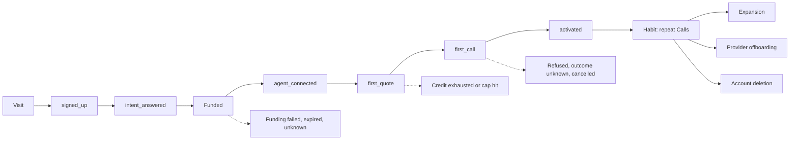
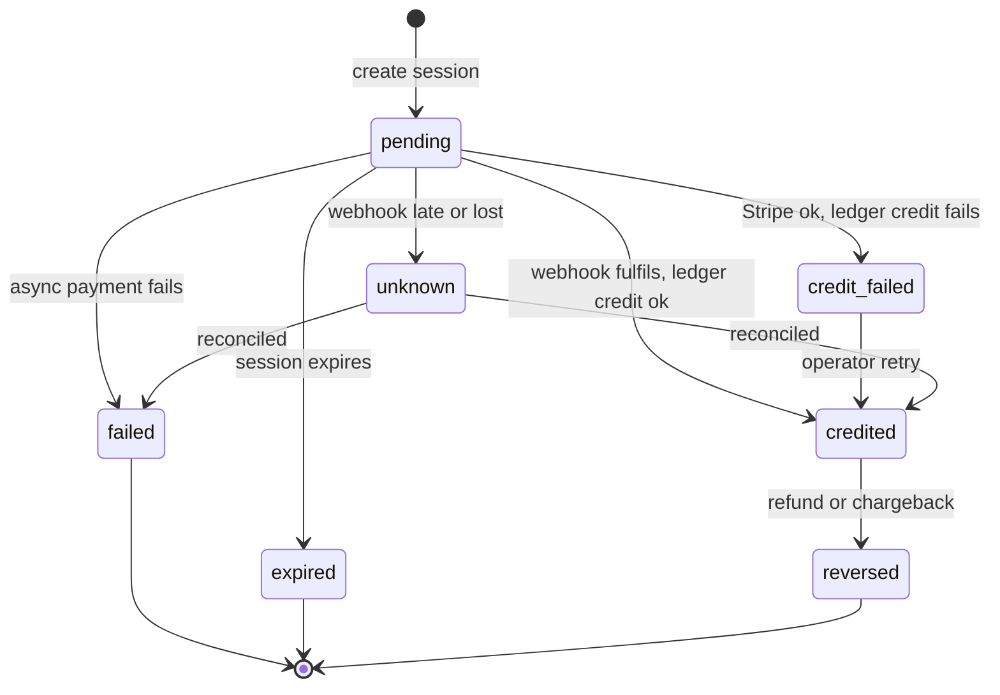
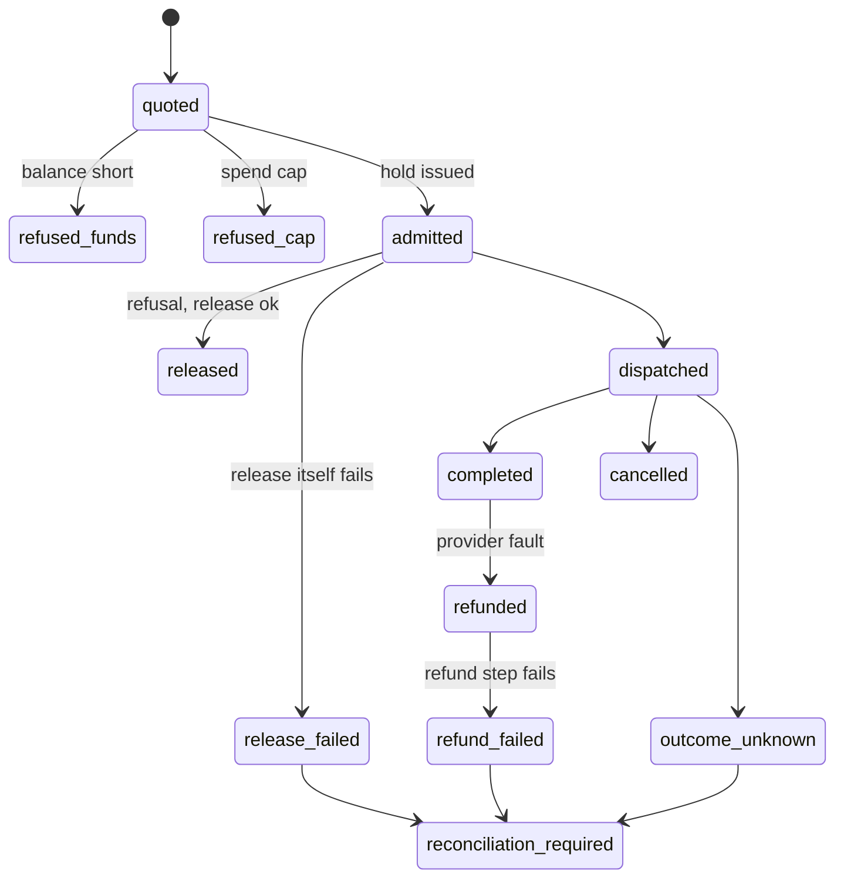

# aecon lifecycle map and untangling plan

Date: 2026-10-11. Status: synthesis of an eight-expert haiku panel, then revised after a completeness review and a pragmatism review. Read-only; nothing was called live.

Evidence caveat. Repo facts cite file:line from the current checkout and the roast doc (`journey-events-and-roast-2026-10-11.md`), which one expert read on branch `codex/email-design`, so some line numbers may have drifted from main. Spot checks on main confirmed the ones marked below. External reference claims come from search snippets, not fetched pages, so they are provisional patterns to copy, and no decision rests on them alone. Not read by any expert: `design-system-walkover`, `design-system-discovery`, `papercut-audit`. Account principal and refund state machines were only partly traced, and the x402 flow was traced only for the funded event.

## 0. Reference method chosen

Keep it small. Two methods, both written as tables in this doc, with no new library.

| Job | Method | Why it fits aecon | Source |
| --- | --- | --- | --- |
| Lifecycle map | Event Storming, Big Picture level (Brandolini): events in time order with actor, command, policy, hotspot | Unhappy paths show up as hotspots | https://en.wikipedia.org/wiki/Event_storming |
| Money, call and approval states | Statecharts (Harel) drawn as mermaid and guard tables, not XState | Every transition names a guard or a failure state. `xstate` is not in `package.json`, so adding it would be a new dependency for no gain | https://stately.ai/docs/xstate |

Dropped for now, with the reason: a Segment-style tracking plan as a separate artefact (the event list in section 2 is the registry, hand-maintained), an NN/g service blueprint (provider back office is covered by the 2.4 table), a Patton story map (the wave table in 5.3 does the slicing), and the Reforge, Verna and Amplitude outcome stack (section 1 keeps one ladder and one metric).

Mature products to map against, by flow (provisional, from snippets):

- Stripe Checkout fulfilment: `checkout.session.completed`, async success and failure, `checkout.session.expired`; redirect and webhook race, so fulfilment must be idempotent. https://docs.stripe.com/checkout/fulfillment
- x402: 402 with payment-required header, signed retry, facilitator `/verify` then `/settle`. Maps to aecon quote, pay, verify, settle. https://docs.x402.org/core-concepts/facilitator
- OpenRouter: 402 with `limit_source` separating a key limit from account balance. Model for splitting refusals. https://openrouter.ai/docs/api_reference/limits
- Replicate: prepaid-first, blocked at zero. https://replicate.com/docs/topics/billing/prepaid-credit
- Vercel Marketplace: async provisioning, invoice webhooks, a wait for final invoices before deletion. Model for provider offboarding and account deletion. https://vercel.com/docs/integrations/create-integration/marketplace-api/reference

Disagreement: two experts wanted a full Event Storm with Joel in the room; the QA lead warned that storming 43 triggers over-scopes. Pick: map the golden path and five unhappy paths, run by agents against the code and real surfaces, with Joel reviewing hotspots. The 43 email kinds are mapped to events afterwards, and only the gaps are counted.

## 1. Outcomes we lead each persona to

Ladder, shared across personas: setup, aha, habit, expansion.

| Persona | Setup | Aha | Habit | Expansion |
| --- | --- | --- | --- | --- |
| Browser (anonymous) | Finds one public priced tool and a runnable curl, no account | Sees a real tool page and a real quote | Returns, saves a tool | Signs up |
| Agent builder / owner | Account, funded credit, agent connected (`ae doctor` passes) | First successful paid Call with receipt visible (`activated`) | Repeat Calls in a window set from cohort data | Second provider, team member, spend cap |
| Team member (invited, role-restricted) | Accepts invite, sees only what the role allows | Reads a statement or runs a Call within role | Repeat use | Role change |
| Agent itself | Key or OAuth grant working | Quote then Call with no human step | Repeat completions | More toolsets, `buy` scope |
| Provider | Verified and live (`provider_live`) | First paid buyer Call on their tool (`provider_first_call`, missing) | Repeat buyer Calls, first payout | Second listing |
| Returning owner | Balance funded | Statement read, receipt trusted | Balance kept funded; low-credit alert acted on | Raises cap, adds members |
| Operator | n/a | n/a | Watches stuck funding, `outcome_unknown`, `reconciliation_required` backlogs | n/a |

Buyer agent and owner-with-agent are one row in the owner column today. Section 3 keeps the buyer-side agent path separate (3.3).

Activation measure (single): count of new owner accounts with a receipted, completed, non-refunded Call within 7 days of signup. Report it as a count, not a rate, until there are enough accounts for a rate to mean something. Split by funding source (sandbox or trial vs paid). Today no event carries a funding-source property, so the split cannot be computed; adding `funding_source` to the funded and activated events is a prerequisite (wave 3).

North Star (derived): weekly accounts with a receipted, non-refunded Call.

Disagreements and picks:

- Aha as a correlate. "First paid Call" is a hypothesis. Pick: use it as the working count. A causal test waits until the user base can support one; no cohort regression or experiment is planned now.
- `retained_w1` (`dispatchFinalize.ts:83-88`) emits only when a receipted completed Call lands 1 to 2 weeks after activation. That is a defined window, not a proven undercount, and no data says otherwise. Pick: treat it as a definition choice and decide in wave 5 whether it is the habit measure Joel wants.
- Second paid Call within 14 days is the first habit input. First paid Call is the activation count. Both sit under one North Star.
- Pay-before-aha. The payments gate (`convex/platformLaunch.ts:11-30`) is not simply admin-only: it allows everyone when the audience is `everyone`, allows active admins, and allows accounts with trial access. Whether public users can reach the aha depends on the runtime audience setting, which has not been read. Pick: first read the audience value for each environment, then Joel decides whether sandbox or trial credit counts (D1).

Input counts: funded accounts, `agent_connected`, `first_quote`, `first_call` within 24 h of signup.

## 2. Full event lifecycle

Legend: exists, partial, missing. Locations are from the inventory; "dark?" means a flag may disable it.

Provider offboarding (2.4 row 34) and account deletion (2.5 row 40) are separate state machines with different grace periods (D4), so they are separate nodes.

Funding states, including failures:

Call and admission states, including failures:

The approval statechart (request, rolled up, decided, expired) is drawn in wave 4 with the approval producers, not before.

### 2.1 Account and access (context: Identity and access)

| # | Event | Actor | Command | Status | Location | Policy |
| --- | --- | --- | --- | --- | --- | --- |
| 1 | Visitor landed | Visitor | Open site | partial | client `visitor_attributed` at `useAppShellState.ts:60`; most funnel events have no client emitter (`literals.ts:21-55`) | Attribute source once |
| 2 | Signed up | Owner | Clerk sign-up | exists (verified) | `provisioning.ts:338` | Whenever signed_up, enqueue welcome |
| 3 | Welcome email queued | System | enqueue welcome | partial, dark | `provisioning.ts:340` (verified); no Clerk `user.created` handler (verified by grep); gated by `AE_EMAIL_PHASE3_ENABLED` at `enqueue.ts:25-27` (verified) | Send once, suppress on unsubscribe |
| 4 | Intent answered | Owner | Answer intent | exists | `accountIntents.ts:42` | Use to tailor first screen |
| 5 | Agent connected | Owner or agent | Approve OAuth grant or create key | exists | `records.ts:170`; grant approve `oauth-state.ts:511`, consume `:638` | Whenever agent_connected, mark setup done |
| 6 | Agent approval requested | Agent | Request approval | partial | `enqueue.ts:140`; cap 3/h, no amount threshold | Suppress email once decided; roll up |
| 7 | Key revoked | Owner | Revoke key | partial, no journey event, no email | `revocation.ts:207-265`; schema `key_revoked` at `:138` | Whenever revoked, notify owner |
| 8 | Role or email changed, account paused or restored | Owner or operator | Change setting | missing | schema kinds `:139-142`, no producers | Notify old address on email change |
| 8a | Team member invited, accepted, role changed | Owner | Invite | missing | no journey event or email kind found by experts | Notify invitee and owner; restrict by role |

### 2.2 Money (context: Money)

| # | Event | Actor | Command | Status | Location | Policy |
| --- | --- | --- | --- | --- | --- | --- |
| 9 | Funding started | Owner | Create funding session | exists | `moneyFundingCommands` pending, `convex-schema.ts:449-500` | Expire unpaid sessions |
| 10 | Funded or topped up (Stripe) | Stripe webhook | Fulfil checkout | exists (verified) | `stripeEventPipeline.ts:260,285`; `events.ts:53-55` | Idempotent; send funding_receipt (`enqueue.ts:155`) |
| 11 | Funded (x402) | Facilitator | Settle | missing (verified: `emitFundingJourneyEvent` is called only from `stripeEventPipeline.ts:285`) | no emitter | Whenever x402 settled, emit funded so the stalled sweep skips funders. Add as a read-side view or emitter beside the existing code; do not reshape tables |
| 11a | x402 verify or settle times out | Facilitator | Verify, settle | missing | success case only in row 11 and `spendResolution.ts:117` | Reservation expires and refunds (`moneyX402Expiry.ts:105-112`); user told next action |
| 12 | Funding failed (async) | Stripe webhook | Mark failed | partial | state exists, no producer for `funding_failed` (schema `:132`; after `stripeEventPipeline.ts:192`) | Email owner with retry link |
| 13 | Funding expired | System | Expire session | partial | terminalReason `expired` in schema | Show "credit not yet applied", never "funded" |
| 14 | Funding outcome unknown | System or operator | Mark unknown | partial | `unknown.ts:25`, `ownerMarkUnknown.ts:37` (console and Sentry only) | Route to operator queue; define payment_stuck N |
| 15 | Funding reversed or refunded | Stripe | Refund | partial | `stripeRefundPipeline.ts:209` | Adjust balance, notify |
| 15a | Chargeback or dispute | Stripe | Dispute | missing | no row, no producer found | Freeze affected credit, notify owner and operator |
| 15b | Stripe succeeds, ledger credit fails | System | Credit | missing | no failure row | Retry idempotently; operator queue if it persists |
| 15c | Refund fails | System | Refund | missing | named in 3.6 only | Operator queue; owner told next action |
| 16 | Low credit | System | Check after Call | partial | `usageAlerts.ts:52-80`, fires only after a Call or report; returns early unless `hasCurrentUsageAlertConsent` is true (consent gate) | Arm and re-arm above 2x; document the consent gate |
| 17 | Credit exhausted | System | Refuse Call | partial: refusal with funding continuation exists (`issueQuote.ts:210-213`, verified); the single email is missing | `quoteValuation.ts:365`, `issueQuote.ts:210-213` | Refusal names next action; email once |
| 18 | Spend cap hit | System | Refuse Call | exists | `usageAlerts.ts:63,67` | Split cap vs balance refusal |
| 19 | x402 reservation settled or refunded | System | Settle or expire | exists | `spendResolution.ts:117` (verified), `moneyX402Expiry.ts:105-112` | `task_refunded` at `moneyX402Expiry.ts:123` |

Month boundary. `evaluateUsageMoneyAlertsHandler` (`usageAlerts.ts`) builds the period from the UTC month (`Date.UTC(...)`), while spend-cap copy says it uses "native financial effective dates". A Call or payment on 31 December UTC can fall in a different month from AU local time, which changes which month a cap or alert counts. Needs a decision on which clock wins, then one fix (wave 4).

### 2.3 Quote and Call (context: Calls)

| # | Event | Actor | Command | Status | Location | Policy |
| --- | --- | --- | --- | --- | --- | --- |
| 20 | First quote | Owner or agent | Quote | exists | `issueQuote.ts:335,340` | Quote expires; idempotency key on repeat |
| 21 | Admission hold issued, reserve consumed | System | Admit | exists | `admissionHold.ts:56`, `admissionReserve.ts:178` | Release on refusal; failure of the release itself has no row (see call statechart, `release_failed`) |
| 22 | Call completed; `first_call` emitted | System | Dispatch | exists | `dispatchFinalize.ts:75` (verified): `first_call` is emitted for every completed projection, before the receipt check | Receipt settled |
| 23 | Activated | System | Finalise first receipted Call | exists | `dispatchFinalize.ts:77-83`: only `activated` is receipt-gated | Whenever activated, send first_call_done (not a kind today); add `funding_source` |
| 24 | Call refused | System | Refuse | partial | `dispatchRefusal.ts:184`; outcome signals go to console and Sentry, not PostHog (`journey.ts:24-35`, wired to Sentry at `sentry.server.ts:40`) | Machine envelope with `nextCommand` |
| 25 | Call outcome unknown, reconciliation required | System | Recover | exists | `callRecoveryProjection.ts:51,274`; result state `outcome_unknown` | Operator queue; user told next action |
| 26 | Call cancelled | Owner or agent | Cancel | exists | `dispatchCancellation.ts:23,61` | Release hold |
| 27 | Refund released | System | Remedy | exists | `moneyManagedCallRemedy.ts:149,179`, `paidCallReports/lifecycle.ts:55` | `task_refunded` email |
| 28 | Retained week 1 | System | Check window | exists as a window check | `dispatchFinalize.ts:83-88` | Definition choice, see section 1 |
| 29 | Provider fault spike, invoice ready | System | Usage alert | exists | `usageAlerts.ts:45,50` | Tax invoice threshold A$1,000 at `enqueue.ts:18-22`; props lack legalName and ABN |

### 2.4 Supply (context: Supply)

| # | Event | Actor | Command | Status | Location | Policy |
| --- | --- | --- | --- | --- | --- | --- |
| 30 | Provider published | Provider | Publish | exists | `publish.ts:256,265,823` (outcome signals only) | Verification begins |
| 31 | Verification failed | System | Verify | missing | no email, no event | Tell provider what to fix |
| 32 | Provider live | System | Admit | exists | `prepared.ts:388` | Email provider |
| 33 | Provider first call, first paid | System | Dispatch to provider tool | missing | buyer-only dispatch today; schema `provider_first_paid` `:146` | Notify provider |
| 33a | Provider payout | System | Pay out | missing, not wired | `convex/lib/principalAccount/notifications/enqueue.ts:25` says payouts, the weekly summary and exception alerts are not wired yet | The golden path ends here, so define states (scheduled, paid, failed, held) before promising payout in copy |
| 34 | Provider offboarding steps | Provider or operator | Offboard | partial | `capabilityProviderOffboardingCases` `:333-370`; no journey event | Freeze, drain, wait obligations, revoke, verify |
| 35 | Provider offboarded | System | Verify cleanup | exists | `verifyPages.ts:127` | Email; failed verification path missing |

### 2.5 Retention, comms and deletion (contexts: Lifecycle comms, Identity)

| # | Event | Actor | Command | Status | Location | Policy |
| --- | --- | --- | --- | --- | --- | --- |
| 36 | Stalled (not funded) | System | Sweep | partial | `convex/lib/journey/stalled.ts:6,9-15` (24 h, `STALLED_MIN_AGE_MS`, verified); the roast doc (`journey-events-and-roast-2026-10-11.md` rows 28 and 34) says 72 h | Reconcile 24 h vs 72 h; skip x402 funders (needs #11) |
| 37 | Week one, dormant | System | Sweep | missing | not in kinds list | Gate on consentBasis and lifecycle cap |
| 38 | Email sent, unsubscribed | Resend | Webhook | partial | `emailWebhook.ts:14-25`, `convex/http.ts:43-67` | Suppress at send time |
| 39 | Payment method or spend cap changed | Owner | Change | missing | not in kinds | Notify |
| 40 | Data request, deletion requested, cancelled, final reminder, deleted | Owner | Request | missing | only Clerk `user.deleted`; `eraseAccountJourney` in `events.ts` | 3-day reminder; grace length open (D4) |

Vocabulary check. The journey schema has nine event names (`src/modules/observability/internal/schema.ts:16-19`, verified) and the roast counts 43 email triggers (5 emitted, 17 partial, 21 missing). These are different objects, so the sizes are not compared. The task is to map each email kind to the journey event that should trigger it and count only the kinds with no producer. That mapping lives in the roast doc and is finished per wave, not as a single registry document.

## 3. Paths per persona

Statuses: exists, partial, missing. Not applicable is stated where it applies.

### 3.1 Agent builder and owner

Golden path: anonymous search, public tool page, sign up, fund, connect agent, quote, Call, receipt, repeat.
- Today: partial. Funding is gated by audience (see section 1), so whether real users can complete step 4 depends on the runtime setting.

Unhappy paths:

| Path | Should resolve | Status |
| --- | --- | --- |
| Card declined or async payment fails | Return to a retryable state, email with link, never show "funded" | partial (no producer) |
| Redirect returns before webhook | Show "credit not yet applied", fulfil idempotently | partial, unverified |
| Funding session expires | Show expiry, offer new session | partial |
| Stripe succeeds, ledger credit fails | Retry idempotently, operator queue | missing |
| Chargeback or dispute | Freeze credit, notify | missing |
| Credit exhausted | Refusal says add credit, names `ae fund` (refusal with funding continuation exists); email once | partial (single email missing) |
| Spend cap hit | Distinct from balance (OpenRouter `limit_source` model) | partial |
| Call outcome unknown | `reconciliation_required`, next action named, operator queue | exists |
| Provider fault | Refund released, `task_refunded` | exists |
| Approval pending, over cap | Roll up, one email, expire | partial |
| Key revoked mid-session | Machine envelope with `nextCommand`; owner notified | partial |
| Catalogue stale (`partialResults`, about 40 h) | Banner in UI, API and CLI | missing |
| Install fails (CLI tarball and npm name 404) | One working install line | missing |

Side paths: team invite, role change, key rotation, export, saved tools, market requests (`saved-tools.*`, `market-requests.*`), change payment method.
Edge cases: double-submit on quote or Call (needs idempotency key); x402 funder emailed as unfunded; account closed with open holds; empty states (no tools reachable, no funds, no providers); read-only MCP mode blocking `buy`; month boundary for caps and alerts (UTC vs AU local, see 2.2); usage alerts silent without consent.

### 3.2 Browser (anonymous)

Golden path: search, tool page, runnable curl or keyless first call, sign up prompt.
- Today: partial. Launch copy says accounts are not open while `/for-agents` shows "Start setup" and prices.
Unhappy: 404s on aecon.ai (`/pricing`, `/docs`, `/status`, `/support`), three competing start actions (`/trial`, `/t/new`, `/for-agents`), marketing pages all funnelling to `/launch` then `/waitlist`, with no link into the app.
Side: visits `/developers`, reads llms.txt or `SKILL.md` and acts on them without the site; joins the waitlist; arrives from a shared tool link.
Edge: search sends queries and provider summaries to OpenRouter without disclosure (roast Theme 4); JavaScript-disabled or bot visit.

### 3.3 Agent

Golden path: `tools/list`, quote, call, receipt, all via envelopes. Exists, with partial error guidance.
Unhappy: missing scope (`market_tools:call`), unknown tool (guidance exists, `mcp-api.ts:598-602`), 402 refusals (balance vs cap split missing), `tools/list` paging at 50 items or 40KB, request body above 320KB. `fund` and `revoke` hand off to a browser by design (`manifest.ts` about 337, 461); resolution is a clear handoff message.
Side: OAuth grant renewal, key rotation by the owner while the agent runs, switching toolsets.
Edge: retry after a timeout must not double-charge (idempotency key); agent keeps calling after the owner revokes the key; agent hits the spend cap mid-task; read-only mode blocks `buy`.

### 3.4 Provider

Golden path: publish, verify, live, first paid Call, payout. Partial (first call, verification failure and payout missing).
Unhappy: verification fails (silent), offboarding stalls on obligations, cleanup verification fails (path missing), lease expiry or `reconciliation_required` (`lease.ts:584,612`), payout fails or is held (no states yet).
Side: edit a live listing, change price, pause a tool, second listing.
Edge: provider offboarded with in-flight Calls.

### 3.5 Returning owner

Golden path: statement, balance, top up, receipts. Partial (low credit only fires after a Call).
Unhappy: low credit unseen until a Call fails; `invoice_ready` without legal name and ABN for tax invoices over A$1,000.
Side: change spend cap, add member, team invite, role change. Edge: dormancy, email change with old-address snapshot, month-boundary cap counting, usage alerts off without consent.

### 3.6 Team member (new persona)

Golden path: accept invite, sign in, see only what the role allows, run a Call or read a statement within role.
Unhappy: invite expires or goes to the wrong address; role blocks the action (refusal names who can grant it); role removed mid-session.
Side: owner changes role, member leaves. Edge: member holds an agent key when removed; last owner removes themselves. Status: missing (no events, no email kinds).

### 3.7 Operator

Golden path: daily digest matches its spec, queues empty. Partial.
Unhappy: stuck funding, `outcome_unknown`, `reconciliation_required` backlog, refund failures (row 15c), ledger credit failures (row 15b), chargebacks (row 15a). No payment_stuck definition.
Side: not applicable. The operator has no side journey; their work is the queues above.
Edge: payments gate drift between code and copy (see section 4).

### 3.8 Surface by path

Which surface should resolve each path. Y means a real path exists and is verified in swarm 2; the cells are filled by swarm 2, not by this doc.

| Path | Web | `ae` CLI | MCP | HTTP | Email |
| --- | --- | --- | --- | --- | --- |
| Browse and quote | yes | yes | yes | yes | n/a |
| Fund | yes | handoff to web | handoff to web | funding quote | receipt, failure |
| Call and receipt | yes | yes | yes | yes | first_call_done (not built) |
| Refusal and recovery | yes | yes | yes | yes | credit exhausted (not built) |
| Key revoke | yes | handoff to web | handoff to web | no | owner notice (missing) |
| Provider publish and offboard | yes | partial | no | partial | live, offboarded |
| Operator queues | yes | partial | no | no | digest |

## 4. Where it is tangled today

Mapped to roast themes (Theme 1 launch state, Theme 2 dead ends and install, Theme 4 disclosure, Theme 5 split developer surfaces).

| Tangle | Evidence | Roast theme |
| --- | --- | --- |
| Launch state is stated in many places that disagree: `/launch` says accounts closed; `/for-agents` says "Start setup"; `/status` Calls row; llms.txt, SKILL.md, `brand-copy.ts:71`; Credit nav shows funding while the gate (`platformLaunch.ts:11`, refusal at `:30`) can return `payments_admins_only` | Duplicated state across at least six surfaces | Theme 1 |
| The payments gate is located (`convex/platformLaunch.ts:11-30`) and depends on a runtime audience value (`none`, admins, `everyone`) plus trial access. Copy cannot be checked until the audience value per environment is read | `readOwnerPaymentAccess` | Theme 1 |
| Journey events and email kinds are not mapped: nine journey names, 43 email kinds, plus console and Sentry-only outcome signals. Count only the kinds with no producing event | `schema.ts:16-19`; `journey.ts:24-35` | n/a |
| x402 never emits `funded`, so funders look unfunded and can be emailed as stalled | `stripeEventPipeline.ts:285` is the only caller | n/a |
| Money states live in separate tables (funding, x402 reservation, managed call, receipt). Fix with a read-side view, not a table rewrite | `convex-schema.ts:449-500`, `spendResolution.ts:117`, `transitions.ts:184-320` | n/a |
| Readiness and availability copied per surface: catalogue status, `partialResults`, status row | Duplicated freshness | Theme 1 |
| Promises that break: "pay per Call" vs closed accounts; "Start setup" vs gated payments; install line vs CLI 404; catalogue 40 h stale with no banner; provider verification failure sends nothing | Service designer list | Themes 1, 2 |
| Dead ends and shims: `owner.index`, `owner.market`, `owner.team`, `owner.workspace`, `owner.settings`, `owner.operations.new`, OAuth callback and agent-keys redirects | file:line list in the web inventory | Theme 2 |
| Duplicate starts: `/trial`, `/t/new`, `/for-agents`; marketing `/product`, `/solutions/*`, `/x402` all to `/launch`; `/developers/api` and `/developers/discovery` split across hosts | Web inventory | Themes 2, 5 |
| Unsafe comms: lifecycle emails with no consentBasis or cap; stalled timing 24 h in code (`stalled.ts:6`) vs 72 h in the roast doc | `convex/lib/journey/stalled.ts:6`; roast doc | n/a |
| Undisclosed data flow to OpenRouter in search | CLI and web inventory | Theme 4 |

## 5. Untangling approach

### 5.1 Principles

1. One owner per state and per event. Add beside existing code (strangler); do not move state or rewrite working money code.
2. Copy reads state; it never defines it. Every public claim derives from one availability source.
3. Money, call and approval get statecharts as mermaid and guard tables in docs; each transition names a guard or failure state. No new library.
4. One hand-maintained event list (section 2). Rows are written for the events a wave touches, in the same change as that wave. No generator, no new registry or dispatcher. A kind is enabled only after its producer exists.
5. Reuse mature patterns (Stripe fulfilment, OpenRouter limit split, x402 verify and settle).
6. Each wave is proven by real use on `ae` CLI, MCP, HTTP and web, not by new test suites.

### 5.2 Target ownership

| State or event | Owner context | Single source |
| --- | --- | --- |
| Launch and payments availability | Availability | `readOwnerPaymentAccess` (`convex/platformLaunch.ts:11`, allow check `:26`, refusal `:30`), surfaced via one string from `/launch` |
| Catalogue freshness, partial results | Discovery | `catalogue-status` |
| Accounts, keys, grants, roles | Identity and access | principal records and OAuth tables |
| Funding, balance, cap, x402 spend, receipts | Money | funding and managed-call tables; a read-side view for x402 `funded`, tables unchanged |
| Quote, hold, Call, refund | Calls | `callLifecycle` |
| Publish, verify, offboard, payout | Supply | admission and offboarding cases |
| Email kinds, suppression, consent | Lifecycle comms | `enqueueEmail` with send-time gates |
| Event names and properties | Journey and analytics | the section 2 list, hand-maintained |

Naming. Keep the nine existing snake_case journey names unchanged and use snake_case for new events.

### 5.3 Waves

Order: copy truth first (cheap, blocks every other claim), then dead ends, then the walking skeleton of the golden path plus the unhappy paths users hit, then comms. Each wave is shippable alone.

| Wave | Outcome | Scope | Proof through real use |
| --- | --- | --- | --- |
| 1 Launch truth | One availability string across `/launch`, `/status`, `/for-agents`, llms.txt, SKILL.md, `brand-copy.ts:71`, API descriptions; prices hidden on `setup_required` tools; audience value read and documented | Copy and one read path | Fetch each surface via web, HTTP and `ae status`; all agree |
| 2 Dead ends and install | 404s fixed (`/pricing`, `/docs`, `/status`, `/support`); CLI tarball hosted; one MCP line on `/developers`; one start action (after D5); redirect shims removed | Routes and docs | Fresh install via the documented line, then `ae doctor` |
| 3 Golden path skeleton | Event rows (producer, guard, failure) written for only the events this wave touches; `funding_source` on funded and activated; `funded` from x402 as a read-side view, after the x402 flow is traced | Journey events | Sandbox funding, then first Call; activation count splits by source |
| 4 Money unhappy paths | `funding_failed` and expiry producers; `credit_exhausted` single email with balance vs cap split; low-credit arm and re-arm and consent gate documented; month-boundary clock decided; payment_stuck defined (needs D2 for what counts as stuck for public users) | Money context | Stripe test and x402 testnet via `ae fund` handoff; force each failure |
| 5 Call and receipt outcomes | Refusals carry `nextCommand`; outcome signals promoted to named events; decide whether `retained_w1` stays as defined | Calls context | `ae call` refusal and recovery on CLI, MCP, HTTP |
| 6 Identity and supply | key revoked, role, email change events; verification-failed path; `provider_first_call`; offboarding journey events; payout states | Identity and supply | Revoke a key then call; publish a failing provider |

Blocked on Joel, not in the sequence until decided:

- Comms gates (consentBasis, lifecycle cap, per-kind switches, stalled timing reconciled): blocked on D3.
- Deletion and export (request, cancel, reminder, execute): blocked on D4.
- Metric lock: not planned until the user base supports it; count accounts until then.

## 6. Working approach for the next swarms

Each agent is haiku, one atomic outcome, returns at most 300 words with file:line. Every brief carries the ABSOLUTE RULES line (no stash, no checkout of files, no reset, no add, no commit, outside the named scope untouched). Discovery agents read; editing agents are sonnet with the exact change plus a verify command, one editor per shared file.

Cost rule. One explorer pass per wave. A second independent verifier runs only where a finding changes money or comms; other findings get one explorer and the orchestrator's check. This departs from the standing "second and third opinion always" memory on purpose, to keep token cost down, and Joel can overrule it.

Swarm 2: path verification on real surfaces (read-only, no edits). Pass criterion per path: the observed behaviour matches the "should resolve" cell in section 3, on each surface in the 3.8 matrix.

| Agent | Scope | Output |
| --- | --- | --- |
| A | Browser path on web: marketing and app, all start actions, 404 and redirect list | Status table per path in sections 3.2 and 4 |
| B | `ae` CLI golden and unhappy paths for owner and agent: `search`, `quote`, `call`, `status`, `recover`, `fund` handoff, `doctor` | Error envelopes observed, missing `nextCommand` |
| C | MCP: four toolsets, scopes, paging, read-only mode, unknown tool | Gaps against section 3.3 |
| D | HTTP `api.v1.*`: funding quote errors, call, status, balance, cancel | Request and response shapes, auth, pagination; fills the HTTP column of 3.8 |
| E | Funding on sandbox (Stripe test, x402 testnet): success, decline, expiry, redirect-before-webhook, x402 verify or settle timeout; read the payments audience value | Observed states against section 2.2 |
| F | Provider path: publish, verify failure, offboarding, payout | Section 2.4 statuses |
| G | Emails: which kinds actually send, which are dark behind flags (`AE_EMAIL_PHASE3_ENABLED` and per-kind); read the three unread docs (design-system-walkover, design-system-discovery, papercut-audit) | Emitted vs dark list |
| H | Operator: digest vs spec, queue views | Section 3.7 statuses |

Disagreements go to the orchestrator, not to a third agent by default.

Later fix swarms: one sonnet editor per wave and per file, real-use proof from section 5.3, then a short smells register entry per well.

Measures that prove progress (all countable now):

- Surfaces agreeing on availability: count of surfaces whose launch string matches the source (target: all).
- Dead ends: count of 404s and redirect shims (target: zero).
- Email kinds with no producing event: count (target: zero for kinds that are switched on).
- Producers with no consumer or consumers with no producer: target zero.
- Real-use paths passed: paths in sections 3.1 to 3.7 that pass their criterion on each surface in 3.8, as a count out of the listed paths (list fixed at the start of each wave).
- Accounts with a receipted Call in 7 days, and accounts with a second Call in 14 days (counts, split by funding source once wave 3 lands).

Statechart completeness is a checklist item in each wave's change (every transition has a guard or failure state), not a metric.

## 7. Decisions Joel must make

1. D1: does sandbox or trial credit count toward activation? Read the audience value first (wave 1); the answer changes what the metric means.
2. D2: open payments to all accounts, and when. Copy depends on the answer, and it affects what counts as payment_stuck.
3. D3: lifecycle consentBasis and whether a marketing-style lifecycle cap applies before any lifecycle flag goes on (compliance). Blocks comms gates.
4. D4: account deletion grace length, separate from provider offboarding grace (open question Q2). Blocks deletion.
5. D5: one start action to keep among `/trial`, `/t/new`, `/for-agents`.
6. D6: which clock a month means for caps and alerts, UTC or AU local.
7. D7: verifier depth, one explorer pass with a second verifier only on money and comms (default here), or two verifiers on everything.

## Review notes

Accepted and applied: all persona gaps (side and edge lines added, operator side marked not applicable, team member added as a persona, buyer agent kept separate); payout, chargeback, ledger credit failure, refund failure, release failure and x402 timeout rows; funding and call statecharts with failure branches; surface-by-path matrix; month-boundary and consent-gate edges; payments gate citation fixed to `:11` and `:26-30`, not-located caveat removed; row 17 re-marked partial; `first_call` timing corrected; offboarding and deletion split; x402 funded confirmed missing by grep; funding-source property named as a prerequisite; method stack cut to two; XState dropped; generator dropped from the registry; table unification replaced with a read-side view; waves reshaped so each ships alone and blocked work is listed apart; 24 h vs 72 h cited to the roast doc; 9 vs 43 reframed as a mapping with gap counts; activation and measures changed to counts with defined criteria; admin-only and `retained_w1` claims corrected.

Rejected or changed:

- "Pick one method, drop the rest": kept two (event map and statecharts as tables) because unhappy-path coverage needs the statecharts; the other three are dropped.
- "Drop any decision that rests on external claims": no decision rests on them alone. They are kept as provisional patterns, flagged as unfetched.
- "Write registry rows only for waves touched" accepted, but the section 2 inventory stays as a map, since it is the lifecycle deliverable the request asked for.
- "One verifier per wave": partly rejected. The standing memory asks for second and third opinions, so one extra verifier is kept for money and comms findings; flagged as D7 for Joel.
- Not done: reading the three unread docs and the runtime audience value, because this pass is edit-only; both are assigned to swarm 2 (agents E and G).
- Unverified still: the 72 h figure is only sourced from the roast doc, not from code.

## Decisions (Joel, 2026-10-11)
- D2 launch state: payments are controlled by one switch in the admin console that turns full Stripe and paid calls on. It stays off for now. Alpha users get trial credit only. Public copy follows the switch from one availability source.
- D1 activation: paid only. The activation metric counts a first receipted call on real credit. Sandbox and trial calls are tracked separately as a leading indicator.
- D5 start action: every "get started" goes to /for-agents.
- D4 deletion grace: 14 days, with a reminder 3 days before.
- D7 verification: two independent verifiers on every finding (Joel's standing rule).
