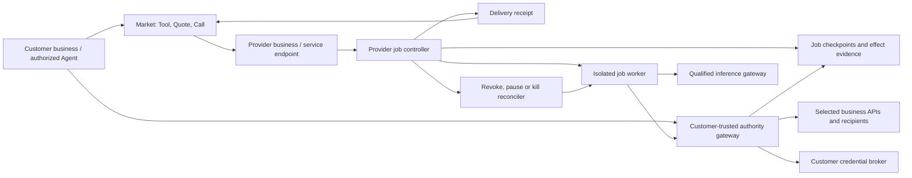

# Managed task agents: research program and provisional specification

**Evidence date:** 1 October 2026. **Status:** source research and planning arithmetic completed; runtime, customer and contractual qualification outstanding. **Decision status:** recommendations for Joel; launch commitments remain unqualified. This is a prospective product study, not an implementation claim or a change to Agentic Economy's charter.

**Product thesis:** a Customer's Agent engages an identifiable Provider business for one bounded service; that business's agent performs the work under a recorded contract and temporary permissions. The Provider can instantiate an isolated worker on demand and return a verifiable result. The business, service definition and purchase record persist after compute sleeps or is destroyed.

The proposed product combines Provider service creation and operation with direct distribution and optional marketplace acquisition. Publish the service as a Tool; an agent is its delivery mechanism. The promising opportunity is the operating contract around a job: what it may access, what it may change, what constitutes success, how failure is recovered and what it costs. Ephemeral compute is one mechanism. It does not by itself establish limited authority, correct output or deletion.

## 1. Scope and research discipline

The accepted direction is self-service, specific work scope and short-lived execution. The invoice example is an engineering boundary test. Commercial proof needs Provider-controlled expertise, licensed information or access that a buyer cannot readily reproduce. Persistent personal assistants, unrestricted employee replacements and autonomous expansion of goals are outside this study's proposed first release.

**User refinement:** the product is an external service engagement, comparable to contracting a business through Fiverr with agents handling the interaction. The Provider represents an actual business. Prioritize bounded external contributions. Customer-system writes and external communication remain boundary tests; a useful Provider service need not access any Customer account. Self-service deployment remains the Provider's supply experience; the buyer purchases the full scoped service. A reusable worker may spin up for seconds and return to standby, or each engagement may use fresh compute. Business authority and obligations must not depend on the VM's lifetime.

The maintained deliverables are this document, [evidence and cost inputs](managed-task-agents-evidence.json), and a [reproducible cost calculator](managed-task-agents-costs.py). Extend these three files as questions close. Retire superseded conclusions in place; do not create a new report for every vendor or meeting. This refinement changes the commercial frame, not the existing Agentic Economy charter: provider execution stays outside the market boundary.

Evidence levels are **vendor-published**, **documented**, **source-inspected** and **observed**. The first three establish statements or code, not exercised behavior. No provider runtime, model quality, integration write or actual invoice was exercised in this study. The evidence register contains 114 attributed sources with dates and locators; OpenMuse code is pinned to `d0b3a6b3ea461bc938a5dea6c46e65eefdb1b933` and Cloudflare workspace code to `6e1c3467338b092da04a058594cd47fca13556db`. Existing comparison archives provide Tasklet/Pickaxe packaging context, not fresh proof of embedded APIs.

Every material external assertion must have a first-party source and locator. Record unsupported internals as unknown. Separate proposed requirements and numeric assumptions from facts. Prices need currency, unit, effective/checked date, allowances and additive fees. Never use trial credits, vendor demos or passing source inspection as evidence of production economics or isolation.

| Work package | Specific question and method | Required result and acceptance standard | Current status |
| --- | --- | --- | --- |
| R01 Product and identities | Resolve Ace, Muse, Grok Bot, Dots and Instinct; read first-party material | Identity, audience, lifetime, authority, isolation, commercial access; unknowns visible | Desk comparison complete; Ace full-page fetch incomplete |
| R02 Inspectable implementation | Read OpenMuse authentication, actions, worker, computer and adapter code | Commit/path locators; distinguish implemented paths, limitations and unfinished adapters | Source inspection complete; no execution |
| R03 Runtime qualification | Exercise fresh, disk-standby and memory-standby execution, wake races and restricted networking | Time to authorized output, billed wake/pause seconds, cached-data isolation, stale-authority denial, resume quotas and expiry cleanup | Lifecycle protocols expanded; not run |
| R04 Connections and disclosure | Compare Provider-owned connections and optional Customer grants; retain upload-to-Xero as a boundary test | Own OAuth, exact organization/folder selection, scoped actions; byte-level retention/subprocessor map | Published contracts compared; live binary path unresolved |
| R05 Authority and recovery | Test two independent businesses, grants, approvals, leases and effects | Bind Provider identity and Quote/Call; deny cross-customer/stale scope, unauthorized representation and changed approval; recover uncertain writes | Cross-business contracts specified; not implemented |
| R06 Task quality | Assemble held-out inputs and independent expected outputs | Per-task critical-field accuracy, abstention, duplicate handling and regression gates | Evaluation specification only |
| R07 Economics | Reproduce vendor meters and scenario arithmetic; reconcile a real bill later | No double-counted credits; sensitivity to tokens, retries, support, retention, currency and quotas | Calculator checked; inputs remain estimates |
| R08 Capacity and growth | Translate jobs into concurrency, creates/s, API load and operator hours | Known public-plan limits, queues and unquoted capacity distinguished from forecasts | Scenario analysis complete; load tests/quotes outstanding |
| R09 Terms and privacy | Read upstream terms; design our commercial authority and remedy terms | Embedded-use rights, DPA, scopes, retention and customer remedies reviewed for launch jurisdiction | Issues identified; no legal clearance or final ToS |
| R10 Business proof | Selected tender-review profile: one Provider/five recurring buyers, then second independent Provider, external buyer harness and genuinely new buyers | Monthly incremental Provider benefit after all costs; full-price renewal; ≥3/5 useful repeats within declared recurrence window; all shaping time counted; later unassisted comparison/acquisition and retained market purchases | Owner-selected test in §12; no demand evidence |

Close a package only when its stated output and evidence standard are met. Runtime evidence must identify configuration, vendor/runtime versions, inputs, expected/actual outputs, timing, failures and cost. Contractual approval means written coverage of our actual service, not a sales assertion. A model change reopens affected quality and privacy checks.

## 2. What the comparables teach us

| Product | Published or inspected architecture | Useful lesson | Fit and limits |
| --- | --- | --- | --- |
| **Ace / Automat** | Persistent computer/identity and workflow execution; FDE setup and maintenance [S01] | Managed output includes deployment, evaluation and ongoing operations | Broad always-on worker; no source or complete public infrastructure contract inspected |
| **Meta Muse** | Per-person VM; runtime cell, trusted credential service, Sentinel action authority and external durable state [S02] [S03] | Keep secrets and enforcement outside the model's computer; use explicit approval UI [S04] | Personal context is broader than our scope. Published confidential-VM additions are future work |
| **xAI Grok Bot** | Multiple bots share one user's computer, files, sessions and logins [S05]; connector credentials remain outside it [S06] | Action history, safe sign-in and admin controls are product features | Separate bot names do not isolate jobs. Several enforcement controls are enterprise-specific; deleting a bot does not delete shared state |
| **OpenAI Dots** | Personal cloud assistants and focused organizational specialist pilots [S07]; layered action checks/workspaces [S08] | Specialist workflows validate the competitive category; enterprise governance matters | Adjacent competition already exists. Public self-service ephemeral deployment infrastructure was not established |
| **Instinct** | Persistent personal context across phone, computer and channels [S09] | Simple channels hide operational complexity | Broad authority and privacy/training choices differ from a purpose-limited business worker [S10] [S11] |
| **OpenMuse / CopilotKit** | Single-owner Hono/SQL application with persistent browser/Docker workspace, durable worker and approval records [S12] [S14] [S15] | Concrete lease, action identity, approval-version and uncertain-outcome patterns | Reference code, not a ready multi-tenant platform; unfinished adapter and browser isolation caveats |
| **Tasklet + Pickaxe** | Earlier documentation shows task setup, folder organization, app connections and customer-facing packaging [S50] [S51] | Combine understandable setup with customer-owned connections | Packaging does not establish secure embedding rights or a job-level enforcement boundary |
| **Superlayer** | InstantDB-based backend with real-time data/auth/storage; programmatic app provisioning, streams and webhooks [S52] [S53] [S56] [S57] | Consider a provisioned workspace/control surface per worker | Execution remains elsewhere; beta shared-usage pricing and production guarantees need qualification |
| **Toyo** | Current site describes a messaging/voice executive assistant with connected apps [S84]. Joel's supplied 28 September screenshot claims Cloudflare execution and S3/R2 files with 1000× savings | Persistent files and service availability need not require a running VM | No disclosed benchmark or complete implementation inspected. May terms still describe an organizational VM [S85]; neither wording proves the current runtime topology |

OpenMuse's action code gives us a useful starting pattern: persist the intended action, bind approval to its connection/context, atomically claim execution and record a confirmed or uncertain result [S14]. Its worker fences state updates with leases and compare-and-swap checks [S15]. These patterns can be reimplemented against our own domain contract; copying the complete persistent assistant would add unrelated scope.

Its authentication is owner-oriented [S13]. Container configuration checks are valuable [S16], but the browser worker explicitly acknowledges limits to its network and Chromium protections [S17]. The OpenBot adapter is unfinished [S18]. The README's runtime setup and package expectations also need reconciliation before adopting dependencies; our existing checkout remains on Node 22 [S12]. No OpenMuse tests were run.

**Inference:** the defensible wedge is self-service bounded work with explicit authority, measured output and transparent cost. These sources establish adjacent products, not unmet demand or unique technology.

## 3. Service engagement and bounded first release

The buyer's journey is `capability gap → compare Provider Tools → Quote → Call → delivery or uncertainty → remedy → purchase resolution/status → Agent continues`. The purchased unit remains a Tool. A complete service can contain multiple internal steps without transferring ownership of the Customer's larger objective to the Provider.

The Provider's self-service setup is the deployment journey below. The buyer selects an admitted service, accepts its bounded Quote within delegated purchasing authority, and supplies only the inputs and access required for that Call. Natural-language negotiation may clarify scope; the accepted version must be structured and immutable. Missing access is an explicit request, not permission to inspect the Customer's other systems.

1. Choose a supported job template or describe a task. A generator proposes a manifest using approved actions and schemas.
2. If required, connect the Provider's own knowledge/system and select its permitted resources. Customer-system access is optional and separately granted. The OAuth connection is a ceiling, not per-Call authority.
3. Review a plain-language permission card: reads, writes, exclusions, approval rule, maximum spend, data locations/retention and expected output.
4. Run a preview on a sample. For writes, show the exact proposed change and require approval according to the manifest.
5. Deploy the definition. Receive a stable task URL/API identifier and optional upload/webhook/schedule trigger; creation does not allocate an idle VM.
6. Each input creates a job. Show queued, working, waiting, completed, uncertain or failed with a receipt and remedy route.
7. Stop new work, revoke connections or delete the definition. Explain separately what happens to active requests, local copies, remote business records and audit retention.

Keep sandbox IDs, OAuth scopes and implementation logs out of the normal flow. Make permissions and exceptions inspectable. Self-service means no engineer is required to provision each customer; it does not require arbitrary tools, arbitrary code or arbitrary workflows in v1.

Proposed first service release: admitted Provider businesses, one bounded offer each, permitted inputs, Provider-controlled resources, upload/API submission, explicit review where sold, receipts, capacity/price limits and supported remedies. Customer-system writes or fixed external inquiries require their separate qualified gateway. Service purchasing uses the declared payment adapter; guests never receive payment credentials. Scheduling, arbitrary plugins/browser access, personal assistants, nested autonomous procurement and self-modifying permissions are deferred.

### Packaging: a service storefront with managed delivery

The sellable unit is a versioned Tool representing a bounded contribution. A Provider may maintain a portfolio Service and publish several distinct Tools through Offerings/Publications; these remain separate records under `CONTEXT.md`. One agent implementation can perform several Tools, but each Call pins one contract and receives fresh authority. Hosting is optional: a Provider-owned endpoint can join the same market without migrating its internal systems.

| Product surface | User outcome | Required boundary |
| --- | --- | --- |
| Create | Describe one result, supply examples, connect Provider knowledge/systems | Guided contract draft: accepted inputs, excluded requests, output schema, permitted use, data recipients, review mode, deadline and remedy; generated text never grants permission |
| Qualify | Demonstrate repeatable delivery on held-out requests | Separate schema validity, domain quality, license rights and professional review; mark evidence date/version and unsupported cases |
| Publish | Set price, capacity, eligibility and service terms | Private availability first; public admission is a separate decision. Never present generic “verified” as a guarantee of work |
| Sell | Share a branded link, website embed or API; opt into market discovery | The same Tool version and Quote/Call contract across channels; identify Seller at purchase. No required AE-hosted personal assistant |
| Operate | See jobs, exceptions, review queue, earnings and customer remedies | Reviewer permissions, escalation, pause/admission controls, refund status, replay-safe callbacks, version rollbacks and export/offboarding |

The creation experience should propose an offer, then expose the few decisions that determine its obligations. Preview a realistic buyer request, refusal and disputed output. Do not hide these behind a generic “deploy agent” button. Private delivery to an existing client may need less public reputation evidence, but never weaker data authority or purchasing controls.

Start with specialist businesses selling **licensed research findings or explicitly Provider-reviewed reports**, using their own knowledge and clients. A suitable first offer answers one recurring question from a small permitted input and returns cited findings or a named reviewer's approved report. It does not promise general advice, certification or legal reliance unless that exact professional obligation is qualified. Supplier stock/lead-time responses are a useful next category, but may be free lead generation rather than paid service demand. Invoice filing is valuable engineering practice and weak evidence of external market value.

Three contract layers are necessary: (1) Provider-platform terms for hosting, operation, fees and suspension; (2) buyer–Seller service terms for delivery, permitted use and remedies; (3) per-Call purchasing/resource authority, binding exact inputs, price, data recipients and permitted actions. A hash records accepted material; it does not establish enforceability or professional standing.

Provider expertise, method and quality belong to the Provider; the platform owns its representations, containment and operating service. For the proposed fiat lane, **Provider-as-Seller** is the candidate. AE's existing principal-reseller x402 lane remains distinct. Distribution channel alone must not silently change the Seller. Charging an application fee does not remove the platform's own statutory, privacy or infrastructure obligations.

Selected price hypothesis: an operating subscription and an execution-profile meter, with **0% distribution commission on Provider-originated clients**. Market-originated first purchases pay 15%; subsequent on-platform purchases pay 5%. Record attributed origin and the applicable rate at Quote time; no off-platform referral tax or general no-bypass clause. Hosting and distribution are independent choices. The superseded 5%/15% model remains a comparison, not launch pricing. See §9 for monthly Provider benefit, buyer acquisition, churn and growth cash.

Adjacent competition is substantive. Harvey publishes client-facing workflow delivery [S107]; Thomson Reuters distributes specialist capability into Claude [S108]. Tasklet/Pickaxe supply useful creation/distribution patterns. The proposed distinction is independently supplied, purchasable contributions across buyer harnesses with supported operation and recovery. None of this establishes an uncontested category or paid demand.

### Owner-selected starting business and product

**Decision, 1 October 2026:** build a service operating product for specialist firms that already deliver repeatable document reviews. First cohort: small Australian tender/bid-review firms with existing clients and sufficient recurring workload. First Tool: **a Provider-reviewed tender compliance and evidence review**. This is one supply-development experiment; the accepted cross-harness market remains broad.

The category exists: The Bid Agency advertises detailed bid reviews from A$1,500 ex GST with meetings [S111]; TenderWise distinguishes free high-level screening from paid detailed review [S112]. Public Tenders Australia advertises a specialist review and its own portal in indexed material [S113]. These offers establish useful scope and competitors, not demand for our platform. We must improve a substantive paid service, rather than sell a generic summary. A$990 incl GST below is an illustrative price for a narrower offer, not the price or equivalent scope of those businesses.

| Decision | Chosen implementation/offer | Why this earns its place |
| --- | --- | --- |
| First Provider | Existing specialist firm with its own clients, review method and accountable reviewer; target ≥10 eligible reviews/month | Has real work and a commercial counterfactual; avoids inventing both capability and demand |
| Purchased contribution | One tender pack plus draft response → cited requirements/evidence matrix, identified gaps, prioritized corrections, reviewed PDF and structured JSON | Useful to a human client and consumable by its existing agent; Provider accepts the exact review obligation |
| Initial envelope | Text-readable documents, ≤80 total pages and ≤30 assessment criteria; complete declared document/addenda list; one correction round for a defective delivered review; one-business-day review turnaround | Fixed admission and capacity before Quote; unsupported or ambiguous scope is declined, not silently billed or truncated |
| Excluded obligations | Tender writing, lodgement, supplier communication, price commitments, legal certification and predicted win probability | Keeps the purchased review bounded; other services need their own qualified Tool |
| Input/permissions | Buyer supplies only the tender and draft; Provider supplies approved method/examples; no buyer SaaS, email, bank or drive connection | Real cross-business work with a small data boundary and no broad account privileges |
| Quality | Provider reviewer checks requirements/addenda completeness and each material finding; every claim cites supplied evidence or is explicitly unverified | Schema validation catches malformed artifacts; domain review establishes the sold work |
| First delivery | Private branded service link/API; direct client remains the Provider's buyer; Quote and result are the same through either interface | Provider gets operating value immediately; machine consumption is tested before claiming cross-harness utility |

**Creation should begin from an existing service:** the Provider supplies its current offer and rights-cleared examples, identifies supported/refused requests and selects a standard output/review profile. The app proposes a versioned draft and preview; the Provider approves the business terms and method. Use fixed form/schema/template assembly first. No new general task or legal-contract compiler is required. Provider-specific preparation, examples, qualification, training, engineering and first-delivery assistance all count toward activation cost, even when they occur before the UI opens.

**Operating loop:** accept eligible input and payment → fresh bounded extraction/draft → validate evidence references → stop compute and queue named review → approve the immutable artifact → deliver PDF/JSON with Call receipt → handle correction/refund under that offer. The buyer agent can wait by stable Call reference and resume with the result; it need not chat with another assistant or surrender its larger workflow. Active compute may last minutes; the disclosed service turnaround includes the human wait.

**Selected commercial arrangement:** charge the Provider for hosted operation, with no percentage levy on the clients it brings. Let businesses with existing endpoints join public supply without an operating subscription; they pay the disclosed acquisition/repeat fee only on purchases through the marketplace. That removes an unjustified hosting dependency and preserves a reason for each side to participate. First/repeat attribution binds the verified Customer–Provider business relationship, not a new agent key, session or runtime. Private-client invitations and accepted purchase history are evidence; public discovery alone never reclassifies an existing private customer.

Initial stack remains React/TanStack Start, Clerk organizations and Convex canonical market/authority/jobs. Start with one trusted fixed handler and restricted file/model actions. Qualify a fresh Cloudflare JS execution adapter for adaptive extraction; use private object storage through a job-bound file interface. Each Call sees its permitted inputs, approved Provider method and output namespace, never the Provider-wide/customer-wide filesystem. No Linux machine or memory standby is required for this profile; native/OCR/browser profiles can justify a sandbox later. Runtime selection can change without changing the service's Seller, terms or purchasing record.

**How this becomes a marketplace:** Providers first distribute to their clients. With explicit buyer permission, searchable offer metadata and aggregate service-level delivery evidence can support comparison; confidential tender content is not market inventory. An unfamiliar buyer agent brings a real review need, sees comparable admitted Tools, obtains a Quote and buys within its authority. New-to-Provider acquisition, repeat retention and buyer CAC must be observed independently. Provider private clients are never silently reclassified as marketplace leads. Complementary document-review profiles follow only after the second Provider can reuse the first profile without bespoke engineering.

### Hard questions and evidence needed

| Question | Evidence that changes the decision |
| --- | --- |
| Which Provider businesses supply the first service, and why do buyers choose it? | The unit is now a bounded service; paid trials must establish Provider margin, buyer savings and repeat purchases |
| What makes this materially better than a queue, function and integration platform? | A real task needing bounded adaptation; measured onboarding time, net work saved and failure handling against that alternative |
| Can a new user define a useful job without our engineers becoming the deployment team? | Unassisted creation/preview/deployment by representative users; record every support intervention |
| Which state deserves to survive standby? | Performance benefit of files/mappings/RAM separately; grant-reduction and retention tests showing old data is inaccessible when policy changes |
| How do we detect a confidently wrong job? | Independent receipts/validation, held-out domain tests, abstention/correction rates and meaningful remedy cost; a model judging itself is insufficient |
| Does reuse actually beat a clean launch? | Time to first authorized output and billed seconds on fresh, disk-only and full-memory paths; API create latency alone is not the metric |
| Will task compilation save enough to justify its complexity? | Repeated-planning/token/time reduction with equal task quality; disable the compiler if it mostly adds brittle special cases |

Security constraints define what the worker may do. Inside that boundary, explore execution methods freely. The main creative question is whether businesses will entrust a defined service to an external counterparty and repeatedly buy it.

### Trust across independently controlled businesses

There are three separate authorizations: the Customer allows its Agent to buy; the Provider business allows its service agent to quote and perform; the Customer permits that Provider to use selected resources or represent it in a particular interaction. Purchasing the service does not itself grant account access or permission to speak for the Customer. A Provider agent represents its own business by default.

| Trust question | Required evidence/control | What that does not establish |
| --- | --- | --- |
| Which business is accountable? | Legal entity, jurisdiction, verified controller, service contact, terms version and verification date; bind approved endpoint/signing keys to that business | An ABN, domain or signed Agent Card alone does not prove controller authority or service quality |
| What has been purchased? | Customer-bound Quote/Call, Tool version, accepted inputs, output/acceptance rules, price, deadline, exceptions and remedy | Funding, payment or an agent saying “done” is not delivery |
| What may this worker do? | Customer-controlled resource grant bound to Provider identity, Call, task version, resource/action/argument limits and expiry | Provider-side promises and broad OAuth scopes do not enforce the Customer's limits |
| May it communicate externally? | Approved represented party, recipients/thread, disclosed fields, permitted message type and commitment limits | Permission to ask a supplier a question is not permission to accept its terms or promise payment |
| Was the service delivered? | Independently checked artifact/remote effect evidence, explicit uncertainty, and attributed Provider report | A signature authenticates a report; it does not make the reported result true |

ABN Lookup provides public registration information, but warns that its data may be incomplete or stale [S80]. Proposed onboarding therefore records entity verification and service-controller verification separately; quality qualification is a third assessment. Verification descriptions must state precisely which checks passed. Key rotation or a new VM does not create a new Provider or erase purchase history.

Keep the Customer's connection credentials at a boundary it trusts. The Provider worker calls a small action interface there; it receives neither the Customer's refresh token nor arbitrary proxy access. Where we operate this gateway, the Customer is trusting us to enforce its grant. A Provider hosting its own worker can still use this interface, but we cannot claim to enforce its internal data retention, model choice or deletion without further evidence and contractual coverage.

For a hosted worker, assume the model and guest code may be compromised. Network restrictions, typed actions, server-resolved destinations and current-grant checks must remain effective anyway. An allowed host is too broad: an agent could misuse an allowed email or accounting API. Also distinguish containment from quality: a wrong draft bill or misleading permitted message can fit its schema and still harm the Customer. Validate task facts independently; use fixed communication templates or exact-message approval where free-form commitments cannot be reliably bounded.

Use existing protocol primitives, with an explicit gap analysis:

| Primitive | Documented contribution | Remaining service responsibility |
| --- | --- | --- |
| A2A v1 [S72] | Discovery, task/artifact exchange, optional signed cards, authentication and per-request authorization | Its `AUTH_REQUIRED` state does not define scope, representation, validity or revocation. Bind tasks to our commercial and resource records; a task-completed report is evidence to assess |
| MCP [S73] | Tool access and OAuth security requirements | Validate token audience and handle ownership; avoid token passthrough and unsafe discovery URLs. Tool descriptions do not enforce business authority |
| OAuth token exchange / rich authorization [S74] [S75] | Audience-targeted delegated tokens, current actor identity, structured authorization details | Issuer/resource server must support and enforce the selected profile. Nested `act` history is informational; it is not automatic permission inheritance |
| Auth0 Token Vault [S76] | Third-party token storage, refresh and retrieval | A valid retrieved access token is still powerful. Keep it in trusted action code and apply the Call's resource/argument policy |
| Web Bot Auth / Visa TAP [S71] [S79] | Signed agent traffic and, for participating Visa integrations, consumer/payment context | Recognition is not our service acceptance/remedy contract. Verify the enrolled business/key and covered request components; universal counterparty adoption is unproven |
| AP2 [S77] [S78] | Signed checkout/payment mandates and deterministic constraint verification | Useful purchase-authorization patterns; service execution permissions, output quality and our commercial role remain separate. AP2 treats agents as potential attackers |

Cloudflare's current Web Bot Auth verification does not validate nonces or maintain a replay database [S71]. Our protected mutation boundary must bind method/target and the exact payload to the authenticated request, enforce expiry/current authority, and deduplicate the semantic effect durably. A fresh signature is not permission to repeat a previously dispatched bill or purchase. This is an application requirement, not a claim that all HTTP-signature implementations share that limitation.

No new universal trust protocol, blockchain, reputation token or federation is required for the first proof. Start with one admitted Provider business, one service and authenticated HTTP; add A2A/MCP adapters for actual callers. Preserve their protocol fields and translate into existing Quote/Call records. A Provider-side job references the purchase; “engagement” describes its scoped relationship, not a new AE market object.

### Invoice engineering reference — separate from commercial proof

Input is one image/PDF plus customer-approved settings. Produce a filed copy and a **draft supplier bill** in the selected Xero organization. The platform does not own final accounting classification; mappings come from the customer or their accountant.

- Limit accepted content types/pages/bytes; reject malformed or ambiguous documents. Extract supplier, invoice number, date, currency, line items, tax and totals with provenance.
- Validate arithmetic, required fields and duplicate signals. Do not infer a new supplier, bank details or accounting/tax policy from document instructions.
- Use existing approved supplier and account/tax mappings. Ask for a correction when absent; save a checkpoint and release compute while waiting.
- File only into the authorized destination. Invoke a typed `createDraftSupplierBill` action that fixes `ACCPAY` and `DRAFT` server-side. No payment, authorization, deletion or unrelated invoice update.
- Confirm the created remote ID and filed artifact. If filing succeeded but the bill failed, expose partial delivery and resume the missing step. Do not claim a cross-provider transaction or delete confirmed business records automatically.
- Duplicate upload detection uses content and business identifiers within the customer/organization scope. Same bytes are not automatically the same business event; replacement/correction must be explicit.

Xero requires our own OAuth app in the Composio toolkit [S29]. Its current API tiers and granular-scope changes must be included in rollout planning; the published rules prohibit training on API data and constrain automation that bypasses approved access [S44]. This specification chooses API access for Xero.

## 4. Architecture options and stack

| Option | Components and coupled concerns | Cost/benefit and decision |
| --- | --- | --- |
| A: existing TypeScript foundation | React/TanStack Start, Clerk organizations, Convex durable workflow/storage, trusted Node gateway, E2B | Reuses familiar infrastructure; couples state/workflow to Convex. **Existing candidate**, with an independent Provider execution boundary |
| B: provisioned workspace backend | Superlayer app/auth/data/streams, an explicit scheduler/action gateway, E2B | Fast provisionable UI/data surface; scheduler, conditional admission and effect recovery still need proof. **New candidate**, not a concluded replacement for Convex |
| C: own execution platform | Firecracker/container orchestration, durable workflow service, network/credential brokers | More control over residency and unit compute cost; substantial security/operations burden. **Defer** until contractual/residency needs or measured managed costs justify it |
| D: optional Cloudflare Provider execution | Trusted Worker adapter, execution-only Durable Objects/checkpoints, private R2, Dynamic Workers; Linux Sandbox only if needed | Low idle compute and useful scoped execution; couples Provider delivery to Cloudflare. **Candidate execution adapter beside existing market state**, not a new market control plane |

A TypeScript/Postgres/private-storage/Upstash control plane remains the portability alternative if required. Keep one canonical job/effect store; do not add Superlayer beside Convex merely to collect technologies. Its documented atomic writes [S58] do not yet establish conditional budget/lease admission under contention or durable orchestration.

This is a candidate stack, not authorization to add services to the current application. Agentic Economy owns the Tool market and commercial procurement boundary; it does not own general runtime, memory or orchestration (`PRODUCT.md`, “What Agentic Economy is not”). A Provider may publish an admitted Tool whose performance uses this managed runtime. The market records Quote/Call, delivery, remedy and purchase resolution; Provider execution translates those contracts without taking over the market or Customer objective.

Reuse existing AE identity and market state. Use an isolated Provider execution deployment for qualification, with a narrow authenticated Call/result interface; do not copy purchasing state into it. The cost scenario allocates the quoted professional allowances to this proposed product; it does not assume the existing product's allowance is available for free.

| Concern | Candidate and concrete responsibility | Qualification condition |
| --- | --- | --- |
| Product UI/API | Existing React 19 / TanStack Start / TypeScript / Zod on Node 22 | Validate manifests and authenticated tenant access; no generated prompts as authority |
| Identity | Clerk organizations and explicit roles | Customer owner/operator/reviewer roles; checked membership on each protected operation |
| Durable control | Convex + installed workflow/workpool | Dedicated job state/admission pools; version workflows; short trusted actions, no worker held open while waiting |
| Canonical artifacts | Authorized Convex HTTP file access initially | Per-request authorization, size constraints and deletion policy; substitute private object storage if streaming/residency economics require |
| Execution | Trusted fixed handler first; Cloudflare Dynamic Worker for constrained JS; E2B or Linux Sandbox when native processes/browser are necessary | Distinct per-Call input/grant/workspace, restricted bindings/egress, measured lifecycle. No mandatory VM or general filesystem for a fixed API task |
| Inference | AI SDK structured workflow through a server-side model gateway | Explicit model/provider policy, token cap, fail-closed privacy route; cheaper model only after task evaluation |
| Connections | Composio scoped Sessions or Nango auth + typed integration functions | Own OAuth, tenant/account binding, no admin key in guest, written embedded-use terms and verified file path |
| Side effects | Our typed business-action gateway | Application-level resource/argument checks and durable effect reconciliation; OAuth vendor does not own this policy |
| Billing/operations | Stripe Connect direct fiat candidate plus separate operating-plan billing; existing Sentry/redaction | Pin Seller/account configuration; reconcile payment/refund/dispute state independently of delivery; current resale ledger not reused as a Provider wallet |

The connection vendor remains a bounded decision in R04, not a permanent abstraction over every connector platform. Composio is the priced baseline for breadth; Nango is the narrower auth/integration alternative. Sensitive attachment bytes should use a verified direct trusted adapter, or disclose/accept upstream staging. Neither route has yet been exercised.

Installed Convex workflows support durable waits/events. Cancellation stops progression but cannot undo an already-running action; changing live step order can violate replay determinism [S39]. Use versioned workflow definitions and artifact IDs, not invoice bytes in workflow journals. Never route these jobs through AE's market dispatch pool without a separate design decision.

### Superlayer as a provisionable workspace/control plane

The product bundles real-time data, auth, permissions, storage and streams, and lists $25/month beta pricing for unlimited apps with shared usage [S52]. The Platform API can create an app, schema and rules; temporary apps expire after two weeks, while long-lived apps use authenticated provisioning [S53]. This makes **one backend workspace per worker or customer** worth comparing with one tenant-partitioned application. Distinct app IDs are not proof of hard infrastructure isolation or economical scaling.

The interesting pairing is a durable workspace/UI surface plus an E2B runtime that wakes only for work. Built-in user sign-in does not establish a Xero/Drive business-data connection; the separate OAuth/action boundary remains. Our platform creates the workspace and retains provisioning/admin tokens. Giving the agent even an app-scoped admin token would let it change that app's permissions [S53]. Admin SDK operations bypass user rules; scoped user operations are a different mode [S55].

Explicitly install default-deny data rules and prevent unapproved attribute creation; ordinary permissions otherwise default to allow [S54]. Streams have separate default-deny rules and storage-backed retention without automatic expiry [S56]. Stream live receipts/redacted progress rather than persist raw documents indefinitely. Signed webhook retries can drive admission, but receivers must deduplicate and durably queue work before acknowledging [S57]. Permission rate limits are useful ingress controls, not spend reservations [S63].

Unproven: conditional lease/budget transitions under concurrent attempts, worker orchestration, usage allowances/overages at 10k workspaces, production SLA, regions/DPA, and deletion/backup guarantees. Do not replace a $50 Convex resource budget with $25 Superlayer and call the result a production cost comparison. Qualify one canonical store, not two competing sources of truth.

### Cloudflare execution beside the existing market

Cloudflare Agents already provide durable identities that wake on events, retain SQL/checkpoints and hibernate. Eviction does not preserve RAM variables or open requests [S64]. This supplies much of the proposed standby model; it is distinct from E2B's memory snapshot. An active service engagement can wait for a supplier for hours with no live guest, then launch a new attempt with current permissions.

For API-only work, begin with trusted Worker handlers and durable steps. If the model writes code that only invokes approved methods, Dynamic Workers can run it with `globalOutbound: null`. If Linux tools/files are required, Cloudflare's current sandbox uses a dedicated microVM; its Durable Object scheduling policy is public beta [S65]. A stopped container loses its working files unless explicitly snapshotted [S83]. Use fresh per-engagement workspaces first; qualify retained state later.

Cloudflare documents keeping tokens in the host Worker: `enableInternet: false` confines a Container to intercepted hosts, while a Dynamic Worker calls only the passed methods [S66]. The handler still needs method/path/body/resource checks. Strip agent-supplied authentication headers, resolve destinations from trusted records, disable unauthorized redirects, and restrict returned data. A generic credential-injecting fetch proxy would fail our business contract.

Do not put arbitrary supplier/model-generated code in the trusted authority Worker or give it database/admin/network bindings. Workers for Platforms outbound interception explicitly excludes fetches from Durable Objects and mTLS bindings [S70]. That is a documented coverage boundary, not an observed exploit; prohibit such guest bindings or enforce each path separately. These controls need live bypass tests on the current SDK/configuration.

Proposed ownership: existing AE durable state serializes purchasing authority, grants and aggregate reservations; Provider execution objects hold only attempt checkpoints/workspace state. A Customer-trusted resource gateway owns its action grants. Do not introduce a second DO authority ledger merely because execution is on Cloudflare. SQLite transactions are local to an object [S69]; separate per-job objects cannot independently reserve a shared customer cap. Avoid network I/O inside the reservation transaction, and use stable intents/reconciliation for the subsequent remote action. Measure the authority owner's contention before partitioning it. Keep one authoritative owner for each fact, not parallel truth in DO, D1 and Convex.

**Simplicity decision:** execution isolation, durable recovery, business identity, permission enforcement and commercial resolution are independent concerns. Cloudflare supports execution and retained workspace conveniently; it must not define business identity, purchasing authority or commercial resolution. Qualify its execution adapter while retaining Convex market truth; avoid implementing a multi-runtime framework before a second runtime is needed.

### Virtual workspace without a persistent machine

Cloudflare's experimental `@cloudflare/shell` executes JavaScript against typed filesystem operations, with a durable Workspace using SQLite and optional R2. It is not a Bash interpreter or Linux process environment [S86]. This fits document processing and bounded API orchestration; native binaries and OS processes still require a separately qualified execution path. Dynamic Workers can also serve generated applications through host-provided asset bindings [S90]; application availability does not imply a continuously running process.

At the inspected commit, Workspace defaults to a 1,500,000-byte inline threshold. Larger content uses R2 when configured. Object keys combine prefix, namespace and path; a missing explicit prefix falls back to `name`, and an absent name throws. This corrects the older design note's empty-default description. Uniqueness across businesses/Calls remains our responsibility. R2 writes precede SQL metadata with compensating cleanup on failure, rather than a transaction spanning both stores; stream writes buffer content before storing it [S87]. Keep authoritative effect receipts separate from mutable working files.

**Workspace contract — Requires:** authenticated Provider/Call binding, current resource grant, host-selected workspace identity, read/write policy and file/byte quotas. **Ensures:** only permitted files are exposed; durable inputs, artifacts and checkpoints can outlive execution. **Invariant:** the guest cannot choose another workspace, access raw bucket/SQL credentials or broaden its grant; paths are checked after normalization and symlink resolution. **On violation:** deny and record the attempted operation; a failed content/metadata write remains incomplete until reconciled. For v1, use one writer per job and immutable delivered artifacts, rather than assuming filesystem locks or cross-store atomicity.

Give generated code selected file methods and typed business actions with `globalOutbound: null`; that setting blocks guest fetch/connect but still permits supplied bindings [S91]. Each binding is therefore part of the permission boundary. Reusing a Worker code/ID for billing must never reuse a previous Call's grant or cached customer data. The durable resource being provisioned is the service definition and scoped workspace; compute is allocated when an eligible event arrives. An idle resource may retain storage charges.

### Trust and data boundaries



The guest receives only the authorized input snapshot, immutable manifest and a short-lived job capability. OAuth refresh tokens, connector/admin keys, model keys and billing credentials stay in trusted services. The gateway resolves connections and destinations server-side; an agent-supplied URL, header, toolkit or organization ID is never sufficient authority.

Use the same gateway for model requests: sending a document to inference is a disclosure. Enforce approved providers/regions/retention, token budget and model version there. OpenRouter retention controls apply to inference, not every tool provider [S41]. Region routing currently adds Business pricing and supports US/EU, not an Australian-only chain [S42].

## 5. Domain model and lifecycle

These are bounded modules/records, not a requirement for separate microservices.

Context map: the market publishes Tool/Quote/Call contracts; Provider execution translates them at its boundary rather than importing market internals. Customer authority owns resource/representation grants and exposes bounded actions to the Provider. Integration adapters translate those actions into each SaaS API without giving upstream scopes the meaning of service permission. Business identity enrollment binds keys/controllers to parties; delivery evidence and commercial resolution consume that identity without treating an IAM principal as a Seller or Provider automatically.

| Boundary | Owns | Must not be confused with |
| --- | --- | --- |
| Customer identity | Organization, member role and actor | Connection ownership or delegated action authority |
| Provider identity | Performing business, verified controller, service endpoint and agent key | Customer, buyer-facing Seller, upstream SaaS account or disposable VM |
| Definition | Versioned task manifest, schemas and trigger configuration | Running computer, conversational identity or perpetual permission |
| Authority | Grant, approval, expiry, resource set and limits | OAuth access, funding or a prompt requesting more access |
| Connections | Upstream business-app account, scopes, credential reference and version | Performing Provider identity, task permission or tenant identity supplied by a model |
| Jobs | Input snapshot, checkpoint, bounded outcome and active generation | Sandbox availability or confirmed remote effects |
| Runtime | Allocation, sandbox ID, lease, heartbeat, termination status | Canonical memory, artifact storage or business completion |
| Effects | Stable intended change, dispatch status and remote evidence | A model statement that a write succeeded |
| Artifacts | Content/provenance, authorized access, retention and filing receipts | Shared agent drive or durable unbounded memory |
| Usage/billing | Metered resource facts and invoiceable events | Permission to execute or proof of delivery |

Minimal execution records: `TaskDefinition`, `TaskVersion`, `Connection`, `Grant`, `Job`, `Attempt`, `Approval`, `Effect`, `Artifact`, `UsageEvent`. A purchased job also binds the verified Provider/service identity and immutable Quote/Call references. The Provider directory and commercial market own their records; execution does not duplicate them as new market objects. Immutable versions carry runtime/template/model/tool schemas. Stable action identity survives retries; each attempt has a new generation and lease. Keep upstream identifiers/signatures opaque.

A proposed manifest shape illustrates the contract; values below are suggested limits, not implemented defaults:

```json
{
  "schemaVersion": 1,
  "template": "invoice-to-xero-draft@1",
  "input": {"kind": "document", "maxFiles": 1, "maxBytes": 10000000},
  "requiredOutputs": ["archive.receipt", "xero.draftBill.receipt"],
  "resourceBindings": {
    "input": "selected-file-grant",
    "archive": "selected-folder-grant",
    "xero": "selected-organization-grant"
  },
  "actions": ["readGrantedDocument", "fileApprovedCopy", "createDraftSupplierBill"],
  "approval": "before_each_external_write",
  "limits": {"workSeconds": 600, "modelTokens": 50000, "actions": 10, "attempts": 2},
  "execution": {"templateVersion": "qualified-runtime-version", "vcpus": 2, "ramGiB": 4,
    "lifecycle": {"mode": "adaptive", "maxHotIdleSeconds": 0, "standbyRetentionHours": 168}},
  "dataPolicy": "customer-selected-qualified-policy"
}
```

The server binds these grant references to canonical tenant/connection/resource records. It supplies the model/provider policy and a separately approved monetary cap. The model cannot submit a new resource binding. Validate the manifest against the template's supported combinations, then freeze its version.

Proposed API operations: create/version a definition; bind connections and grants; submit input with a tenant-scoped idempotency key; inspect job/receipt; approve a hashed action; cancel a job; revoke a grant; export/delete a definition. Internal operations allocate attempts, heartbeat, checkpoint, dispatch/reconcile effects and meter usage. Tenant context comes from authentication; sandbox callbacks require job/generation authentication and never establish authority by themselves. These are semantic interfaces, not changes to AE's public route/schema contracts.

Job progression: `queued → allocating → running → waiting_for_review | reconciling → completed | failed | cancelled | partial_delivery`. Waiting jobs hold no running compute or usable attempt capability. A new attempt may create a fresh runtime or reuse an eligible paused one after authorization is rechecked. Failed/cancelled records preserve confirmed effects and uncertainty; they do not imply rollback.

Effects separately progress `prepared → dispatching → confirmed | uncertain → reconciled`. Runtime separately tracks `absent → provisioning → active → pausing → paused_disk | paused_memory → resuming`, or `terminating → terminated`; failed lifecycle operations carry a visible reconciliation-pending condition. Completion requires verified required business outputs. A receipt distinguishes confirmed standby from deletion and unresolved lifecycle cleanup.

The progression above is a presentation sketch. Persist validated state variants with required evidence, not a generic status string and unrelated optional fields:

| State-shape finding in this draft | Invalid combination / risk | Required type and transition rule |
| --- | --- | --- |
| Job outcome | `completed` without receipts or with an unknown required effect | Completed variant requires all required confirmed receipts and no unresolved required effects |
| Failure/cancellation | Terminal label incorrectly implies no remote changes | Store stop reason separately from delivery assessment; failed/cancelled execution retains confirmed and uncertain effects; an unknown write keeps the delivery assessment uncertain |
| Review wait | Waiting state accidentally retains usable authority | Waiting variant requires checkpoint/review references and revoked attempt capability; runtime termination evidence or visible cleanup-pending state is separate |
| Effect | `confirmed` with no provider evidence; `uncertain` with no reconciliation identity | Confirmed variant requires evidence; uncertain variant requires stable intent/dispatch identity and reconciliation status |
| Runtime | Paused treated as deleted or active authority silently restored | Explicit paused-disk/paused-memory variants require snapshot policy, owner and expiry; active requires current generation/lease; terminated requires deletion evidence |
| Grant/price | Interchangeable tenant/org/resource strings; unknown quote interpreted as zero | Validated internal identities and money-with-currency at boundaries; provider IDs remain opaque; explicit quote-required variant |

These constraints are specification requirements, not an assertion that a TypeScript type already enforces them. Loading database/network records must validate the same rules. State transitions atomically check prior version/generation and evidence. A cancellation event cannot overwrite an uncertain effect with a definitive no-delivery outcome.

Admission atomically reserves a tenant budget and establishes the next attempt generation. Allocate outside the transaction with a stable attempt identity. On a create timeout, reconcile inventory before retrying; attach verified identity/ownership labels. Bootstrap a pinned template; copy only authorized inputs; never mount a customer-wide drive or reuse another job's cookies/files.

A bounded loop produces schema-validated proposals; the trusted gateway checks and executes them. Checkpoint before durable waits; revoke the current capability, pause or kill according to policy and verify the transition. Delivery generates a receipt with confirmed IDs, approved actions, cost and any uncertainty/lifecycle failure. A reconciler finds abandoned allocations, expired standby snapshots and leases. Paused compute is an execution choice; canonical state and authority remain external [S21].

### Fresh, disk standby or memory standby

| Mode | State between jobs | Benefit | Cost/risk to qualify |
| --- | --- | --- | --- |
| Fresh | Only approved canonical artifacts/settings; no retained guest | Clean boundary and straightforward permission changes | Template boot, input restoration and creation quotas |
| Disk standby | Authorized task workspace persists; processes restart | Preserve files/tools without retaining arbitrary RAM [S60] | Reboot/init time, copied-data policy and snapshot expiry |
| Memory standby | Approved disk/RAM/process state survives | Avoid rebuilding expensive in-memory state [S21] | Stale code/capabilities and retained sensitive data; full pause latency/billing |

Proposed runtime ownership is `(tenant, task-version, permission-fingerprint, workspace-policy)`. Lease one eligible runtime to one job at a time. Every wake gets a new generation and short-lived job capability; the old capability remains invalid even if RAM restores it. Runtime state never serves as permission evidence. A retained workspace has its own explicit purpose-limited authorization; previous job inputs are not retained by default.

If the grant shrinks, connection/task version changes, or retained memory may contain data outside the next job's authority, discard the full snapshot and rebuild from only authorized canonical state. Deleting a file does not prove it vanished from a memory snapshot. Never resume old code into valid new authority before template/policy compatibility is checked.

E2B documents roughly one second to resume and about four seconds per GiB to full-pause; these are vendor estimates, not our latency or billing measurements [S21]. At 4GiB, pause latency may be about 16 seconds. Disk-only mode avoids retaining RAM and is described qualitatively as lighter/faster [S60]. Benchmark the whole authorized work path and right-size memory; do not promise that standby is always fastest or cheapest.

Auto-resume can wake on commands, file operations or tunneled service traffic, and supplies a timeout of at least five minutes [S59]. This is **not** a five-minute minimum charge if we explicitly pause earlier. A short job should checkpoint, revoke and explicitly pause, with a bounded timeout as a failure fallback. Secure controller access uses an access token [S62], but authorization ordering for every wake path is unverified: customer inputs go through trusted admission, not a publicly exposed runtime URL. Monitoring should inspect control-plane state rather than repeatedly wake a worker to check it.

Use a proposed seven-day standby expiry initially, enforced by our reconciler; paused E2B state does not delete itself [S21]. User-selected data retention may require shorter expiry or no snapshot. Pause failure means potentially running compute and must remain visible. Cancellation/revocation denies future actions independently of pause/kill success.

For bursty work, a capped hot-idle interval may amortize repeated pause/wake overhead. Compare expected idle running cost against measured pause/wake/reload cost and latency; never silently keep all workers running. Forking a clean golden template is another experiment, but E2B forks copy memory/files/processes [S61]: no shared customer state, provider secrets or valid parent job capability in a cross-tenant image.

## 6. Permission and integrity contracts

**Engagement — Requires:** authenticated authorized Customer request, admitted Provider/Tool version, accepted unexpired Quote, valid purchasing authorization and separately granted resource/representation scope. **Ensures:** the Provider job is bound to the accepted Call, parties, obligations and grant versions. **Invariant:** Provider identity, buyer-facing Seller and payment recipient remain separate; neither payment nor the agent's message grants more authority. **On violation:** reject acceptance or wait for specifically missing authority; no guest or outward action is admitted.

**Admission — Requires:** authenticated authorized request, admitted immutable task version, valid bounded input, sufficient reserved allowance and valid grants; purchased jobs also satisfy the engagement contract. **Ensures:** one canonical job for a deduplicated submission; at most one active attempt generation. **Invariant:** attempts cannot increase authority or budget. **On violation:** reject/queue with a specific reason; do not allocate unaccounted compute.

**Action — Requires:** current job generation/lease, matching tenant and connection version, live grant, allowed action/resource/arguments, remaining budget and exact approval where required. **Ensures:** intent is durably recorded before dispatch; confirmed effects have provider evidence. **Invariant:** the guest cannot resolve credentials or substitute destinations. **On violation:** deny and record a redacted policy result; changed approval data requires new consent.

**Retry — Requires:** unchanged semantic action identity and either proof the prior attempt did not execute, provider idempotency coverage, or successful reconciliation. **Ensures:** confirmed effects are reused, not dispatched again. **Invariant:** unknown remote outcomes remain unknown until evidence resolves them. **On violation:** move to `uncertain/reconciling`, release compute and request appropriate review; never hide a write retry in a generic HTTP wrapper.

**Revocation — Requires:** authenticated authorized actor or expiry. **Ensures:** no new actions are admitted under the revoked grant; current capability is invalidated and teardown requested. **Invariant:** revocation cannot retract a request already admitted by the remote provider or erase data already disclosed. **On violation:** retain a visible pending/in-flight status and reconcile; never promise rollback.

**Delivery/cleanup — Requires:** all required outputs confirmed or clearly classified as partial/uncertain. **Ensures:** receipt distinguishes business outcome from compute cleanup. **Invariant:** guest files are not the only copy of required output. **On violation:** withhold complete status, preserve recoverable checkpoint and escalate orphan/partial delivery.

Grant fields are tenant, task version, connection version, provider organization, resource IDs, allowed operations, argument limits, release destinations, budget, expiry and approval policy. Resource membership must be verified by trusted code; folder names, OAuth scopes and prompt instructions are insufficient. A source moving outside its authorized folder invalidates access. Revoke/purge copied inputs when access is withdrawn; token revocation alone cannot remove local copies.

For external service jobs, additionally bind the performing Provider/agent identity, Call/accepted-terms reference and represented party. The authenticated caller determines that identity; a supplied Provider ID cannot select another party's connections. Check authority at outward-action admission, with a defined ordering against revocation. An already admitted/dispatched effect may finish after revocation; preserve and reconcile it. Contract expiry or completion denies new operational actions; remedial writes require the applicable remedy scope and fresh valid authority.

Approval binds the canonical action hash, exact data/input version, destination, connection/grant versions, cost limit and expiry. The server canonicalizes and checks this hash. One approval is consumed for one semantic effect; edits, broadened scope or a different destination invalidate it. A connected bank or Xero account never grants permission to pay.

## 7. Requirements and observable acceptance

All thresholds below are proposed release requirements, not measured performance.

| ID | Requirement | Observable acceptance |
| --- | --- | --- |
| F01 | Self-service deployment of supported task definitions | User deploys a template with selected resources without operator provisioning |
| F02 | Structured, versioned manifest | Invalid states/actions rejected; historical job replay uses its original version |
| F03 | Upload/API trigger with duplicate identity | Concurrent identical submissions create one job; explicit correction creates a new version |
| F04 | Review, pause, cancel and revoke | Each party manages its own authority; Provider review and Customer effect approval remain distinct; resumed work rechecks both relevant policies |
| F05 | Outcome receipt and export | Confirmed remote IDs/artifacts/cost and partial/uncertain status remain accessible |
| F06 | Create, qualify, publish, sell and operate | An admitted Provider versions an offer, previews refusal/delivery, serves a private client and operates review/remedy without an engineer; public admission separate |
| P01 | Tenant isolation on every operation | Cross-tenant definition, input, connection, approval and download requests are denied |
| P02 | Per-job resource grants | Unlisted folder/file/org/action, moved resource and forged connection arguments are denied |
| P03 | Secrets stay outside guest | Guest file/process/environment inspection finds no provider/admin/model credentials |
| P04 | Host-enforced outbound boundary | Raw IP, DNS, shared CDN, redirect, alternate port and TLS/SNI attempts fail under approved policy |
| P05 | Prompt injection cannot grant authority | Document asking to send data/change payee/install tools produces no prohibited effect |
| P06 | Exact approval and revocation | Changed field/hash/target, expired approval, stale generation and revoked grant cannot admit action |
| P07 | Purpose-limited disclosure | Inference only reaches approved retention/region/provider route; unavailable policy fails closed |
| R01 | Durable attempts and effects | Lost worker/callback after dispatch yields confirmed or uncertain status without silent duplicate write |
| R02 | Admission and metering are idempotent | Duplicate trigger, callback and usage event cannot allocate/charge twice for the same identity |
| R03 | Teardown is accountable | Kill timeout, snapshot failure and control-plane restart expose/reconcile orphan allocations |
| R04 | Human waits release compute | Review pending for 24 hours accrues no running compute after confirmed pause/kill; resume issues a fresh attempt generation and job capability |
| R05 | Integration partial failures are recoverable | Filed-only/bill-only outcomes preserve evidence; retry executes only safe missing steps |
| D01 | Private canonical artifacts | Revoked/mismatched-tenant downloads denied; no permanent public file URL in the receipt |
| D02 | Explicit retention and deletion | Normal deletion, backups, audit retention and remote records have separate documented timelines |
| D03 | No customer-content training by default | Provider contract/route and our telemetry/evaluation pipeline enforce intended data use |
| D04 | Scoped virtual workspace | Wrong business/Call, normalized traversal, symlink escape and forged workspace selection are denied; R2-key collisions, byte-limit breaches and content/metadata partial failures cannot silently confirm delivery |
| Q01 | Invoice engineering extraction/abstention reference | At least 500 held-out documents; ≥99% critical-field exact-match accuracy; ambiguous cases routed for correction |
| Q02 | Invoice engineering action boundary reference | Adversarial cases never create new payees, authorize bills or pay; evaluation is on real boundary outputs |
| Q03 | Regression qualification | Manifest/model/template/tool changes pass relevant held-out and policy suites before activation |
| Q04 | Per-service quality and professional review | Domain reviewer defines expected outcomes/refusals and critical errors; held-out suite includes unsupported/malicious requests; report quality/rework by version. An offer requiring review cannot deliver as approved without the authorized reviewer |
| Q05 | Provider-owned resource and output rights | Provider resource policy limits inputs/queries/output release; license expressly permits intended client delivery; Customer cannot grant access to unrelated Provider knowledge |
| O01 | Bounded spend and resource use | Token, wall-time, action, file and concurrency caps stop runaway jobs; visible cost-limit result |
| O02 | Responsive admission | Target p95 healthy-template bootstrap ≤10 seconds at qualified admitted load; separately report queue delay |
| O03 | Idle transition and deletion latency | Target confirmed pause/kill ≤60 seconds normally; standby expiry explicitly deletes snapshot; failures alert and remain visible |
| O04 | Fair queues and backpressure | Noisy tenant cannot consume another tenant's reserved capacity; quota/rate waits remain visible |
| T01 | Business-backed service identity | Copied business numbers, unbound endpoint keys and unauthorized service-controller changes fail onboarding/dispatch checks; key rotation preserves Provider history |
| T02 | Purchase-bound temporary access | Provider A/Call A cannot use Provider B/Call B's grant; wrong audience, task version, organization and expired/closed scope deny outward actions |
| T03 | Bounded external representation | Unapproved recipient/thread, altered message, new contractual promise and unauthorized attachment are rejected; approved inquiry receives an attributed message receipt |
| T04 | Verifiable delivery across parties | Forged/replayed completion, substituted artifacts and conflicting remote receipts cannot silently become confirmed delivery; remedy remains linked to the purchase |
| T05 | Two-party isolation and limits | Independent Customer/Provider admins, concurrent jobs under a shared cap, revocation/wake races and cross-customer downloads preserve the recorded authority boundary |
| L01 | Commercial embedding and integration rights | Written terms cover our actual end-user job service; approved OAuth and data-processing path |
| L02 | Clear customer authority and remedies | Counsel-reviewed terms match permissions, billing, cancellation, privacy and correction/refund behavior |
| C01 | Declared commercial lane | Quote binds Seller/Provider/payee and payment account; no silent Seller switch by channel or funds credential |
| C02 | Payment handoff and uncertain capture | Authentication/expiry pauses eligible dispatch; lost remote success reconciles correct Seller account before retry; duplicates/concurrency cannot create another intended charge |
| C03 | Attributed fees and remedies | Partial/full refund explicitly returns agreed application fee; pending/failed remedy remains open; replay/out-of-order events cannot duplicate refunds or overwrite a newer status |

Q01/Q02 apply to the invoice engineering reference, not every published service. Q04/Q05 govern new service admission. Q01 alone is not permission for unreviewed financial posting. Publish per-field error/abstention rates and uncertainty intervals; a finite attack suite with zero escapes is not a universal security guarantee. Invoice writes remain draft-only; other offers disclose their exact Provider review/Customer approval rule.

Test enforcement both through manipulated documents/tool responses and by directly issuing adversarial action requests without an LLM. Denial must come from the trusted boundary. Record which guarantees are established for the qualified configuration; business verification, allowed recipient access and cryptographic evidence do not establish universal honesty, correct judgment or downstream deletion.

Research package identifiers above and acceptance identifiers in this table are separate namespaces. A desk-research package closing does not satisfy a runtime acceptance requirement.

### Mutation and recovery analysis

| Mutation point | Failure/repetition risk | Required protection |
| --- | --- | --- |
| Submission and allowance reservation | Duplicate/concurrent inputs; double reserve | Tenant-scoped request identity plus atomic insert/reservation |
| Sandbox allocation | Provider created VM but response lost | Attempt identity/inventory reconciliation; orphan deadline; no blind create retry |
| Worker start and checkpoint | Two workers or stale callback | Lease, monotonically increasing generation and compare-and-swap update |
| Approval consumption | Approval reused/edited after review | Hash/version checks and atomic admission against current grant |
| Provider write | Timeout after success; highest integrity risk | Stable effect identity, provider key where supported, remote lookup/reconciliation; uncertainty otherwise |
| Filing/attachment | Duplicate file; partial multi-system delivery | File/effect identity and content hash; independent confirmed receipts; no claim of atomic cross-app commit |
| Usage event/invoice | Duplicate callback; double charge | Unique event identity, immutable resource facts, reconciliation against provider usage |
| Kill/revoke/delete | In-flight effect and lost termination callback | Deny future admissions immediately, retry safe cleanup, verify runtime inventory |

Xero documents a six-minute idempotency-key lifetime [S45]; its coverage for our actual endpoints and timeout paths still needs testing. Our persistent effect record must outlive that deduplication window. A lost bill-creation response followed by a late resume must reconcile the existing bill rather than submit under a fresh key. Database uniqueness cannot guarantee exactly-once external writes.

| Failure condition | Class and safety guarantee | Recovery owner and visible result |
| --- | --- | --- |
| Admission transaction fails | Recoverable; strong guarantee within that transaction | Control plane retries safe admission; no partial budget/job insert |
| Vendor 429/unavailable before any side effect | Recoverable; unchanged intent | Scheduler respects retry hint and budget/deadline; queued with reason |
| Credential expires or is revoked | Recoverable; no broadened fallback | Connection boundary requests reauthorization; job waits without compute |
| Write timeout after dispatch | Recoverable uncertainty; external rollback not guaranteed | Effect reconciler preserves intent/evidence; reconcile or review, never retry blindly |
| Worker lost or kill response absent | Recoverable; durable state preserved, immediate cleanup not guaranteed | Runtime reconciler revokes capability, checks inventory and escalates cleanup-pending; do not claim leak-free termination until verified |
| Internal impossible state / corrupt persisted authority | Bug or fatal integrity failure; stop affected execution | Fail closed, preserve evidence and alert operations; no default-success or broad catch-and-continue |

Translate provider failures into typed domain results at the integration boundary; choose recovery at the scheduler/effect/runtime owner, and render a concise actionable status at the user boundary. No strong cross-provider rollback or infallible cleanup guarantee is available. Customer-facing recovery/timing choices remain provisional until qualified; the default here favors visible uncertainty over repeating an unverified write.

## 8. Storage, connectivity and deployment constraints

| Data class | Proposed location and retention | Access/deletion rule |
| --- | --- | --- |
| Task definition/settings | Trusted database; until customer deletes | Authorized organization roles; active jobs retain pinned version |
| OAuth credentials | Contracted server-side vault; until revoked | Never guest/UI/logs; vault hard deletion and provider revocation verified separately |
| Job input/output copy | Private artifact storage; proposed 30 days | Per-request authorization; customer may shorten retention; business archive remains customer-owned |
| Guest working files | Fresh runtime or policy-bound task workspace | Retain only separately authorized state; expire/purge snapshots explicitly; provider backup/deletion rules remain distinct |
| Approval/effect/usage metadata | Trusted database; proposed 90-day operational window | Content minimized; legal/commercial record retention determined separately before launch |
| Diagnostic telemetry | Redacted operational system; proposed 7 days detailed | No documents, OAuth tokens or unrestricted tool responses; access audited |

Those periods are design inputs, not a legal record-retention policy. Our invoices, disputes and required accounting records need separate rules. Tenant-configured retention changes storage economics. Deleting a task must not imply deleting a bill from Xero or a filed copy in the customer's archive.

E2B internet access needs explicit restriction. Its documentation flags DNS handling, shared destinations and policy-update behavior [S22]. The host proxy and workload-identity features are private beta [S23] [S24]; volume limitations also prevent assuming read-only mounts [S25]. Start with copied files and a dedicated gateway. Prove network restrictions, including DNS outside the TCP proxy, before marketing strict egress control. Potential DNS disclosure is a test hypothesis, not an observed exploit.

A static dedicated gateway address may simplify the outbound allowlist, but address policy alone does not bind an HTTP destination or TLS identity. The gateway must reject arbitrary relaying and redirects. If the qualified E2B configuration cannot meet P04, select contracted hardened networking or a different runtime before production; model promises cannot repair that boundary.

Composio ZDR excludes staged files, triggers and certain sandbox/search paths; prior logs and downstream providers also have independent retention [S30]. Avoid broad “zero data retention” marketing. Nango's immediate connection inaccessibility differs from its subsequent hard deletion, and logs have their own retention [S33]. Evaluate the actual attachment path rather than infer it from a vault certificate.

Convex has a Sydney region [S37]. Direct storage URLs can be used by anyone holding them; an authenticated HTTP action can recheck access [S38]. Sydney database placement does not establish Australia-only processing: sandbox, connector, model, logs and backups all need a location/control matrix.

## 9. Payment architecture and service economics

### Rails follow the commercial model

**Candidate decision:** Australian Provider-as-Seller services use Stripe Connect direct charges in AUD, with the Provider's connected account as charge owner. Prefer Accounts v2 merchant configuration, full Stripe Dashboard, Stripe fee/loss collection where approved, and hosted/embedded onboarding with requirement notifications [S110]. Check current capabilities before charging. This is a proposal requiring processor and legal qualification, not an enabled lane or a blanket exemption from liability.

| Option | What it solves | Decision / material limitation |
| --- | --- | --- |
| Stripe Connect + cards | Familiar checkout, Provider collection, platform application fee, refunds/disputes | First fiat candidate. Direct-charge records are connected-account scoped [S94]; configure losses explicitly [S93] |
| PayTo / bank payment | AUD bank-funded advance collection; lower priced fee for eligible larger tickets | PayTo documents direct Connect charges, refunds and no manual capture [S114]. Qualify merchant verification/mandates and actual business-bank coverage; retain card fallback. Saving/cloning a card does not establish bank-method portability |
| MPP with Stripe | HTTP machine-payment challenge; cards via SPT or stablecoins | Optional adapter. AU absent from current SPT seller list [S96]; ordinary checkout remains available. No preview-only requirement for first release |
| Tempo stablecoin path / x402 | Programmatic stablecoin settlement where useful | Not fiat merely because a processor later settles fiat. Existing x402 resale retained; no crypto requirement for creator services [S95] [S97] |
| Airwallex Payments for Platforms | Connected-account collection, splits, multi-currency settlement/payout and PSP-agnostic payouts | Credible alternative when cross-border needs justify it; request applicable price, approved fund flow, loss and refund terms [S100] [S101] |
| Airwallex AgentOS / business account | An agent operates its business's existing finance account | Not the embedded payment acceptance adapter. Broad account powers unnecessary for service execution; money-out and client approvals are separate [S102] |
| AE-owned customer wallet across Providers | Unified balance and microbilling | Defer in this new lane. Reusing issuer-only credits while independent Providers sell changes the actual facility and needs separate qualification [S104] |

Stripe-handled Connect pricing can avoid the platform-priced account/payout tariffs. The alternative platform-priced model adds A$2 per active account-month and 0.25% + A$0.25 per payout [S92]. Current domestic card pricing is 1.7% + A$0.30, inclusive of GST, effective 1 October 2026; PayTo/BECS published rate is 1% + A$0.30 capped at A$3.50 [S43]. Do not use the page's international-card rate effective April 2027 as today's rate. A payment-platform quote remains necessary; tax credit eligibility and rate contracts are not assumed.

First purchase: accept the exact Quote, then create a Seller-scoped Checkout Session. An Agent receives `payment_action_required` plus a browser handoff, and resumes on a verified payment event. A cancelled/expired handoff closes its reservation without delivering a paid job. Repeat automation can use explicitly consented saved-payment setup and purchasing policy; authentication may still require the buyer. Card sharing between direct-charge sellers needs the documented cloning path and country checks [S109]. A stored credential alone is never authority to buy from a newly selected Seller.

For short jobs, authorize before dispatch and capture on the agreed delivery event if the chosen method supports it. Track actual `capture_before`, not a fixed indefinite hold [S98]. For longer reviewed work, use disclosed advance payment/refund terms or supported milestones, not a fake escrow promise. Payout delay is not an acceptance or refund guarantee. Open-ended negotiations and multi-Seller carts are outside the first proof.

**Payment boundary — Requires:** accepted Quote, current purchase authorization, active Seller capability, currency/amount limits and account-scoped stable payment identity. **Ensures:** at most one intended charge/capture per purchase intent; validated events/reconciliation update the correct Seller's payment record. **Invariant:** payment, delivery, remedy, purchase status and platform fee remain separate; no capture from worker-supplied price/account; no network call inside an authority transaction. **On violation:** deny new dispatch/capture; expose `requires_action`, `payment_uncertain` or failed status and reconcile before retrying. Grant revocation cannot undo a completed charge or disclosed data.

**Existing purchase continuity:** accepting a Quote creates an exact purchase/capture mandate distinct from the reusable spending policy. Revoking the policy blocks new purchases; it does not itself cancel or enlarge an accepted purchase. Resource revocation stops new operational disclosures/actions and may prevent completion; resulting cancellation/remedy follows the accepted terms. Capture is permitted only for the already accepted amount, supported delivery event and still-valid payment mandate, within actual capture expiry; disputed or revoked payment mandates require reconciliation. Never infer collection rights beyond that mandate. This is a proposed contract, not a legal enforceability claim.

For unfamiliar marketplace buyers of the reviewed-document profile, prefer disclosed advance payment with cancellation/remedy terms, so long human waits do not depend on a card hold. Proposed offer behavior: before work starts, cancellation requests a full refund; after work starts, stop further work and apply the disclosed lawful work-performed/cancellation rule; after delivery, use the correction/remedy path. Accepted terms and mandatory rights govern, not a worker's cancellation flag. Later authorize/capture profiles must test revocation before dispatch, during work, after delivery and during uncertain capture.

| Failure | Buyer-facing owner and decision | Funding/execution boundary |
| --- | --- | --- |
| Provider's review is defective | Provider responds, corrects or decides substantive review remedy; AE coordinates/escalates and records the evidence | Provider funds its service remedy; AE returns the corresponding acquisition fee. A Provider-quality refund alone does not erase spent hosting |
| AE execution or admission fails | AE reconciles/restores or coordinates the Seller's refund; Provider assesses whether any artifact is safe to deliver | Credit the affected operating meter and fund agreed infrastructure make-good. Provider remains Seller and executes its account-scoped buyer refund; this does not cap AE's actual obligations |
| Buyer input is incomplete/unsupported | Decline before payment where detectable; otherwise request only the missing permitted input and stop compute | Apply the accepted scope, deadline and cancellation terms; no hidden rewrite or extra-price dispatch |
| Payment/delivery is uncertain | AE shows open status and reconciles authoritative evidence | No blind re-charge, duplicate delivery claim or assumed refund success |
| Provider disappears/is suspended | AE stops new Quotes, becomes the support contact and preserves recovery/export | Qualification must establish permitted refund delegation and a processor-supported funding path; do not promise a substitute reviewer or guaranteed payout-funded refund |

**Existing private clients may retain Provider-issued invoicing/on-account terms.** This is a proposed Seller-owned trade-credit profile, not AE lending, a shared wallet or independently verified bank settlement. The Quote must declare invoice/collection terms. Admission requires both Customer purchasing authority and the Provider's explicit bounded credit approval for that identified client, plus Provider operating allowance. Reserve unpaid exposure against the Seller-approved limit before work; concurrent Calls cannot consume the same remaining allowance. Seller-reported invoice/payment evidence keeps its provenance and cannot be presented as a Stripe-confirmed payment. Past-due or revoked credit approval stops new purchases, while existing obligations/recovery remain. Use a credit note for an unpaid cancelled invoice; do not report it as returned cash. Count invoice generation, confirmation and collection administration in the actual baseline/trial. Legal/contract and receivables/reconciliation qualification remain required before this profile is enabled.

Before a paid pilot, configure the objective refund delegation, named substantive reviewer/escalation contact, response deadline and actual funding method. An insufficient Seller balance remains visible and open; a platform credit is not a confirmed buyer refund. These terms allocate responsibilities without asking buyers to diagnose an internal runtime fault. Price a make-good reserve and obtain applicable insurance/contract quotes; the calculator's reserve frequency is neither loss coverage nor a liability cap.

Use an intent/outbox with deterministic idempotency keys per Call and operation. Verify/deduplicate webhooks by connected account and event ID, tolerate out-of-order events, and read authoritative payment status when necessary. Successful remote capture with a lost local response remains uncertain until reconciled; never create another charge blindly. A full/partial refund must explicitly return the agreed application fee: Stripe does not do so automatically [S94]. Refund requested, pending, succeeded and failed are distinct; original processing fees remain spent [S99]. Preserve statutory remedies even where the application fee or Seller balance is insufficient.

Ports use business commands such as authorize/capture/refund a purchase and return typed payment status. Stripe IDs live in attributed adapter records, not domain definitions; Cloudflare SDKs stay inside execution adapters. Do not build a generic payment or multi-runtime portability layer before a second actual caller requires it. Formance remains behind the existing Node money boundary; no direct browser or guest-ledger access.

### Selected operating model: direct value first

Run `python3 research/managed-task-agents-costs.py --operating` (or `--json`). This is the owner-selected launch hypothesis; `--marketplace` retains the superseded percentage-fee sensitivity below. Both are planning arithmetic, not enabled prices, observed bills or forecasts.

| Execution mode | Provider operating price ex GST | Distribution charge | Cost ownership |
| --- | --- | --- | --- |
| Managed bounded review | A$199/month + A$5 per admitted Call within the quoted profile budget | Own-client 0%; first genuine market purchase 15%, later on-platform purchases 5% | AE pays qualified execution; Provider pays its review, buyer card fees and data rights |
| Existing Provider endpoint / market publication | No operating subscription or execution meter for the marketplace-only publication path | First genuine market purchase 15%; later on-platform purchases 5% | Provider pays existing execution/review; AE funds its gateway/records/support from acquisition fees. Existing private clients remain on the Provider's own rail |

Hosted plan and meters are collected from the Provider in one monthly B2B bill; an execution charge is not a separate tiny buyer card purchase. Validate the Provider's billing status and reserve its bounded operating exposure before admission. Unsupported input is not admitted/charged; running, failed and refunded jobs may already have spent resources. Credit an AE-fault meter under the operating agreement. No silent overage beyond the accepted profile; stop/checkpoint and request a new authorized limit when necessary. Providers set their own service price; these meters apply only to the selected bounded profile, not every future Tool.

**Operating billing — Requires:** an active Provider operating agreement, accepted execution profile/price, available Provider-side allowance and stable Call identity. **Ensures:** one operating meter entry per admitted semantic Call, with separately attributed credits; retries/late callbacks cannot create another entry. **Invariant:** the buyer's service purchase and the Provider's hosting bill are distinct authorizations and records; job code cannot select either price or billing account. **On violation:** decline new admission and expose the exact billing/limit state; reconcile uncertain collection before retry. Existing earned charges follow their accepted mandate when future access is revoked. This contract is proposed; calculator checks do not prove runtime admission or collection idempotency.

**Reference Provider:** A$990 incl GST per review, 10/month. Current equal-scope delivery is assumed 120 human minutes; proposed preparation 15 + named review 60 + expected rework 3 =78 minutes at A$90/hour. Include A$199 plan, A$49.75 expected meters, 30 minutes monthly administration, 2% service refunds and disputes. Conservatively assume the current method has zero payment cash cost and zero payment-administration time; measure the actual rail instead of crediting unobserved savings. With buyer cards, the new fee is A$17.13/Call and monthly incremental benefit is **A$164.95**, or A$29.95 in month one after 90 minutes Provider setup. About six monthly Calls cover incremental plan/admin. If the existing service already pays the same card fee, benefit is A$336.25; that is a separate sensitivity, not the headline.

**Payment optimization:** PayTo is documented for direct Connect charges and refunds, but not manual capture. Its relatively low business-account coverage and verification/mandate requirements prevent treating it as a universal solution [S114]. Where qualified, the published A$3.50 cap [S43] gives modeled monthly benefit **A$301.25** versus the same zero-fee baseline; first month after setup A$166.25. Cards remain the fallback. Measure actual acceptance and loss/refund costs; bank confirmation, not a screenshot or mandate request, admits paid work.

**Private invoicing sensitivity:** retain the selected Provider's qualified existing payment process for invited clients. At a zero-fee invoice/bank cost assumption, the model also budgets 0.5% uncollected sales after refunds. Expected incremental contribution is **A$292.15/month** at ten reviews, or A$157.15 after first-month setup. This is expected contribution, not first-month Seller cash; current invoicing fees, bad debt and administration must be measured. It is the preferred first private-client profile when the Seller can safely approve the existing relationship; public-market purchases remain prepaid.

**Existing endpoints are a different proposition:** their 78-minute workflow and execution already exist. No automation saving belongs to AE. The rejected A$99 + A$0.50 operating tier would reduce a ten-Call Provider's result by A$148.98 even if its existing card cost were unchanged (more if it currently collects free bank payments). Remove that launch SKU. Allow admitted existing endpoints to publish without buying hosting; charge only for genuinely market-originated purchases. Compare those purchases with the Provider's alternative acquisition cost, capacity and new-demand margin. The calculator's equal-total-volume comparator deliberately shows the commission cost; it does not treat those Calls as proven incremental revenue.

| Managed/direct scenario | Platform revenue ex GST | After company cost and replacement acquisition | After additional 5% net-growth acquisition |
| --- | ---: | ---: | ---: |
| 5 Providers ×10 reviews/month | A$1,244 | −A$14,216 | −A$14,364 |
| 100 ×20 | A$29,850 | −A$21,718 | −A$24,668 |
| 1,000 ×30 | A$348,250 | A$28,856 | −A$644 |

Assume 3% monthly Provider churn, A$500 hosted Provider CAC plus one hour onboarding at A$90, A$35 monthly support and A$10 fixed allocation per hosted Provider. Company costs remain A$15k/A$40k/A$180k by row. Model full-price-sized make-good cost at 0.1% of Calls plus 0.5% meter credit, independently; neither is an observed failure rate. The direct operating model can support positive steady contribution at scale yet still consume growth cash. Do not fund a large team from a pilot or assume a funding-free growth curve. Endpoint-only supply is a marketplace complement whose economics require incremental demand, not an assumed operating subscription.

**Marketplace sensitivity stays separate:** assume 25% market Calls, A$60 buyer CAC, three potential purchases/relationship and 60% retention of follow-ups (2.2 expected Calls/acquired buyer). First 15%/repeat 5% yields a ~9.55% blended market take, not perpetual 15%. At 100 hosted Providers ×20 Calls, modeled company/replacement contribution becomes A$6,741 and steady contribution after net-growth acquisition A$3,791. These marketplace figures normalize lifetime relationships in steady state, not first-month buyer cash timing. They are upside to qualify, not the initial financing case. The calculator attributes buyer CAC, Provider churn/replacement and net growth separately, retains spent delivery on refunds, and reports monthly Provider profit and equal-volume benefit for every mode/channel.

Contribution accounting treats plan/commission expenses ex GST for a hypothetical GST-registered Provider; processor cash fees are counted in full without input-credit netting. Actual credit eligibility, tax and working-capital timing are not established by the example.

Additional exclusions: actual insurance premiums, unmodeled fraud, extra refund/dispute fees, negotiated/embedded terms and tax/FX. Model and runtime budgets remain provisional. The relative benefit assumes equal quality/refund outcomes against the current process; measure both. The same illustrative dispute reserve is used for card/PayTo sensitivity; actual bank-dispute fees and exposure need qualification. Exact payment tax/cash treatment and any compensation remain separately qualified. Do not compare an expensive full advisory engagement with a reduced-scope automated summary and call the difference savings.

### Superseded percentage-fee sensitivity


Run `python3 research/managed-task-agents-costs.py --marketplace` or add `--json`; `--self-check` exercises all three models. Default mode retains the historical A$49 workflow-subscription scenario. It is not this service market's revenue model. The new mode separates gross purchase volume, Provider contribution and platform fee/plan revenue.

All following numbers are **hypothetical AUD planning inputs**, not offers, observed bills or demand forecasts. Assume taxable prices including 10% GST; calculate revenue excluding that GST, conservatively count full processor cash fees without input-tax-credit netting. Operating plan A$199/Provider-month ex GST; take rate 5% on own customers and 15% on market-originated sales; 2% refunded principal and proportional fee return; 0.2% received dispute-fee incidence. Provider pays card costs, review/rework and data license. Platform pays execution budget and its own exceptions. Plan collection includes card/Billing costs. No double-counted Provider review as platform support.

| Service / channel | Buyer price incl GST | Provider contribution per booked Call | Platform Call contribution before fixed cost |
| --- | ---: | ---: | ---: |
| Licensed lookup / own customers | 29 | 20.48 | 0.94 |
| Licensed lookup / marketplace | 29 | 17.89 | 3.53 |
| Reviewed report / own customers | 249 | 161.66 | 9.84 |
| Reviewed report / marketplace | 249 | 139.48 | 32.03 |
| Tiny lookup / marketplace stress case | 0.50 | -0.03 | -0.08 |

Lookup budgets: A$3 license, no routine human review, 3% ×5-minute Provider exception at A$90/hour, A$0.30 platform execution budget. Reviewed report: A$10 license, 20-minute review, 10% ×30-minute rework, A$1.20 execution. Platform exceptions: 1% ×5 minutes at A$60/hour. Execution budgets include inference/compute/tools/storage/retries provisionally; they are **not** measured Cloudflare bills. At 60 minutes of routine review rather than 20, a marketplace report loses another A$60 of Provider contribution. Low-ticket products need a different charge unit or qualified aggregation; cheap compute does not remove card fixed fees or support.

| Scenario | Active Providers × Calls each/month | GMV incl GST | Platform revenue ex GST | Contribution after assumed company cost | First month including activation/CAC |
| --- | ---: | ---: | ---: | ---: | ---: |
| Qualification | 5 ×50 | 18,250 | 2,214 | -13,471 | -22,771 |
| Early operation | 50 ×100 | 365,000 | 34,339 | -13,839 | -106,839 |
| Scale sensitivity | 500 ×200 | 7,300,000 | 587,273 | 298,996 | -631,004 |

Mix: 80% lookups/20% reports; 25% of purchases market-originated. Per Provider: A$75/month support plus A$30 fixed infrastructure allocation; A$360 onboarding and A$1,500 acquisition. Company monthly cost assumptions rise from A$15k to A$40k to A$180k, **in addition** to those allocations. Each row's first month assumes all Providers newly acquired; steady contribution excludes replacement acquisition, churn and growth funding. At 50-Provider workload, about 77 Providers cover the assumed company cost; acquisition payback before company cost is ~3.55 months. Those results depend completely on the unvalidated price/mix/workload and costs. Insurance, extra refund/dispute fees, taxes/FX, negotiated terms and unmodeled fraud are excluded. Never pitch GMV as platform revenue or this sensitivity as a forecast.

The first investment proof is margin on repeated useful paid delivery with low activation/support—not low VM cost. Independently measure Provider economics and platform economics. If onboarding becomes recurring bespoke engineering, price it as a services business and stop claiming self-service SaaS economics.

### Runtime meters remain a separate qualification

Cloudflare's Container, Workflow, Dynamic Worker and R2 meters are recorded in the evidence register [S67] [S68] [S88] [S89]. Waiting can release compute while retained artifacts, request/operation charges and plan fees remain. Dynamic Worker distinct ID/code creation costs US$0.002 beyond allowances: one new creation equals about 43.5 seconds at the earlier E2B 2-vCPU/4GiB unit rate before subscriptions or other charges [S20]. Toyo's 1000× total savings claim has no disclosed baseline. Measure fresh, clean reuse and standby separately before assigning savings or a runtime winner.

### Seconds-long lifecycle sensitivity

The calculator now also isolates a hypothetical **five-second microtask**, using the same 2-vCPU/4GiB unit prices and 1.10 full-attempt multiplier. This is runtime-only arithmetic, not an invoice benchmark or a complete job price. Fresh bootstrap is assumed five seconds; resumed work assumes one second. Full-pause billed overhead is unknown, so show both 0 and 16 seconds rather than turn vendor API latency into a billing fact.

| Lifecycle | Assumed billable seconds/attempt | Compute US$/accepted job | Compute US$/3M accepted jobs |
| --- | ---: | ---: | ---: |
| Fresh per job | 10 | 0.0005060 | 1,518.00 |
| Resume, explicitly pause; low overhead | 6 | 0.0003036 | 910.80 |
| Resume, explicitly pause; high overhead | 22 | 0.0011132 | 3,339.60 |
| Resume, rely on automatic timeout | 300 | 0.0151800 | 45,540.00 |

The last row assumes no explicit pause or timeout shortening and no snapshot backlog; it is not an unavoidable E2B minimum. Subscriptions, inference/tools/control/support and any future snapshot/storage charges are excluded. The result argues for a measured lifecycle policy, not simply “always pause” or “always kill.” Memory reuse may preserve expensive state yet be wasteful for a tiny stateless job.

## 10. Growth, capacity and operating load

The historical workflow-subscription workload below is retained for vendor-limit sensitivity, not a forecast of the Provider market. Average concurrency = monthly attempts × attempt seconds ÷ seconds/month. Planning peak is 10× average; reserve capacity at 70% utilization. Creation rate depends on arrivals, not how long jobs run. Keep those quantities separate from definition count and billable completed work.

At 1k customers, average running sandboxes ≈15.9; planned capacity 228 fits the published 600 option, and peak create rate ≈1.27/s fits 5/s. At 10k, average ≈159.1; planned capacity 2,274 and peak creates ≈12.73/s both require different contracted limits [S19] [S20]. Ten thousand definitions do not mean ten thousand idle computers.

Those baseline figures assume fresh 125-second attempts. Paused reuse changes creation traffic: at an assumed 1% cold-create fraction, the modeled 10k arrival load would require about 0.127 creates/s and 12.60 resumes/s. It does **not** establish support for that resume rate; confirm resume/pause endpoint, snapshot and placement limits. Seconds-long active work also changes concurrent compute substantially. Track definitions, paused inventory, active jobs, snapshot backlog and create/resume rates separately; do not apply fresh-only capacity conclusions to every lifecycle.

One hundred simultaneous submissions take roughly 20 seconds just to admit sandbox creates at 5/s, before bootstrap/runtime, assuming concurrency is available. Publish separate queue, bootstrap, execution, review-wait, reconciliation and cleanup times. A burst is not a reason to bypass tenant limits or silently duplicate projects to evade a vendor quota.

| Growth stage | Architecture/operational change justified by evidence |
| --- | --- |
| Historical workflow qualification: 10–50 businesses | Invoice template/draft writes, measured bills and failure injection; engineering case only |
| 100 active customers | Tenant budgets/fair queue, automated cleanup and reconciliation, deploy versioning, measured support/approval funnel |
| 1k active customers | Contracted concurrency tier, action-worker capacity and API-rate dashboards; task-class pricing; operational coverage for ~250 monthly support hours at 1% intervention |
| 10k active customers | Enterprise creation/concurrency agreement, regional/tenant partitions where justified, dedicated reconciliation operations, vendor exit/export plan; ~2,500 support hours/month at the same intervention assumption |

At the modeled 10k load, connector calls peak around 3,819/minute; measure each toolkit's upstream quotas separately. Xero pricing is per connected organization; rate limits and review conditions are additional constraints. Control actions average ~50.9 concurrent with an assumed ~509 at 10× peak; verify actual deployment quotas and long-tail overlap. Sandbox concurrency is not identical to trusted-action concurrency.

For the new service market, scale by active Providers, qualified Tool versions, accepted Calls, peak eligible executions, waiting reviews and retained artifacts. In the illustrative 500-Provider row, only ~1 execution is active on average at assumed 10/90-second durations, yet Providers owe ~6,667 routine review hours/month. Actual burst and long-tail measurements may differ radically. Human delivery capacity can exhaust before compute.

Start with one Provider and direct customers, then a second independent Provider on the same selected profile. At tens of Providers, measure activation without engineering, queue fairness, review SLA and fee/refund reconciliation. At hundreds, contract quotas, regional delivery/data chains, support coverage and merchant requirement remediation. Partition only on measured contention, geography or isolation needs. No VM per listing, no hardcoded public-plan assumption at scale.

Track first paid useful result, Provider margin, operator minutes per activation/Call, repeat cohort retention, review/rework burden, refunds/disputes, discovery-to-purchase conversion, incremental cross-Provider purchases and off-platform repeat leakage. No TAM or acquisition forecast is established. APIs/direct links enable existing demand early; marketplace admission and repeat cross-Provider use establish the distribution hypothesis.

Own-infrastructure crossover = avoidable managed-runtime/platform cost versus dedicated compute **plus** security engineering, on-call, utilization, networking, credential protection and compliance. Quote both sides before switching. The current scenario's dominant human cost would not be fixed by moving away from E2B.

## 11. Terms, authority and privacy requirements

This is a requirements/issue register for ToS and vendor agreements, not launch-ready legal text. Australian regulatory sources identify issues for counsel; applicability must be assessed against the actual offer [S46] [S47] [S48].

| Upstream dependency | Material finding | Required resolution before launch |
| --- | --- | --- |
| E2B [S26] | Public restrictions include resale/providing access absent written permission | Confirm embedded commercial job service, end-user execution, volumes/regions, deletion, incident notice, DPA, SLA and quotas in writing |
| Composio [S31] | Commercial grant conflicts with restrictive resale/commercial-use wording; broad content/co-marketing provisions | Embedded SaaS license, constrained customer-data use, publicity consent, DPA and file/trigger retention; reconcile pricing add-ons |
| Nango [S35] | Product integration purpose and DPA; access-transfer restrictions and service-order scope | Confirm our embedding arrangement, subprocessors, retention, production support and credential portability |
| Superlayer [S52] [S53] | Beta pricing; app-builder provisioning documented; complete production terms not located in the reviewed pages | Obtain embedded-use contract, actual usage limits/overages, SLA, regions, DPA, paused-workspace/data deletion and export guarantees |
| Cloudflare [S65] [S66] | Hosted untrusted execution documented; selected scheduling/snapshot features are beta; complete commercial agreement/DPA not assessed here | Qualify commercial embedding, subprocessors, location/retention, production quotas/support and beta change risk; no legal clearance inferred from a technical capability |
| Model routing [S41] [S42] | Retention/region controls apply to specified inference routes | Contracted data use and routes, no unapproved fallback, model/provider change process; full downstream terms still to review |
| Xero [S44] [S45] | App tiers, granular scopes, training prohibition and idempotency limitations | Approved OAuth/app path and supported operations; organizational permission; confirm retries/rate limits |
| Google Workspace [S49] | Limited Use and restricted-scope policy must be reviewed for actual features | Use minimal scopes; obtain any required app verification/security assessment; map downstream use before adding Gmail/Drive |
| Convex, Clerk, Stripe, telemetry | Some operational documentation/prices reviewed; complete contract chain not reviewed | DPA/subprocessors, regions/backups, export/delete, incident terms and payment obligations; do not assume legal clearance |

Our customer terms should attach the accepted service terms and task permission card as distinct commercial and delegation records. The company member must be authorized to connect those accounts and delegate that scope. The Customer Agent may accept supported structured Quotes within recorded purchasing authority; free-form chat or a document cannot broaden that authority. New operations or data destinations require a new grant.

Provider terms must identify the performing business, who may enroll/control its service endpoint, its output obligations, disclosed subprocessors, communications role, escalation contact and correction/refund process. For supported AE principal-reseller purchases, AE remains the fixed buyer-facing Seller, with a separate Provider obligation and payment recipient. This research does not establish that the full principal-reseller record is implemented. The separately proposed Provider-as-Seller fiat lane requires its own contract/processor/tax qualification; payment configuration alone cannot establish every legal role.

A technical contract/hash is evidence of recorded agreement and permission; it is not, by itself, a finding of legal enforceability or representative authority. Australian consumer guarantees can apply to business purchases [S82], while service guarantees address care/skill, fitness and timing [S47]. The actual parties, supported jurisdictions, authority to accept, remedies and standard terms require counsel review. Do not describe a verified business or signed receipt as a guarantee of honest conduct or correct output.

Define what we supply: managed execution, validation, specified business output and disclosed exception handling. State what counts as delivered, partial, uncertain or failed; provide correction, safe retry, refund/credit and support routes that match our operating capability. Allocate customer responsibility for supplied mappings and approvals without attempting to disclaim all our own service failures. Applicable service guarantees and standard-form unfair-terms rules require review [S46] [S47].

Specify billing units, included work, overages, spending cap, service-fault retries, abandoned/uncertain jobs and refund behavior. Do not bill a completed outcome because compute merely ran. Subscription/resource charging and delivery guarantees must be clear and consistent. Cancelled jobs may already have admitted remote effects; disclose their state and reconciliation rather than promise cancellation reverses them.

Customer content remains theirs; grant us only processing rights needed for the instructed service. No general customer-content training by default, no unrelated memory, no unrestricted marketing rights. Explain model/connector processing, transient copies, metadata and lawful retention. Export and deletion must cover our stores and documented subprocessors while distinguishing customer-owned remote records. Instinct's broad authority/training model is a contrast to evaluate, not a terms template [S10] [S11].

For overseas Provider/subcontractor access, OAIC APP 8 guidance distinguishes disclosure from limited contractor use and describes contractual safeguards for applicable entities [S81]. The record needs named recipients/purposes and access scope; a VM deletion receipt cannot prove deletion of data already delivered to an independent business.

Before accepting personal information, map the entire overseas processing chain and whether each step is use/disclosure under the relevant law. Customer notice or a Sydney database alone does not settle accountability [S48]. Defer regulated/high-impact categories until their actual requirements are qualified; scope restrictions should be concrete in product/terms, not a general warning attached to every run.

## 12. Next proofs and decision

The refined design earns a focused two-party qualification build. It does not yet earn a production security claim, broad workflow promise or investment case based on validated demand. Use two independently administered businesses: a Customer and one admitted Provider, with a single published service. Exercise Customer purchasing authority, Provider business representation and Customer resource access separately.

The **commercial sequence is owned and staged**, with one selected review profile rather than an open-ended search for attractive use cases:

1. **Shape and compare:** one tender-review firm, its raw existing service and rights-cleared examples. Freeze sufficient inputs, refusal rules, cited output, review/deadline and remedy. Record all Provider/founder labor from first description through delivery. Establish the equal-scope current delivery baseline; charge the actual proposed operating price after the trial rather than hide a subsidy.
2. **Qualify the cross-business boundary:** independent buyer/Provider administrators; held-out real-domain examples plus malicious inputs, cross-tenant access, stale/revoked keys, replay and exact Call/result binding. Trusted handler first, one isolated path next; no buyer-system writes required for this commercial Tool. Existing invoice/write/inquiry cases remain separate engineering regressions. Live R03/R05 failure-injection counts remain required.
3. **Qualify payment and remedy:** Seller-owned invoice/credit/collection profile for invited existing clients, and processor-approved Provider-as-Seller AUD advance lane for unfamiliar buyers; account-scoped replay/reordering, advance-payment cancellation, capture/revocation races for later short profiles, refunds/fee return, insufficient balances and Provider suspension. Exercise the fault/remedy matrix before paid operation; exact contracts/rights/data processing and funding must be qualified.
4. **Earn the operating renewal:** five buyer businesses with recurring eligible needs, paying normal stated service prices. Predeclare the natural recurrence window (up to 8 weeks for this cohort); require ≥3/5 to return when that need recurs, with independently usable output and no concealed founder drafting. Provider time saved must exceed all incremental fees/admin and preserve agreed quality; require positive monthly incremental benefit and a full-price renewal funded from actual operations. Report declined/ineligible requests and buyer corrections, not only successes.
5. **Make the second deployment cheaper:** second independent Provider uses the same profile from its raw service. Target ≤90 minutes Provider configuration/qualification and ≤60 minutes total AE assistance including preparation/training; these are proposed thresholds, not evidence. Record reusable category-template investment separately in company cost. No bespoke code/policy schema for either Provider. Failure buys one concrete product fix or honestly priced deployment work, not another platform layer.
6. **Prove agent consumption and distribution:** an independently operated buyer harness purchases, waits/reconciles and uses structured findings in its own task. Then recruit buyers new to the candidate Providers, with a documented real need and at least two viable offers; require comparison and payment without founder matching. Count new buyers, acquisition spend, useful repeats, actual fee attribution and leakage. An arranged second-Provider sale is not marketplace validation.

The first Provider's manual assistance is learning, never proof of self-service. A fixed first template can be product investment; recurring Provider-specific preparation must be priced and measured. If a cohort needs only free initial screening, change the paid offer or select a different existing review service. Broader licensed lookup and supplier-response profiles remain later candidates, not parallel launch commitments.

| Edge / stop condition | Required product or decision |
| --- | --- |
| Buyer can reproduce the offer with a generic assistant | Provider supplies exclusive/authorized information, review or access; otherwise compete honestly on convenience and price |
| “Verified agent” is mistaken for accredited professional output | State which business/control/test checks passed; reviewed output names reviewer and exact obligation. No inferred certification |
| Provider disappears or loses merchant/license capability | Stop new Quotes, preserve delivery/refund/recovery access, notify affected buyers; platform cannot promise substitute professional performance it cannot supply |
| Buyer purchases processing to extract Provider IP or redistribute licensed data | Per-offer use rights, bounded result/redaction and query abuse caps; licenses must permit automated client delivery |
| Prompt injection reaches an allowed endpoint or model changes | Typed resource/body policy, budgets, independent validators and version requalification; no silently broader data/model fallback |
| External counterparty is delegated to subcontract or buy another Tool | New attributed Provider/subprocessor and explicit authority; nested unlimited spending is not inherited |
| Demand is free supplier lead qualification rather than paid work | Test seller-funded subscription/acquisition separately; do not fabricate buyer GMV |
| Review queue overwhelms a successful service | Publish capacity/deadline, backpressure or decline before charging; don't keep a sandbox open while waiting |
| Own-client customers refuse recurring transaction fees or bypass marketplace | Test operating plan/direct channel; charge more for demonstrated acquisition, not mandatory discovery tax |
| Microfees are negative or chargebacks exceed take rate | Increase billable unit, restrict category or obtain qualified aggregation; never fund losses by hiding retries/refunds |

No additional memo is needed for these decisions. Extend this specification, the existing evidence register and calculator. The whitepaper and roadmap adopt the qualified direction as a prospective extension, without changing current managed-x402 release gates or claiming a live new lane.

### Complexity decisions applied to this draft

| Structure | Concrete cost | Burden removed / alternative | Decision |
| --- | --- | --- | --- |
| Runtime lifecycle policy | Create/resume/pause/kill reconciliation, snapshot retention and stale-state checks | Fresh isolation or reusable task workspace with low idle compute; a function is cheaper for deterministic microtasks | Compare fresh/disk/memory paths; adopt only measured benefits and supported authority/retention guarantees |
| Trusted action gateway | Schema/policy upkeep for each business action | Prevents broad OAuth access becoming model authority; prompts/tool descriptions cannot enforce it | Keep; one module initially, not a generic arbitrary API proxy |
| External job/effect state | Durable writes, lease/version and reconciliation logic | Survives VM loss and human waits; guest filesystem alone cannot recover uncertain effects | Keep; use installed durable-workflow capability where qualified |
| OAuth infrastructure vendor | Dependency, contractual/data path and per-unit charges | Removes refresh/provider auth maintenance; direct OAuth for a single integration is an alternative | Conditional on R04/R09; select one first |
| Business/service enrollment and purchase binding | Controller verification, key lifecycle, terms versions and buyer/Provider linkage | Establishes accountable supply across parties; a signed endpoint alone is insufficient | Keep for the first Provider; no universal identity/reputation network |
| Customer-controlled action/communication policy | Per-service validators, current-grant admission and recipient/message constraints | Constrains an external Provider without sharing broad account credentials; shared OAuth or prompt rules are weaker alternatives | Keep; start with one typed write and one fixed inquiry, not arbitrary API/email access |
| Optional Cloudflare execution adapter | Separate deployment, current beta/binding qualification and attempt-state mapping | Provides scoped on-demand delivery without migrating existing market state; fixed trusted handler or Provider-owned endpoint is simpler | Keep only for jobs requiring hosted adaptive execution; no second authority ledger |
| Virtual workspace | Experimental API, file authorization, quotas and content/metadata reconciliation | Durable files without an OS disk/RAM snapshot; direct immutable object storage is simpler for a fixed invoice workflow | Keep a narrow file interface where jobs need file editing; do not add a general filesystem to an API-only task |
| Provider-as-Seller Connect lane | Merchant onboarding, account-scoped reconciliation, refund/dispute controls and a second explicit commercial mode | Fiat access and Provider-owned sales without AE buying every underlying service; existing resale remains an alternative | Qualify one AU direct-charge flow; no generic payment engine, wallet or multi-Seller cart |
| Separate hosting/distribution economics | One additional in-file planning function, explicit mode/channel inputs and monthly Provider counterfactual; no production billing framework | Avoids treating optional external endpoints as hosted compute, omitting plan costs or crediting unpriced demand; legacy scenarios remain reproducible | Keep in the existing calculator; reject a generic multi-runtime/payment abstraction |
| Own orchestrator, persistent per-user machine, vector memory, unrestricted browser, plugin marketplace | Large operational/security scope | No concrete requirement in the bounded first job | Remove from v1; do not prebuild |

Design-review synthesis (interview skipped because Joel explicitly delegated ownership): **thesis** is letting an accountable business package and operate one purchasable contribution that another business or agent can use. **Integrity** is strong at the defined service boundary and provisional at runtime/payment qualification. **Constraint exploited:** no buyer-account connection is required for the first document-review service; existing clients remove the need to manufacture demand during operating validation. **Budget:** one reusable review profile, existing market/identity stack, one fixed/restricted execution path and one qualified AUD lane. **Cuts:** broad workflows, memory standby for this profile, mandatory Linux VM, a universal creator contract compiler, direct-client percentage commission and marketplace acquisition credited before observation. **Top risks:** full-scope quality and real time saved, affordable unassisted shaping/activation, and funded remedy/growth. **Open evidence:** participating firms, normal-scope baseline, price acceptance, professional/data rights, processor path, measured runtime and loss frequencies.

Simplicity check: the selected design separates offer/quality, execution ownership, distribution origin and Seller/payment responsibility. A runtime change cannot silently change Seller or authority; a marketplace lead cannot silently change hosting. Reuse existing Convex market truth and business-command adapters. Ease is medium, simplicity is high at these boundaries; keep the composition, and avoid an all-in-one new control plane. The cost analysis adds one hypothesis block and in-file function to absorb monthly benefit/acquisition calculation; a new library, service or reporting system would not earn its cost.

### Source links

Source levels, checked dates, findings and code locators are in the evidence JSON. Closed-product infrastructure beyond published details remains unknown.

[S01]: https://runautomat.com/blog/meet-ace-from-automat
[S02]: https://about.fb.com/news/2026/09/introducing-muse-personal-ai-agent/amp/
[S03]: https://research.meta.ai/blog/security-and-safety-for-ai-agents-our-approach-with-muse
[S04]: https://introducing.muse.ai/
[S05]: https://docs.x.ai/grok-bot/overview
[S06]: https://docs.x.ai/grok-bot/security
[S07]: https://openai.com/index/introducing-dots/
[S08]: https://openai.com/index/how-we-build-safety-security-and-privacy-into-dots/
[S09]: https://instinct.com/
[S10]: https://instinct.com/privacy-policy
[S11]: https://instinct.com/terms
[S12]: https://github.com/CopilotKit/openmuse/blob/d0b3a6b3ea461bc938a5dea6c46e65eefdb1b933/README.md#L150
[S13]: https://github.com/CopilotKit/openmuse/blob/d0b3a6b3ea461bc938a5dea6c46e65eefdb1b933/apps/server/src/auth.ts#L23
[S14]: https://github.com/CopilotKit/openmuse/blob/d0b3a6b3ea461bc938a5dea6c46e65eefdb1b933/apps/server/src/actions.ts#L40
[S15]: https://github.com/CopilotKit/openmuse/blob/d0b3a6b3ea461bc938a5dea6c46e65eefdb1b933/apps/server/src/engine/worker.ts#L118
[S16]: https://github.com/CopilotKit/openmuse/blob/d0b3a6b3ea461bc938a5dea6c46e65eefdb1b933/apps/server/src/computer.ts#L263
[S17]: https://github.com/CopilotKit/openmuse/blob/d0b3a6b3ea461bc938a5dea6c46e65eefdb1b933/apps/worker/README.md#L53
[S18]: https://github.com/CopilotKit/openmuse/blob/d0b3a6b3ea461bc938a5dea6c46e65eefdb1b933/packages/backends/src/openbot.ts
[S19]: https://e2b.dev/pricing
[S20]: https://docs.e2b.dev/billing
[S21]: https://docs.e2b.dev/sandbox/persistence
[S22]: https://docs.e2b.dev/network/internet-access
[S23]: https://docs.e2b.dev/network/byop
[S24]: https://docs.e2b.dev/iam/workload-identity
[S25]: https://docs.e2b.dev/faq/volumes-beta-limitations
[S26]: https://e2b.dev/terms
[S27]: https://composio.dev/pricing
[S28]: https://docs.composio.dev/docs/configuring-sessions
[S29]: https://docs.composio.dev/toolkits/xero
[S30]: https://docs.composio.dev/docs/security/zero-data-retention
[S31]: https://composio.dev/terms
[S32]: https://nango.dev/docs/getting-started/use-cases/tool-calling
[S33]: https://nango.dev/docs/guides/platform/security
[S34]: https://nango.dev/pricing
[S35]: https://nango.dev/terms/
[S36]: https://www.convex.dev/pricing
[S37]: https://docs.convex.dev/production/regions
[S38]: https://docs.convex.dev/file-storage/serve-files
[S39]: ../node_modules/@convex-dev/workflow/README.md
[S40]: https://openrouter.ai/api/v1/models
[S41]: https://openrouter.ai/docs/guides/features/zdr
[S42]: https://openrouter.ai/business
[S43]: https://stripe.com/au/pricing
[S44]: https://developer.xero.com/faq
[S45]: https://developer.xero.com/documentation/guides/idempotent-requests/idempotency/
[S46]: https://www.accc.gov.au/business/selling-products-and-services/contracts
[S47]: https://www.accc.gov.au/business/selling-products-and-services/consumer-rights-and-guarantees
[S48]: https://www.oaic.gov.au/privacy/privacy-guidance-for-organisations-and-government-agencies/handling-personal-information/sending-personal-information-overseas
[S49]: https://developers.google.com/workspace/workspace-api-user-data-developer-policy
[S50]: https://tasklet.ai/learn/guide
[S51]: https://pickaxe.co/learn/actions
[S52]: https://www.superlayer.dev/
[S53]: https://www.superlayer.dev/docs/platform-api
[S54]: https://www.superlayer.dev/docs/permissions
[S55]: https://www.superlayer.dev/docs/backend
[S56]: https://www.superlayer.dev/docs/streams
[S57]: https://www.superlayer.dev/docs/webhooks
[S58]: https://www.superlayer.dev/docs/superml
[S59]: https://docs.e2b.dev/sandbox/auto-resume
[S60]: https://docs.e2b.dev/sandbox/filesystem-only-snapshots
[S61]: https://docs.e2b.dev/sandbox/fork
[S62]: https://docs.e2b.dev/sandbox/secured-access
[S63]: https://www.superlayer.dev/docs/rate-limits

[S64]: https://developers.cloudflare.com/agents/concepts/agentic-patterns/long-running-agents/
[S65]: https://developers.cloudflare.com/sandbox/
[S66]: https://developers.cloudflare.com/sandbox/network/
[S67]: https://developers.cloudflare.com/containers/platform/pricing/
[S68]: https://developers.cloudflare.com/workflows/reference/pricing/
[S69]: https://developers.cloudflare.com/durable-objects/api/sqlite-storage-api/
[S70]: https://developers.cloudflare.com/cloudflare-for-platforms/workers-for-platforms/configuration/outbound-workers/
[S71]: https://developers.cloudflare.com/bots/reference/bot-verification/web-bot-auth/
[S72]: https://a2a-protocol.org/latest/specification/
[S73]: https://modelcontextprotocol.io/docs/2026-07-28/tutorials/security/security_best_practices
[S74]: https://www.rfc-editor.org/info/rfc8693/
[S75]: https://www.rfc-editor.org/info/rfc9396/
[S76]: https://auth0.com/features/token-vault
[S77]: https://ap2-protocol.org/ap2/specification/
[S78]: https://ap2-protocol.org/ap2/security_and_privacy_considerations/
[S79]: https://developer.visa.com/capabilities/trusted-agent-protocol/trusted-agent-protocol-specifications/
[S80]: https://abr.business.gov.au/FAQ/ABNLookup
[S81]: https://www.oaic.gov.au/privacy/australian-privacy-principles/australian-privacy-principles-guidelines/chapter-8-app-8-cross-border-disclosure-of-personal-information
[S82]: https://www.accc.gov.au/consumers/buying-products-and-services/consumer-rights-and-guarantees
[S83]: https://developers.cloudflare.com/sandbox/concepts/lifetime/
[S84]: https://toyo.ai/
[S85]: https://toyo.ai/terms
[S86]: https://github.com/cloudflare/agents/blob/6e1c3467338b092da04a058594cd47fca13556db/packages/shell/README.md
[S87]: https://github.com/cloudflare/agents/blob/6e1c3467338b092da04a058594cd47fca13556db/packages/shell/src/filesystem.ts
[S88]: https://developers.cloudflare.com/dynamic-workers/pricing/
[S89]: https://developers.cloudflare.com/r2/pricing/
[S90]: https://developers.cloudflare.com/dynamic-workers/usage/static-assets/
[S91]: https://developers.cloudflare.com/dynamic-workers/usage/egress-control/

[S92]: https://stripe.com/au/connect/pricing
[S93]: https://docs.stripe.com/connect/risk-management
[S94]: https://docs.stripe.com/connect/direct-charges
[S95]: https://docs.stripe.com/payments/machine
[S96]: https://docs.stripe.com/agentic-commerce/concepts/shared-payment-tokens.md?agent-seller=seller
[S97]: https://docs.stripe.com/payments/machine/mpp
[S98]: https://docs.stripe.com/payments/place-a-hold-on-a-payment-method
[S99]: https://docs.stripe.com/refunds
[S100]: https://www.airwallex.com/docs/payments-for-platforms/understanding-payments-for-platforms
[S101]: https://www.airwallex.com/docs/payments-for-platforms/airwallex-gateway/manage-funds-split
[S102]: https://www.airwallex.com/docs/developer-tools/ai/agentos
[S103]: https://www.airwallex.com/docs/connected-accounts/supported-regions
[S104]: https://www.asic.gov.au/about-asic/news-centre/news-items/asic-remakes-non-cash-payment-facilities-instrument
[S105]: https://www.ato.gov.au/api/public/content/0-5849db46-e794-42d2-b4f8-15527fde95ea
[S106]: https://www.ato.gov.au/law/view/document?LocID=%22GST%2FGSTR20171%2FNAT%2FATO%2Ffp26%22&PiT=20231109000001
[S107]: https://www.harvey.ai/platform/spaces
[S108]: https://www.thomsonreuters.com/en/press-releases/2026/may/thomson-reuters-and-anthropic-expand-partnership-to-connect-claude-with-cocounsel-legal
[S109]: https://docs.stripe.com/connect/direct-charges-multiple-accounts
[S110]: https://docs.stripe.com/connect/accounts-v2/connected-account-configuration

[S111]: https://www.thebidagency.com.au/tender-and-bid-reviews/
[S112]: https://www.tenderwise.com.au/tender-review-service
[S113]: https://www.publictenders.com.au/

[S114]: https://docs.stripe.com/payments/payto
